# Peridynamic-based investigation of the cracking behavior of multilayer thermal barrier coatings

**Han Wang** a,b, **Han Dong** a,b, **Zhenwei Cai** a,b, **Yuhang Li** a,b, **Weizhe Wang** a,b,\*, **Yingzheng Liu** a,b

a Key Laboratory of Power Machinery and Engineering, School of Mechanical and Power Engineering, Shanghai Jiao Tong University, Shanghai, 200240, China

b Gas Turbine Research Institute, Shanghai Jiao Tong University, Shanghai, 200240, China

\* Corresponding author. Key Laboratory of Power Machinery and Engineering, School of Mechanical and Power Engineering, Shanghai Jiao Tong University, Shanghai, 200240, China. E-mail address: wangwz0214@sjtu.edu.cn (W. Wang).

*Ceramics International 48 (2022) 23543–23553*

[https://doi.org/10.1016/j.ceramint.2022.05.002](https://doi.org/10.1016/j.ceramint.2022.05.002)

Received 28 March 2022; Received in revised form 23 April 2022; Accepted 1 May 2022; Available online 11 May 2022

**Keywords:** TBCs; Cooling-induced cracks; Peridynamic; Interfacial cracking

## Abstract

Numerical simulations of the cracking behavior of the top layers of multilayer thermal barrier coatings (TBCs) can effectively reveal the failure mechanisms of the TBCs. Current finite element method (FEM)-based simulation means have been applied to solve certain simple cracking problems in TBCs; however, they cannot effectively describe complex cracking problems in TBCs such as coalescence, intersection, and interference among multiple cracks. Peridynamic (PD), a newly developed mechanical theory, has been widely studied to provide analysis for cracking problems in TBCs. In this paper, a numerical model of TBCs is built by the bond-based PD (BB-PD) theory. Complex cracking behaviors, such as spontaneous crack propagation at both interfacial and internal regions, coalescence, and interference among multiple cracks, are simulated under isothermal cooling and gradient cooling conditions. In addition, the effects of interfacial roughness and calcium–magnesium–alumina–silicate (CMAS) inclusions on the cracking behavior are discussed. The results show that the PD model accurately captures complex cracking behaviors observed via scanning electron microscopy (SEM). Given the ability of the model for analyzing discontinuities in TBCs, it can help to further clarify the fracture mechanisms of TBCs.

## 1. Introduction

Thermal barrier coatings (TBCs) are widely applied for isolating substrate superalloys from high-temperature gas flow. Among the TBC layers, the porous ceramic-based top coating (TC) layer exhibits low thermal conductivity [1]; thus, its integrity is vital for the protection of substrate superalloys from failure. However, numerous factors, including thermal mismatch stress [2], the formation of thermally grown oxide (TGO) [3], and the penetration of calcium–magnesium–alumina–silicate (CMAS) [4], can induce the coalescence of cracks and the propagation and spallation of the TC layer, particularly in air-plasma-sprayed (APS) TBCs. Therefore, investigating the cracking behavior of TBCs, particularly TC layers, is significant for improving the durability and reliability of TBCs.

Numerous numerical simulations based on the finite-element method (FEM) have been conducted to investigate the fracture mechanisms of TBCs [5]. Such simulations can effectively reveal at-risk regions in TBCs that are prone to crack initiation [6,7]; however, they are ineffective for analyzing crack-induced discontinuities because of the continuity requirements of the numerical model. Thus, some corrected FEM methods, such as virtual crack closure technique (VCCT), extended FEM (XFEM) and cohesive zone method (CZM), have been proposed to model crack-induced discontinuities. VCCT can describe pre-defined crack propagation by applying constrains to the nodes at crack edges. XFEM modifies the displacement approximation function in conventional FEM with the enrichment function term to avoid mesh refinement, mesh reconstruction, which has been used to simulate the internal cracking behavior of TBCs [8,9]. CZM uses "very thin" elements to connect areas which are prone to separate, making it effective in analyzing interfacial cracking problems [10,11]. These methods can describe progressive cracking behavior; however, they require the extra restrictions, such as external criteria for discontinuous displacement enrichment [12], multiple parameters [5], and complicated model pre-definitions. Moreover, all three methods cannot effectively address complex cracking problems existing in TBCs, including crack intersection, coalescence, and interference [5]. The reason is that these local-theories-based methods indirectly introduce discontinuity into the numerical model instead of introducing nonlocal effects near the crack tips to eliminate the influence of numerical singularities. Different from the conventional local theories, nonlocal theories consider the effects of all material points within a certain distance, so that infinite-valued physical quantities become physically meaningful [13]. Previous research has investigated nonlocal effects in TBCs [14], and multiple nonlocal theories have been proposed, including peridynamic (PD).

PD was first proposed by Silling et al. [15–18]. In the PD framework, spatial-domain integral terms replace the differential terms in the motion equation of the classical continuous theories, enabling one to directly define discontinuous regions. In addition, PD introduces material damage into the constitutive laws to obtain the damage evolution. These advantages allow for the prediction of crack initiation at any at-risk location and of propagation along arbitrary paths, without any pre-definition of crack initiation locations or propagation paths. The appliance of PD theory makes many complex cracking problems solvable like crack nucleation [19], crack branching [20,21], mixed-mode crack [22], crack intersection and coalescence [23,24] as reported, which cannot be easily described by VCCT, XFEM or CZM. The strong abilities of PD methods make it a powerful tool for analyzing severe discontinuities in coatings or related ceramic-based materials [25,26]. However, studies on the spontaneous simulation of crack propagation, coalescence, and cross-domain evolution are few. Initial efforts at PD-based studies on the cracking behavior of TBCs could further clarify the behavior. Therefore, in this paper, PD theory is applied to investigate crack initiation and propagation behaviors in the TC layer of TBCs under different conditions, providing an effective analysis method for discontinuities in TBCs.

In this paper, a bond-based PD model of TBCs is built to simulate the cracking behaviors in TC layer. Firstly, the PD-based numerical model is illustrated. Next, cracking behaviors near TC-TGO interface are presented with consideration of the interfacial roughness and the TC internal crack. Then, TC internal crack propagation behaviors under thermal gradient cooling are simulated to display damage evolution process from minor defects to major cracks. The effects of CMAS inclusions are also discussed. Finally, crack propagation behaviors between a pre-defined vertical crack and a horizontal crack are simulated to illustrate TC spallation phenomena during cooling.

## 2. Numerical model

### 2.1. Bond-based PD model

#### 2.1.1. Basic concepts of the bond-based PD model

PD prescribes that the physical states (e.g., displacement and temperature) at one material point are dependent on the neighboring points within a certain distance $\delta$. In Fig. 1, the material point $\mathbf{x}$ in the undeformed body $\Omega$ is influenced by material points $\mathbf{x}'$ within $\delta$, so that $\mathbf{x}$ and several $\mathbf{x}'$ points become a family called a horizon, $H_{\mathbf{x}}$, while $\delta$ represents the horizon size [23]. $\mathbf{x}$ and $\mathbf{x}'$ are connected by invisible bonds to transfer mutual influence. When the horizon deforms because of external loads ($H_{\mathbf{x}}$ to $H_{\mathbf{x}}'$ in Fig. 1), the bonds are elongated, and the elongation is defined as stretch $s_i$:

\[
s_i = \frac{\left|\mathbf{y}'_i - \mathbf{y}\right| - \left|\mathbf{x}'_i - \mathbf{x}\right|}{\left|\mathbf{x}'_i - \mathbf{x}\right|}, \quad i = 1, 2, \ldots, N \tag{1}
\]

where $N$ is the number of material points in the $\mathbf{x}$ horizon. Forces are transferred by the bonds in the form of force density vectors $\mathbf{t}_i$, and they can be quantified by relative displacement vectors $|\mathbf{u}'-\mathbf{u}|$, relative position vectors in the undeformed body $|\mathbf{x}'-\mathbf{x}|$, and time $t$ [12]. The displacement–force relationship between $\mathbf{x}$ and $\mathbf{x}'$ in $H_{\mathbf{x}}$ can be described in terms of $s_i$ and $\mathbf{t}_i$.

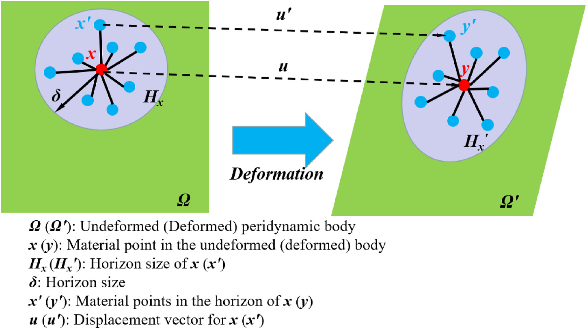

*Fig. 1. Schematic illustration of the bond-based peridynamic model.*

#### 2.1.2. Governing equations

According to the principle of virtual work, Silling et al. [15] rewrote the motion equation from the view of PD:

\[
\rho(\mathbf{x})\ddot{\mathbf{u}}(\mathbf{x}, t) = \int_{H} \left[\mathbf{t}\left(\mathbf{u}'-\mathbf{u}, \mathbf{x}'-\mathbf{x}, t\right) - \mathbf{t}'\left(\mathbf{u}-\mathbf{u}', \mathbf{x}-\mathbf{x}', t\right)\right] dH + \mathbf{b}(\mathbf{x}, t) \tag{2}
\]

where $\rho$ denotes the material density, $\mathbf{b}$ is the external body force vector, $\mathbf{t}$ is the force density vector from point $\mathbf{x}'$ to $\mathbf{x}$, and $\mathbf{t}'$ is the force density vector from point $\mathbf{x}$ to $\mathbf{x}'$. Compared with the classical Cauchy equation, the integral of the nonlocal force is introduced to replace the previous divergence of stress [27], to define the discontinuous regions. Different from other PD models, the bond-based PD (BB-PD) requires that force density vectors between two points must have the same magnitudes and that their directions must be parallel to the relative positions in the deformed configuration [12]. Therefore, the force density vectors are simplified as follows:

\[
\begin{aligned}
\mathbf{t}\left(\mathbf{u}'-\mathbf{u}, \mathbf{x}'-\mathbf{x}, t\right) &= \frac{1}{2}\mathbf{f}\left(\mathbf{u}'-\mathbf{u}, \mathbf{x}'-\mathbf{x}, t\right) \\
\mathbf{t}'\left(\mathbf{u}-\mathbf{u}', \mathbf{x}-\mathbf{x}', t\right) &= -\frac{1}{2}\mathbf{f}\left(\mathbf{u}-\mathbf{u}', \mathbf{x}-\mathbf{x}', t\right)
\end{aligned} \tag{3}
\]

According to Silling and Askari [18], $\mathbf{f}$ can be further linearized as follows:

\[
\mathbf{f}\left(\mathbf{u}'-\mathbf{u}, \mathbf{x}'-\mathbf{x}, t\right) = c_1 s\left(\mathbf{u}'-\mathbf{u}, \mathbf{x}'-\mathbf{x}, t\right) - c_2 T \tag{4}
\]

where $c_1$ and $c_2$ are PD parameters, and $T$ is the temperature. For isotropic materials, $c_1$ is a constant, representing the bond constant $c$, which is calculated from the material properties and horizon size [18]. In two-dimensional (2D) models, $c$ is equal to Ref. [12]:

\[
c = \begin{cases} \dfrac{9E}{\pi \delta^3 h} & \text{plane stress} \\[8pt] \dfrac{48E}{5\pi \delta^3 h} & \text{plane strain} \end{cases} \tag{5}
\]

where $E$ denotes the elastic modulus, and $h$ denotes the model thickness along the paper orientation. $c_2$ can be calculated as [18]:

\[
c_2 = c\alpha \tag{6}
\]

where $\alpha$ denotes the thermal expansion coefficient. Thus, the motion equation is derived as

\[
\rho(\mathbf{x})\ddot{\mathbf{u}}(\mathbf{x}, t) = \int_{H} \left[c_1 s\left(\mathbf{u}'-\mathbf{u}, \mathbf{x}'-\mathbf{x}, t\right) - c_2 T\right] dH + \mathbf{b}(\mathbf{x}, t) \tag{7}
\]

#### 2.1.3. Damage definition

In PD, damage is described according to the number of the fracture bonds at a single material point (Fig. 2). The fracture of a bond implies the elimination of the interaction between connected material points. The local damage $\varphi$ at a point $\mathbf{x}$ is calculated as [12]:

\[
\varphi(\mathbf{x}, t) = 1 - \frac{\int_{H} \mu\left(\mathbf{x}'-\mathbf{x}, t\right) dV'}{\int_{H} dV'} \tag{8}
\]

where $\mu$ is a scalar function to characterize the bond state: broken or unbroken. As for the damage initiation criterion, the BB-PD theory proposes the concept of critical stretch $s_c$ [18]. If the stretch between two material points exceeds the critical stretch during deformation, the related bond is judged to be broken irreversibly, and damage automatically occurs. Therefore, $\mu$ can be defined as

\[
\mu\left(\mathbf{x}'-\mathbf{x}, t\right) = \begin{cases} 1, & \text{if } s\left(\mathbf{x}'-\mathbf{x}, t\right) < s_c \\ 0, & \text{otherwise} \end{cases} \tag{9}
\]

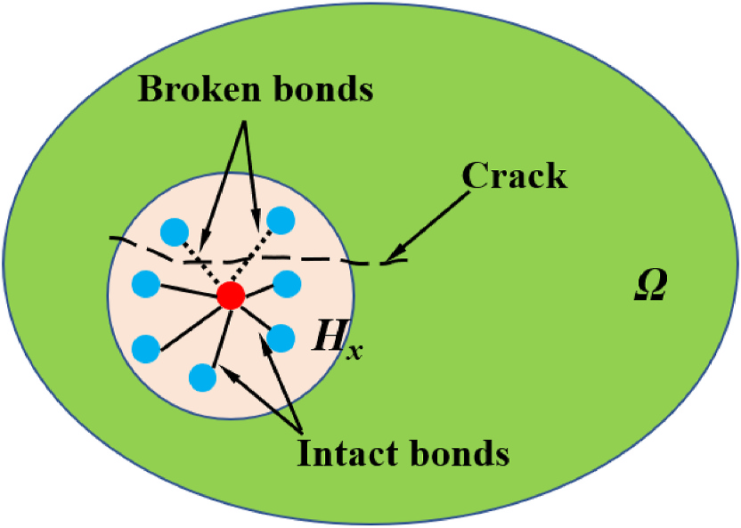

*Fig. 2. Damage scheme of the PD model.*

The cracking process obeys the energy conservation law, so that the total critical strain energy equals the critical energy release rate $G_c$. Then, a relationship between the critical bond stretch $s_c$ and the fracture mechanical parameter $G_c$ can be established. Silling et al. [18] deduced the following relationship using a 2D model:

\[
G_c = \frac{1}{2}c s_c^2 \left(\frac{h\delta^4}{2}\right) \tag{10}
\]

where $c$ is the bond constant, and $h$ is the material thickness. If $G_c$ is known, the damage initiation and propagation can be predicted using the PD model.

### 2.2. Description of TBC model

#### 2.2.1. Geometry and boundary conditions

A 2D BB-PD model of TBCs is built in MATLAB, whose shape follows the model established by Ranjbar et al. [28]. The interface is assumed to be perfectly periodic, with a semicircle or sinusoidal shape. The interface cycle has a length of 80 $\mu$m, and two cycles are selected for investigation. The total thickness of the structure is 480 $\mu$m, with a 280-$\mu$m-thick TC layer and a 200-$\mu$m-thick bond coating (BC) layer. The TGO thickness is set to 6 $\mu$m. The interface amplitudes are different in different cases, which will be illustrated later.

The boundary conditions of the model are illustrated in Fig. 3. Both sides of the model are characterized by multi-point constraints (MPC), and the bottom part is restricted by a zero-y-directional-displacement constraint. The upper surface is a free boundary. As for thermal boundaries, if considering thermal gradients in TBCs, both the top and bottom surfaces are loaded with fixed-temperature boundary conditions, with high and low temperatures, respectively.

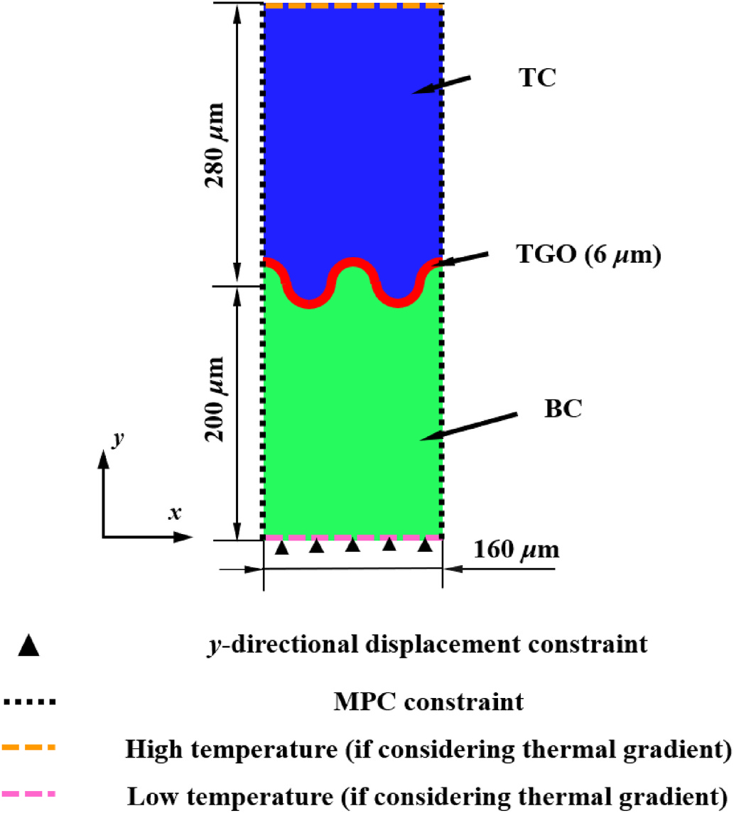

*Fig. 3. Geometry and boundary conditions of the PD model of TBCs.*

#### 2.2.2. Material properties

The material properties of TC, BC, and TGO are presented in Table 1. Plasticity and creep properties are not considered in all three materials. The critical bond stretch $s_c$ is decided by the critical energy release rate $G_c$ according to Eq. (10). Experimental results have shown that the $G_c$ of the TC ranges from 15 to 30 J/m$^2$ [29,30], and here, 20 J/m$^2$ is adopted [31]. For simplification, the crack behaviors of the BC and TGO are not studied; thus, their $s_c$ values are set large enough to avoid bond fracture.

**Table 1**  
Material properties of the PD model [43,44].

| Material | Elastic modulus $E$ /GPa | Poisson's ratio $\nu$ | Density $\rho$ /(kg$\cdot$m$^{-3}$) | Thermal expansion coefficient $\alpha$ /K$^{-1}$ | Thermal conductivity $\lambda$ /(W$\cdot$m$\cdot$K$^{-1}$) |
|---|---|---|---|---|---|
| TC | 40 | 0.25 | 5650 | $1.07 \times 10^{-5}$ | 1.05 |
| TGO | 360 | 0.25 | 7320 | $8 \times 10^{-6}$ | 25.2 |
| BC | 86 | 0.25 | 7320 | $1.75 \times 10^{-5}$ | 4.3 |
| CMAS (if considering) | 84 | 0.25 | 2540 | $8.1 \times 10^{-6}$ | 1.78 |

The critical stretches of bonds connecting different layers of materials depend on the fracture toughness of the interface. In this study, the $s_c$ values of bonds connecting TC and TGO material points are assumed to be equal to those of the TC material points. This $s_c$ value will be corrected according to the results of future studies and related experiments.

### 2.3. Model validation

#### 2.3.1. Solution method

The PD motion equation is solved through temporal-domain and spatial-domain numerical integrations at each material point. For each point, the motion equation Eq. (7) can be further expressed in a discrete form:

\[
\rho_{(k)} \ddot{\mathbf{u}}^n_{(k)} = \sum_{j=1}^{N} \left[c_1 s^n_{(k)(j)} - c_2 T^n_{(k)(j)}\right] V_j + \mathbf{b}^n_{(k)} \tag{11}
\]

where $n$ denotes the $n$-th time step; $N$ denotes the number of points within the horizon of the material point $\mathbf{x}_k$; $V_j$ denotes the corrected volume of material point $\mathbf{x}_j$ (the corrected method is presented in Ref. [12]); $s_{(k)(j)}$ denotes the stretch between points $\mathbf{x}_k$ and $\mathbf{x}_j$; and $T_{(k)(j)}$ denotes the average temperature between points $\mathbf{x}_k$ and $\mathbf{x}_j$:

\[
T_{(k)(j)} = \frac{T_{(k)} + T_{(j)}}{2} \tag{12}
\]

Eq. (11) is solved through explicit integration:

\[
\begin{aligned}
\dot{\mathbf{u}}^{n+1}_{(k)} &= \ddot{\mathbf{u}}^n_{(k)} \Delta t + \dot{\mathbf{u}}^n_{(k)} \\
\mathbf{u}^{n+1}_{(k)} &= \dot{\mathbf{u}}^n_{(k)} \Delta t + \mathbf{u}^n_{(k)}
\end{aligned} \tag{13}
\]

The time increment $\Delta t$ can be obtained under stability conditions [12]. As for static or quasi-static problems, the adaptive dynamic relaxation method is recommended. The method is detailed in Ref. [12].

#### 2.3.2. $m$-convergence and $\delta$-convergence of the model

Different from finite-element models, the PD model is discretized into multiple scattered material points instead of elements; owing to this mesh-free property, the PD model is not limited by mesh division. However, selecting the appropriate horizon size $\delta$ and the spacing between material points $dx$ is important for an accurate PD simulation. Therefore, the $m$-convergence ($m = \delta/dx$) and $\delta$-convergence should be checked before the formal simulation, similar to the mesh independence check in FEM.

The $m$-convergence and $\delta$-convergence are checked in terms of the $y$-directional displacement of the monitor point in the model, marked in Fig. 4. The $m$-convergence results (Fig. 4a) show that a large $m$, which also means a large $\delta$, will result in convergence. When $m$ is greater than 3, the results at $dx = 1$ or 2 $\mu$m show no considerable variation with further increasing $m$, which means that the results converge with an $m$ value over 3. Meanwhile, the $\delta$-convergence results (Fig. 4b) show that divergence occurs at a relatively large $dx$. The results for all $m$ values converge well at $dx = 2$ $\mu$m. Therefore, $dx$ is set as 2 $\mu$m, and the horizon size $\delta$ is set as 6 $\mu$m ($\delta = 3dx$).

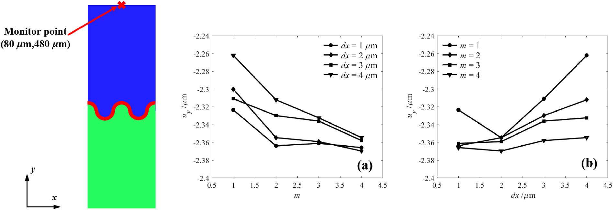

*Fig. 4. $m$-convergence (a) and $\delta$-convergence (b) of the proposed PD model.*

#### 2.3.3. Model accuracy validation

To demonstrate that the PD method can effectively replace FEM, a validation case is implemented to demonstrate the accuracy of the PD model (Fig. 5a). The model is discretized according to the conclusions in Section 2.3.1 and assumed to be isothermally cooled by 400 K ($\Delta T = -400$ K). All bonds in this case are set to be unbroken, which means that no damage will be initiated during the simulation. Fig. 5(b) and (c) show the $y$-directional displacement results calculated by the PD method and FEM (ABAQUS). Errors between the two contours are negligible (Fig. 5d), proving the accuracy of the proposed PD numerical model. The same discretization is adopted in the following cases.

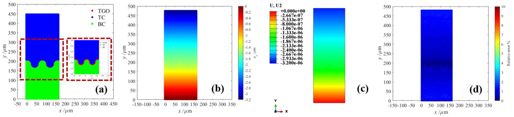

*Fig. 5. Simplified model of the TBCs (a); cooling-induced $y$-directional displacement contours obtained using (b) the PD method and (c) FEM; (d) the corresponding relative errors.*

## 3. Results

### 3.1. Case 1: TC interfacial cracking behavior of isothermally cooled TBC

Firstly, the TC cracking behavior near the TC–TGO interface is studied. The model is assumed to be isothermally cooled by 285 K ($\Delta T = -285$ K). The damage evolution process at different simulation steps is illustrated in Fig. 6. Because of the differences in thermal expansion coefficients between TC and TGO and the interfacial roughness, damage originates from the peak of the interface (Fig. 6a), where interfacial cracks initiate. The damage evolves along a short distance of the TC–TGO interface (Fig. 6b), and then gradually deviates toward the TC interior. Thus, the interfacial cracks automatically transform into TC internal cracks (Fig. 6c), which is difficult to simulate through the conventional FEM. Internal cracks continue propagating inside the TC and finally coalesce to form a larger crack (Fig. 6d). Fig. 7 illustrates the cracking behavior and compares the scanning electron microscopy (SEM) observation and PD simulation results. According to the SEM observation, the interfacial cracks in the TC originate from the peak region of the interface (Fig. 7c), and the internal cracks originate from the interfacial cracks. Therefore, the cracking behavior is accurately captured by the PD model, proving the effectiveness of the method.

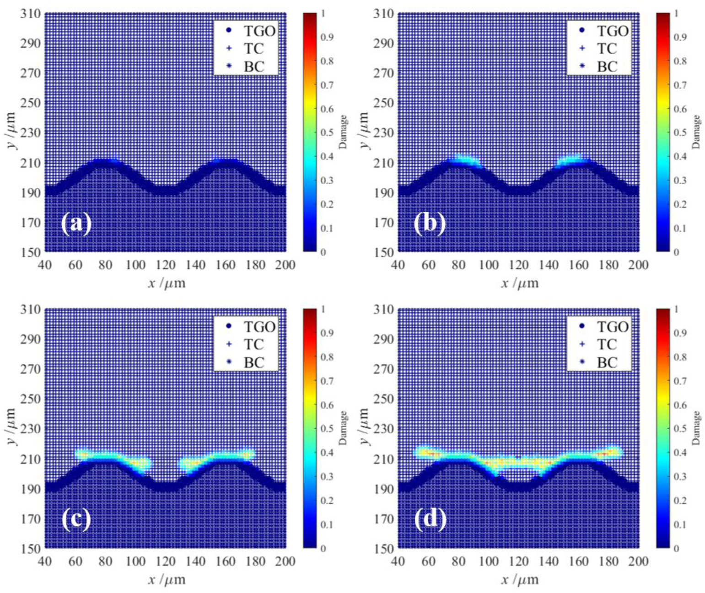

*Fig. 6. Damage evolution process of TC interfacial cracking.*

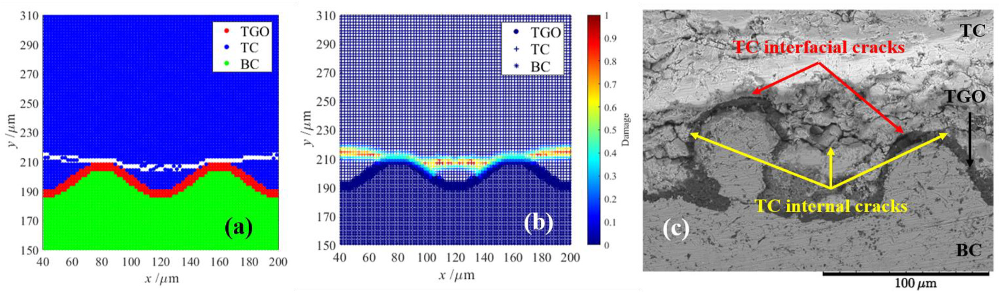

*Fig. 7. Interfacial cracking behavior of isothermally cooled TBCs: (a) cracking schematic illustration, (b) damage evolution, and (c) SEM observation of cracks in the TC layer near the interface [41].*

To demonstrate the generality of the PD method, TBC models with different degrees of interface roughness are built and analyzed. Fig. 8 shows the final cracking schemes and damage evolution contours. As the roughness decreases, the distance along which the interfacial crack propagates decreases, implying a shorter required distance for the interfacial crack to go to cause a total delamination. Experimental studies have shown that flat interfaces may lead to early TBC failures [32,33] because of the low coating compliance and toughness [32]. Here, the flat interface does not sufficiently impede crack propagation, which accords with the PD simulation results. This proves the generality of the PD method.

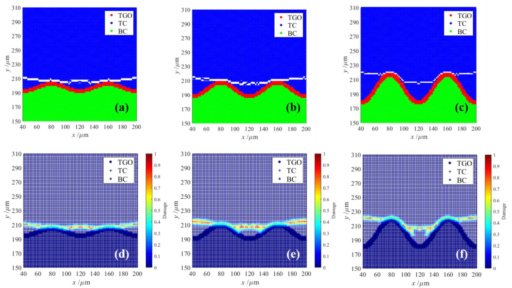

*Fig. 8. Interfacial cracking schemes (a–c) and damage evolutions (d–f) in the isothermally cooled TC layer with different interfacial roughness degrees ($A$ denotes the amplitude of the interface): (a) and (d) $A = 5$ $\mu$m; (b) and (e) $A = 10$ $\mu$m; (c) and (f) $A = 20$ $\mu$m.*

Secondly, the effects of pre-existing micro-cracks on the TC interfacial cracking behavior are analyzed. APS TBCs are typically splat-structured, leaving defects such as pores and voids between splats during manufacture. Micro-cracks may originate from such defects because of stress concentration [34], and these cracks can complicate local stress states and interfere with and even accelerate previous crack propagation. Previously, effects of pre-existing cracks in TBCs are mostly investigated through XFEM-based simulations [9]. However, XFEM requires external criteria to account for discontinuous displacement enrichment [12]. The solutions may also be inaccurate near the crack tip element owing to the partial enrichment of the adjacent elements in the blending region [35]; consequently, it is difficult to solve complex multi-crack problems in TBCs. The PD method avoids such problems, making it a suitable analysis method for multi-crack problems.

To demonstrate the interference of a micro-crack with interfacial cracks, a 6-$\mu$m-long horizontal crack is predefined in the TC layer near the TC–TGO interface to introduce initial damage in the TC (Fig. 9d). Owing to the isothermal cooling, the horizontal micro-crack begins to propagate along the horizontal direction (Fig. 9a–c), consistent with findings by Wang et al. [9]. During the propagation of the horizontal crack, damage also spontaneously originates and evolves at the interface peak (Fig. 9e and f), consistent with the results depicted in Fig. 6. This demonstrates that PD is applicable for describing multi-crack problems.

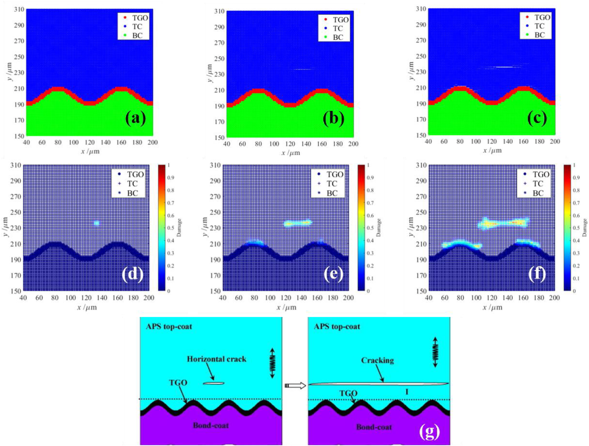

*Fig. 9. Propagation of internal horizontal TC cracks (a–c) and damage evolution (d–f) after isothermal cooling near the interface; (g) internal TC cracking behavior in APS TBCs reported by Wang et al. [9].*

Furthermore, as crack propagation continues, the interfacial crack propagation path deviates owing to the interference of the horizontal crack. The interfacial crack propagates toward the pre-existing TC internal cracks. Fig. 10c shows the final cracking behavior, whose propagation path is different from the propagation path shown in Fig. 7a, indicating that the pre-existing crack influences the interfacial cracking behavior. Besides, the displacement contours of the model are displayed in Fig. 10g and h. Both figures show severe discontinuity. This discontinuity is automatically captured by the PD method, without any local enrichment function as required by XFEM, which demonstrates the superiority of PD to XFEM.

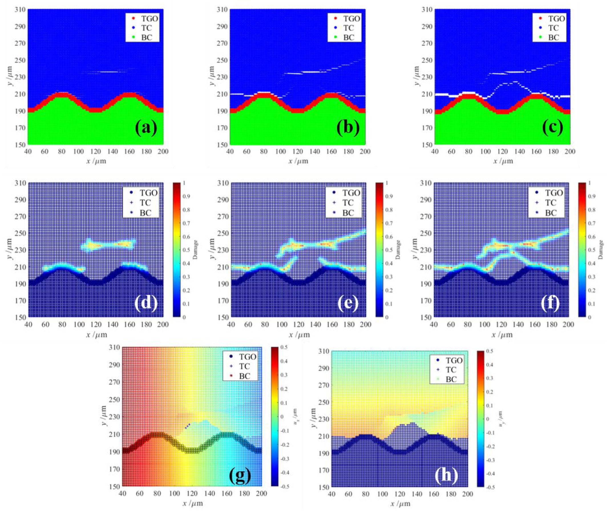

*Fig. 10. Internal-defect-induced complex interfacial cracking behavior: (a–c): crack propagation schematic illustration; (e–f): damage evolution; (g–h) severe discontinuity in $x$- and $y$-directional displacement.*

### 3.2. Case 2: TC internal cracking behavior of TBC with thermal gradient

Differences in the thermal expansion coefficients of the TBC layers result in thermal mismatch, which contributes to interfacial cracking. However, the existence of a sufficiently large thermal gradient in the TC can also contribute to internal cracking in the TC, particularly in a thermal shock test. Large thermal gradients induce crack initiation and propagation along the delamination direction parallel to the interface, further resulting in TBC spallation [36]. Considering the complicated microstructures of APS TBCs with micro-voids and pores, which can develop into micro-cracks, internal crack initiation and propagation can occur at multiple locations in the TC under thermal gradients, increasing the unpredictability in TBCs cracking behavior analysis. To better illustrate this problem, cases considering thermal gradient in TBCs are simulated.

The mechanical boundary conditions are the same as those in Section 3.1. The thermal boundary conditions are shown in Fig. 3; the temperatures at the upper and bottom surfaces are fixed at 400 and 200 K, respectively. The temperature values are relative to the room temperature, so that the temperature decrease is directly loaded onto material points in the PD model. The static temperature field (Fig. 11a) is solved through the finite volume method (FVM). After the temperatures at each point are obtained, the temperature decrease required by each point is easily derived. The temperature decrease is introduced into Eq. (7) to replace the previous isothermal cooling load. To reflect the influence of micro-defects, multiple small-damage regions are randomly predefined in the TC layer (Fig. 11b).

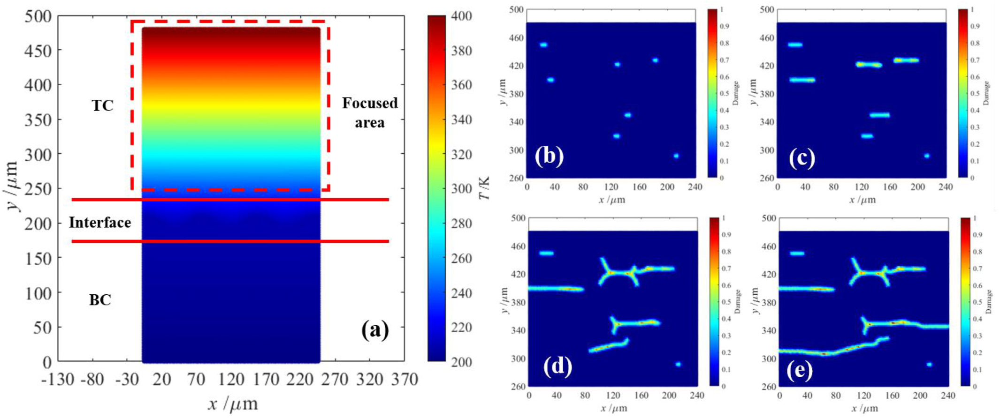

*Fig. 11. Thermal-gradient-induced propagation of internal cracks from micro-defects in the TC layer: (a) temperature distribution in the TC layer; (b–d): damage evolution of cracks.*

The damage evolution process under gradient cooling conditions, which also illustrates the crack propagation process, is shown in Fig. 11b–(e). Most of the defects first propagate along the horizontal direction and then deviate upon interactions with other cracks. Some close cracks coalesce to form a major crack. Notably, some cracks branch out (Fig. 12a), which commonly occurs under extreme mechanical and thermal conditions. The crack branching phenomenon in TBCs was also observed in a previous study via SEM [37] (Fig. 12b). Studies on thermal cycling and thermal shock testing [38,39] have also reported similar phenomena in coatings. Although the PD method captures the crack branching in TBCs, the results slightly differ from the SEM observations because crack branching highly depends on several conditions, including material properties, external loading, and the TBC microstructure. Thus, a PD model with more detailed inputs would be required to more accurately simulate the crack branching, further more closely reproduce the experimental results.

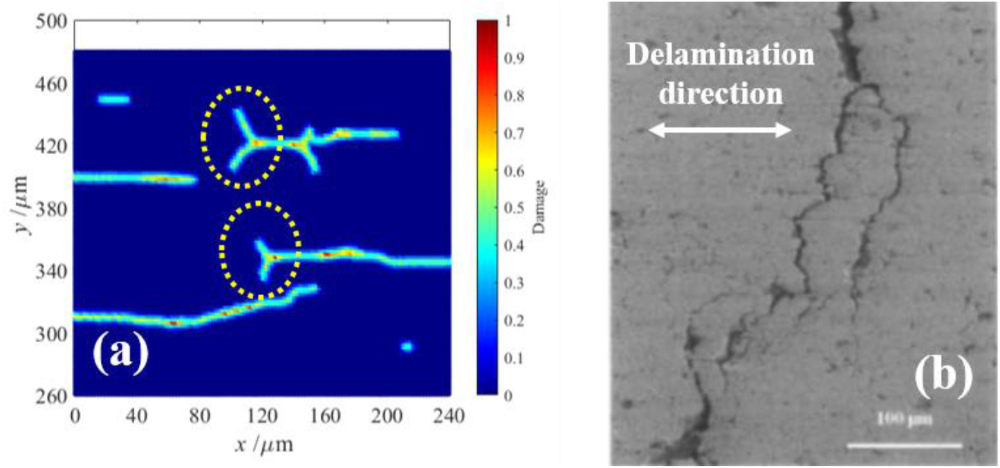

*Fig. 12. Crack branching in the TC layer: (a) PD simulation; (b) SEM observation [37].*

In addition to pores and voids in the TC layer, inclusions such as CMAS also contribute to fracture development. The thermal properties of the TC and CMAS inclusions differ, resulting in different contraction degrees and local stress concentrations. The high-stress-concentration regions are prone to crack initiation [40] and attract crack propagation. To validate the utility of the PD model in analyzing CMAS-induced cracking problems, a TBCs model with randomly distributed CMAS inclusions is built and analyzed, as shown in Fig. 13a. Some TC material points are replaced with points that inherit CMAS properties to represent CMAS inclusions. The initial damage regions and thermal boundaries are the same as those illustrated in Fig. 11. The final cracking behaviors and damage distributions of the CMAS-containing TBC subjected to gradient cooling are illustrated in Fig. 13. In addition to the interaction between CMAS inclusions and the crack propagation paths, the PD model also captures CMAS-driven cracking, which includes crack propagation along the CMAS inclusions (red marks in Fig. 13b and d) and crack impediment due to CMAS inclusions (yellow marks in Fig. 13b and d). Compared with XFEM, PD-based methods reproduce in more detail the complexity of the TC cracking behavior influenced by CMAS inclusions.

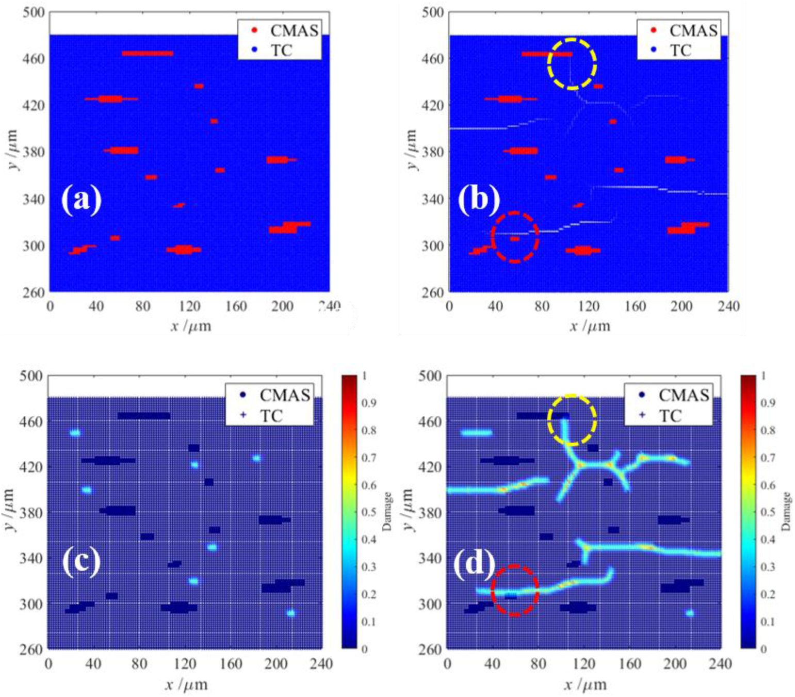

*Fig. 13. Internal crack propagation in the CMAS-incorporated TC layer subjected to thermal gradient cooling: (a and c) initial state and damage distribution in the TC layer; (b and d): cracking schematic illustration and damage evolution after cooling.*

Only horizontal cracks, which dominate TBCs delamination, are addressed in the above cases. Vertical cracks, which dominate TBCs segmentation, are also important, as their interaction with horizontal cracks causes TBCs spallation during thermal shock testing (Fig. 14a). Spallation commonly occurs in APS TBCs within the TC layer [41], leaving residual TC materials attached to the BC layer. To analyze this, a TBCs model with horizontal and vertical cracks is built. To better illustrate the interaction between both cracks, the vertical cracks are set to be longer than the horizontal cracks. The damage evolution process under the thermal gradient cooling (Fig. 11) is illustrated from Fig. 14b–(d). Both cracks propagate along a certain distance, after which the vertical crack gradually deviates to the horizontal direction, and the horizontal crack is also slightly deflected. Both cracks continue propagating along their new directions and finally merge, resulting in total spallation in the TC layer. Although similar numerical results may be obtainable through the combination of XFEM and CZM simulations [9,42], such a procedure would be more complicated than the PD method. Overall, the PD method can effectively capture the thermal-shock-induced spallation of the TC layer, and is thus a powerful tool for analyzing the thermal shock behaviors of TBCs.

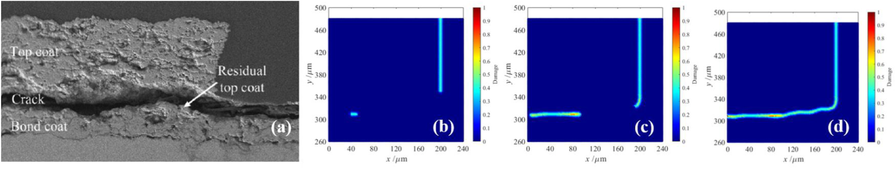

*Fig. 14. Thermal-shock-induced spallation of the TC layer: (a) SEM observation [45]; (b)–(d) damage evolution in the TC layer during thermal shocking.*

## 4. Outlook

The above numerical results demonstrate the strong ability of PD for analyzing cooling-induced cracking problems in the TC layer. However, the built model has several limitations, which need to be addressed in future.

(1) The restrictions of the BB-PD method: The BB-PD theory used in this paper requires a fixed Poisson's ratio of the material. For 2D plane stress and strain problems, the values are 1/3 and 1/4, respectively (2D plane strain is used in this paper). However, the Poisson's ratios of materials in real TBCs vary. Thus, the BB-PD model could yield some inaccuracies. Moreover, the BB-PD theory is not able to describe the plasticity of the BC and TGO materials or the creep properties of materials in TBCs. More accurate PD theories such as the ordinary-state-based PD (OSB-PD) theory and the non-ordinary-state-based PD (NOSB-PD) theory can potentially overcome these limitations.

(2) The inaccuracies of current model descriptions: Current PD models of TBCs neglect the TGO growth, which can potentially accelerate crack propagation. The cracking behavior is restricted to the TC layer, while the cracking behaviors of the TGO and BC layers are neglected because of the lack of relevant experimental data. In this paper, the critical stretch value of the TC material is adopted as the critical stretch between the TC material and the TGO. Except that, the transient temperature conduction during cooling process is not considered in the current model, so that temperature-dependent material properties are also not taken into count. More research and tests are needed to solve the above inaccuracies in the future.

In addition, the PD methods for TBC modeling have considerable room for improvement:

(1) A TBC thermomechanical model based on the PD theory: PD methods are effective for solving multi-physics problems. The cooling-induced cracking of TBCs, a highly temperature-dependent problem, can be modeled using a thermomechanical framework. This requires the combination of current PD-based mechanical models with a PD-based thermal diffusion model. During the simulation, the calculated temperature fields could be directly loaded onto the material points in real time. Moreover, the real-time calculated discontinuity could affect the thermal conduction calculation, which can be directly fed back to temperature solvers. The thermomechanical model would better approximate the cracking behavior of real TBCs and lay the foundation for real-time monitoring of the cracking of TBCs in service.

(2) A fast calculation framework combining PD methods and FEM in TBC-related simulations: Current PD-based methods use a completely separate framework from the conventional FEM. However, FEM is highly developed and efficient, and a combination of FEM and PD could therefore considerably reduce the computational cost of large-scale modeling compared with the use of PD alone. In this approach, certain at-risk regions would be described through PD, and the remaining regions through FEM. Furthermore, if the PD method could be solved using the same calculation algorithm as the FEM, some FEM-acceleration techniques such as reduced-order modeling (ROM) could also be applied, which would enhance the real-time monitoring of TBCs in service.

## 5. Conclusions

In this study, a PD-based numerical model is built to investigate the cooling-induced cracking behavior of the TC layer in multilayer TBCs. Interfacial cracking in the TC under isothermal cooling and internal cracking under gradient cooling are analyzed using the PD method. The following conclusions can be obtained:

(1) The PD model effectively describe the interfacial cracking behavior of the TC layer. The built PD model could effectively capture crack initiation at the interfacial peak and the transformation from interfacial to internal crack. While considering pre-existence of the crack near the interface inside the TC layer, the crack's self-propagation and interference towards previous interfacial crack propagation path are both captured, which presents the ability of PD method in simulation of multi-location cracking problems.

(2) The PD method effectively describe TC internal cracking problems while considering thermal gradients. Randomly distributed micro-cracks in the built PD model of TBCs could propagate under cooling at a sufficiently high thermal gradient. The model effectively captures complex cracking behaviors such as crack coalescence and branching. The PD model also performs well under complex conditions, such as the occurrence of CMAS inclusions in the TC layer. Moreover, the model accurately simulates the interactions between vertical and horizontal cracks, which lead to the spallation of the TC material.

As a newly developed mechanical formulation, the PD theory provides a new approach for dealing with discontinuities in TBCs. The results of this study are tentative, and the model still has considerable room for improvement. Overall, PD methods are promising for TBC cracking behavior simulation.

## Declaration of competing interest

The authors declare that they have no known competing financial interests or personal relationships that could have appeared to influence the work reported in this paper.

## Acknowledgment

This project was supported by the National Natural Science Foundation of China (Grant No. 51875341) and the National Science and Technology Major Project (No. 2017-V-0002-0051).

## References

[1] M. Zhao, W. Pan, C. Wan, Z. Qu, Z. Li, J. Yang, Defect engineering in development of low thermal conductivity materials: a review, J. Eur. Ceram. Soc. 37 (2017) 1–13, https://doi.org/10.1016/j.jeurceramsoc.2016.07.036.

[2] K.W. Schlichting, N.P. Padture, E.H. Jordan, M. Gell, Failure modes in plasma-sprayed thermal barrier coatings, Mater. Sci. Eng. 342 (2003) 120–130, https://doi.org/10.1016/S0921-5093(02)00251-4.

[3] A.G. Evans, D.R. Mumm, J.W. Hutchinson, G.H. Meier, F.S. Pettit, Mechanisms controlling the durability of thermal barrier coatings, Prog. Mater. Sci. 46 (2001) 505–553, https://doi.org/10.1016/S0079-6425(00)00020-7.

[4] S. Krämer, S. Faulhaber, M. Chambers, D.R. Clarke, C.G. Levi, J.W. Hutchinson, A.G. Evans, Mechanisms of cracking and delamination within thick thermal barrier systems in aero-engines subject to calcium-magnesium-alumino-silicate (CMAS) penetration, Mater. Sci. Eng. 490 (2008) 26–35, https://doi.org/10.1016/j.msea.2008.01.006.

[5] L. Wang, D.C. Li, J.S. Yang, F. Shao, X.H. Zhong, H.Y. Zhao, K. Yang, S.Y. Tao, Y. Wang, Modeling of thermal properties and failure of thermal barrier coatings with the use of finite element methods: a review, J. Eur. Ceram. Soc. 36 (2016) 1313–1331, https://doi.org/10.1016/j.jeurceramsoc.2015.12.038.

[6] M. Ahrens, R. Vaßen, D. Stöver, Stress distributions in plasma-sprayed thermal barrier coatings as a function of interface roughness and oxide scale thickness, Surf. Coating. Technol. 161 (2002) 26–35, https://doi.org/10.1016/S0257-8972(02)00359-6.

[7] J. Jiang, L. Jiang, Z. Cai, W. Wang, X. Zhao, Y. Liu, Z. Cao, Numerical stress analysis of the TBC-film cooling system under operating conditions considering the effects of thermal gradient and TGO growth, Surf. Coating. Technol. 357 (2019) 433–444, https://doi.org/10.1016/j.surfcoat.2018.10.020.

[8] X.L. Fan, W.X. Zhang, T.J. Wang, Q. Sun, The effect of thermally grown oxide on multiple surface cracking in air plasma sprayed thermal barrier coating system, Surf. Coating. Technol. 208 (2012) 7–13, https://doi.org/10.1016/j.surfcoat.2012.06.074.

[9] L. Wang, J.S. Yang, J.X. Ni, C.G. Liu, X.H. Zhong, F. Shao, H.Y. Zhao, S.Y. Tao, Y. Wang, Influence of cracks in APS-TBCs on stress around TGO during thermal cycling: a numerical simulation study, Surf. Coating. Technol. 285 (2016) 98–112, https://doi.org/10.1016/j.surfcoat.2015.11.036.

[10] M. Białas, Finite element analysis of stress distribution in thermal barrier coatings, Surf. Coating. Technol. 202 (2008) 6002–6010, https://doi.org/10.1016/j.surfcoat.2008.06.178.

[11] M. Bäker, Finite element simulation of interface cracks in thermal barrier coatings, Comput. Mater. Sci. 64 (2012) 79–83, https://doi.org/10.1016/j.commatsci.2012.02.044.

[12] E. Madenci, E. Oterkus, Peridynamic theory, New York, NY, in: Peridynamic Theory its Appl, Springer, New York, 2014, pp. 19–43, https://doi.org/10.1007/978-1-4614-8465-3_2.

[13] A. Cemal Eringen, B.S. Kim, Stress concentration at the tip of crack, Mech. Res. Commun. 1 (1974) 233–237, https://doi.org/10.1016/0093-6413(74)90070-6.

[14] M. Arai, H. Katori, K. Ito, Numerical simulation of inelastic deformation and crack propagation in TBC-multilayered Ni-based superalloy subjected to thermo-mechanical loadings, Surf. Coating. Technol. 399 (2020), 126159, https://doi.org/10.1016/j.surfcoat.2020.126159.

[15] S.A. Silling, Reformulation of elasticity theory for discontinuities and long-range forces, J. Mech. Phys. Solid. 48 (2000) 175–209, https://doi.org/10.1016/S0022-5096(99)00029-0.

[16] S.A. Silling, M. Epton, O. Weckner, J. Xu, E. Askari, Peridynamic States and Constitutive Modeling, 2007, https://doi.org/10.1007/s10659-007-9125-1.

[17] S.A. Silling, F. Bobaru, Peridynamic modeling of membranes and fibers, Int. J. Non Lin. Mech. 40 (2005) 395–409, https://doi.org/10.1016/j.ijnonlinmec.2004.08.004.

[18] S.A. Silling, E. Askari, A meshfree method based on the peridynamic model of solid mechanics, Comput. Struct. 83 (2005) 1526–1535, https://doi.org/10.1016/j.compstruc.2004.11.026.

[19] S.A. Silling, O. Weckner, E. Askari, F. Bobaru, Crack nucleation in a peridynamic solid, Int. J. Fract. 162 (2010) 219–227, https://doi.org/10.1007/s10704-010-9447-z.

[20] Y.D. Ha, F. Bobaru, Studies of dynamic crack propagation and crack branching with peridynamics, Int. J. Fract. 162 (2010) 229–244, https://doi.org/10.1007/s10704-010-9442-4.

[21] A. Agwai, I. Guven, E. Madenci, Predicting crack propagation with peridynamics: a comparative study, Int. J. Fract. 171 (2011) 65–78, https://doi.org/10.1007/s10704-011-9628-4.

[22] J. Jung, J. Seok, Mixed-mode fatigue crack growth analysis using peridynamic approach, Int. J. Fatig. 103 (2017) 591–603, https://doi.org/10.1016/j.ijfatigue.2017.06.008.

[23] Y. Wang, X. Zhou, X. Xu, Numerical simulation of propagation and coalescence of flaws in rock materials under compressive loads using the extended non-ordinary state-based peridynamics, Eng. Fract. Mech. 163 (2016) 248–273, https://doi.org/10.1016/j.engfracmech.2016.06.013.

[24] Z. Chen, J. Wan, X. Chu, H. Liu, Two Cosserat peridynamic models and numerical simulation of crack propagation, Eng. Fract. Mech. 211 (2019) 341–361, https://doi.org/10.1016/j.engfracmech.2019.02.032.

[25] V. Guski, W. Verestek, E. Oterkus, S. Schmauder, Microstructural investigation of plasma sprayed ceramic coatings using peridynamics, J. Mech. 36 (2020) 183–196, https://doi.org/10.1017/jmech.2019.58.

[26] S. Bazazzadeh, F. Mossaiby, A. Shojaei, An adaptive thermo-mechanical peridynamic model for fracture analysis in ceramics, Eng. Fract. Mech. 223 (2020), 106708, https://doi.org/10.1016/j.engfracmech.2019.106708.

[27] A.V. Vasenkov, Multi-physics peridynamic modeling of damage processes in protective coatings, J. Peridynamics Nonlocal Model (2021) 167–183, https://doi.org/10.1007/s42102-020-00046-7.

[28] M. Ranjbar-Far, J. Absi, G. Mariaux, F. Dubois, Simulation of the effect of material properties and interface roughness on the stress distribution in thermal barrier coatings using finite element method, Mater. Des. 31 (2010) 772–781, https://doi.org/10.1016/j.matdes.2009.08.005.

[29] A. Rabiei, A.G. Evans, Failure mechanisms associated with the thermally grown oxide in plasma-sprayed thermal barrier coatings, Acta Mater. 48 (2000) 3963–3976, https://doi.org/10.1016/S1359-6454(00)00171-3.

[30] R. Vaßen, S. Giesen, D. Stöver, Lifetime of plasma-sprayed thermal barrier coatings: comparison of numerical and experimental results, J. Therm. Spray Technol. 18 (2009) 835–845, https://doi.org/10.1007/s11666-009-9389-z.

[31] J. Jiang, W. Wang, X. Zhao, Y. Liu, Z. Cao, P. Xiao, Numerical analyses of the residual stress and top coat cracking behavior in thermal barrier coatings under cyclic thermal loading, Eng. Fract. Mech. 196 (2018) 191–205, https://doi.org/10.1016/j.engfracmech.2018.04.031.

[32] M.D. Weeks, R. Subramanian, A. Vaidya, D.R. Mumm, Defining optimal morphology of the bond coat-thermal barrier coating interface of air-plasma sprayed thermal barrier coating systems, Surf. Coating. Technol. 273 (2015) 50–59, https://doi.org/10.1016/j.surfcoat.2015.02.012.

[33] W. Nowak, D. Naumenko, G. Mor, F. Mor, D.E. Mack, R. Vassen, L. Singheiser, W.J. Quadakkers, Effect of processing parameters on MCrAlY bondcoat roughness and lifetime of APS-TBC systems, Surf. Coating. Technol. 260 (2014) 82–89, https://doi.org/10.1016/j.surfcoat.2014.06.075.

[34] S. Cui, W. Liang, L.S. Mora, Q. Miao, J.P. Domblesky, H. Lin, L. Yu, Mechanical analysis and modeling of porous thermal barrier coatings, Appl. Surf. Sci. 512 (2020), 145706, https://doi.org/10.1016/j.apsusc.2020.145706.

[35] G. Zi, T. Rabczuk, W. Wall, Extended meshfree methods without branch enrichment for cohesive cracks, Comput. Mech. 40 (2007) 367–382, https://doi.org/10.1007/s00466-006-0115-0.

[36] J.W. Hutchinson, A.G. Evans, On the delamination of thermal barrier coatings in a thermal gradient, Surf. Coating. Technol. 149 (2002) 179–184, https://doi.org/10.1016/S0257-8972(01)01451-7.

[37] R.W. Steinbrech, Thermomechanical behavior of plasma sprayed thermal barrier coatings, in: 26th Annu. Conf. Compos. Adv. Ceram. Mater. Struct. B Ceram. Eng. Sci. Proc, John Wiley & Sons, Inc. Hoboken, NJ, USA, n.d.: pp. 397–408.

[38] M. Karger, R. Vaßen, D. Stöver, Atmospheric plasma sprayed thermal barrier coatings with high segmentation crack densities: spraying process, microstructure and thermal cycling behavior, Surf. Coating. Technol. 206 (2011) 16–23, https://doi.org/10.1016/j.surfcoat.2011.06.032.

[39] I.N. Giannakeas, T.K. Papathanasiou, H. Bahai, Simulation of thermal shock cracking in ceramics using bond-based peridynamics and FEM, J. Eur. Ceram. Soc. 38 (2018) 3037–3048, https://doi.org/10.1016/j.jeurceramsoc.2017.12.039.

[40] Z. Cai, J. Jiang, W. Wang, Y. Liu, Z. Cao, CMAS penetration-induced cracking behavior in the ceramic top coat of APS TBCs, Ceram. Int. 45 (2019) 14366–14375, https://doi.org/10.1016/j.ceramint.2019.04.152.

[41] K. Al-Athel, K. Loeffel, H. Liu, L. Anand, Modeling decohesion of a top-coat from a thermally-growing oxide in a thermal barrier coating, Surf. Coating. Technol. 222 (2013) 68–78, https://doi.org/10.1016/j.surfcoat.2013.02.005.

[42] S.M. Bostanci, E. Gürses, D. Çoker, Finite element modelling of TBC failure mechanisms by using XFEM and CZM, Procedia Struct. Integr. 21 (2019) 91–100, https://doi.org/10.1016/j.prostr.2019.12.090.

[43] M. Ranjbar-Far, J. Absi, S. Shahidi, G. Mariaux, Impact of the non-homogenous temperature distribution and the coatings process modeling on the thermal barrier coatings system, Mater. Des. 32 (2011) 728–735, https://doi.org/10.1016/j.matdes.2010.07.034.

[44] J. Cao, K. Gao, X. yu Cao, B. Jiang, Thermal shock behavior of a 8YSZ/CoCrAlYTaSi thermal sprayed barrier coating on GH202 superalloy, Ceram. Int. 46 (2020) 7489–7498, https://doi.org/10.1016/j.ceramint.2019.11.247.

[45] H. Jamali, R. Mozafarinia, R. Shoja-Razavi, R. Ahmadi-Pidani, Investigation of thermal shock behavior of plasma-sprayed NiCoCrAlY/YSZ thermal barrier coatings, Adv. Mater. Res. 472–475 (2012) 246–250, https://doi.org/10.4028/www.scientific.net/amr.472-475.246.
