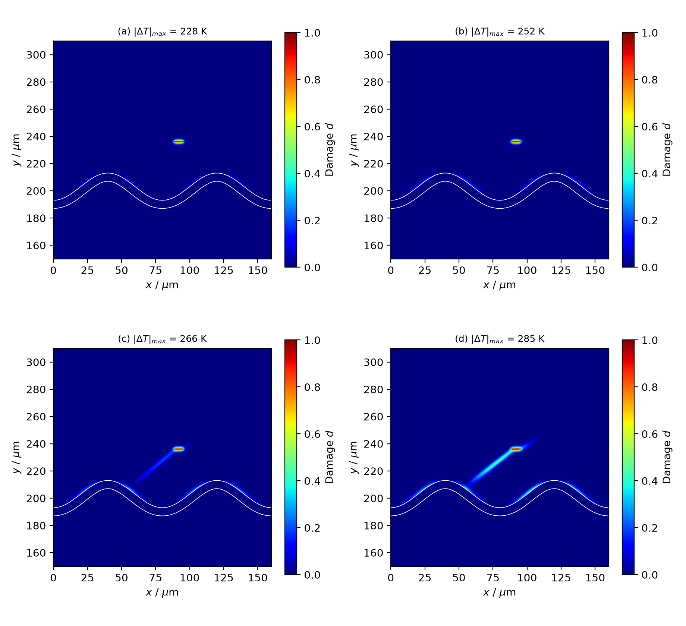
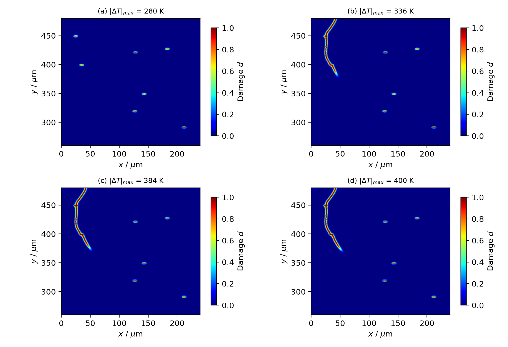
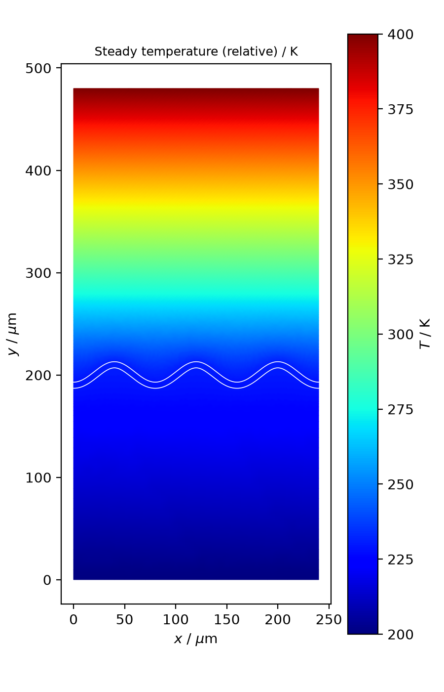

# FEniCSx 复现：TBC 冷却开裂（Wang et al., Ceram. Int. 48 (2022) 23543）

本目录用 **FEniCSx (dolfinx 0.9)** 复现论文 `../10.md` 的两个算例：

| 算例 | 脚本 | 开关 | 已运行工况 |
|---|---|---|---|
| Case 1：等温冷却 ($\Delta T=-285$ K) 下 TC 界面开裂，界面粗糙度幅值 $A=20\,\mu$m | `run_case1_isothermal.py` | `--precrack 1/0`（6 μm 预存水平微裂纹） | `--precrack 1` → `results/case1_isothermal_precrack1/` |
| Case 2：热梯度冷却 ($T_{top}=400$ K, $T_{bot}=200$ K) 下 TC 内部开裂 | `run_case2_gradient.py` | `--defects 1/0`（7 个 6 μm 预存微缺陷） | `--defects 1` → `results/case2_gradient_defects1/` |

## 1. 环境

```bash
# micromamba 从 GitHub release 获取（micro.mamba.pm 无法解析）
curl -L -o /tmp/micromamba https://github.com/mamba-org/micromamba-releases/releases/latest/download/micromamba-linux-64
chmod +x /tmp/micromamba
/tmp/micromamba create -y -p /opt/fenicsx -c conda-forge python=3.12 fenics-dolfinx=0.9 mpich matplotlib scipy gmsh python-gmsh
```

运行：

```bash
cd 11_21/10/tbc_fenicsx
/opt/fenicsx/bin/python run_case1_isothermal.py --precrack 1   # 约 8 min (2 核)
/opt/fenicsx/bin/python run_case2_gradient.py   --defects 1    # 约 30-40 min
# 关闭开关：--precrack 0 / --defects 0（未运行）
```

其他参数：`--ft --Gc --l0 --h --nsteps --out`，Case 2 另有 `--ref {room,top}`（见 §3.2）。

## 2. 模型

### 2.1 几何与边界（论文 Fig. 3）
- 总高 480 μm：BC 200 μm + TGO 6 μm + TC 280 μm；TC/TGO 界面为余弦，
  $y = 203-\tfrac{A}{2}\cos(2\pi x/80)$，$A=20\,\mu$m 取为峰谷差（与 Fig. 6/9 中 193→213 μm 一致），TGO 为其法向 6 μm 偏移。
- Case 1 宽 160 μm（两个周期），Case 2 宽 240 μm（三个周期）。gmsh 生成，裂纹带局部加密。
- 底面 $u_y=0$；左侧 $u_x=0$；右侧 $u_x=\bar U$（统一未知量，对应论文 MPC），用叠加法求解：
  $\mathbf u=\mathbf u_0+\bar U\,\mathbf u_1$，由右侧合反力为零确定 $\bar U$。顶面自由。
- 材料取论文 Table 1（TC/TGO/BC 的 $E,\nu,\alpha,k$）。

### 2.2 断裂模型：PF-CZM 代替 BB-PD
采用 Wu 的相场内聚区模型（PF-CZM，线性软化），只在 TC 中（含 TC/TGO 界面处的 TC 侧）开裂，与论文“只考虑 TC 开裂、界面用 TC 临界伸长率”一致：

$$
\omega(d)=\frac{(1-d)^2}{(1-d)^2+a_1 d(1-\tfrac12 d)},\qquad
a_1=\frac{4E G_c}{\pi l_0 f_t^2},\qquad
\alpha(d)=2d-d^2
$$

相场方程（弱形式，仅在 TC 上积分，$c_0=\pi$）：

$$
\int_{\Omega_{TC}}\Big[\omega'(d)\,\mathcal H\,q+\frac{G_c}{c_0 l_0}\,\alpha'(d)\,q
+\frac{2G_c l_0}{c_0}\nabla d\cdot\nabla q\Big]\,\mathrm d\Omega=0,
\qquad \boldsymbol\sigma=\omega(d)\,\mathbb C:(\boldsymbol\varepsilon-\alpha\Delta T\,\mathbf I)
$$

具体实现见 `tbc_common.py::PFCZM`：
- **运动学 `pd2d`**：二维 BB-PD 只有面内键，热应变为 $\alpha\Delta T\,\mathbf I_2$（无 $\varepsilon_{zz}$ 约束的泊松耦合）。经典平面应变下冷却时面内主应变被泊松效应压成负值，无法体现 PD“键伸长”判据，因此采用此运动学。
- **驱动力（类键伸长判据）**：$Y=\tfrac12 E\langle\varepsilon_1\rangle_+^2$，$\varepsilon_1$ 为面内弹性应变 $\boldsymbol\varepsilon-\alpha\Delta T\mathbf I$ 的最大主值；历史量 $\mathcal H=\max(\mathcal H_n, Y, f_t^2/2E)$。
- 交错迭代：$u$ 为线性问题；$d$ 用 SNES `vinewtonrsls`（不可逆约束 $d_n\le d\le 1$），$-d^2$ 在迭代值处线性化保证凸性，PETSc LU。
- 预存裂纹/缺陷：嵌入网格的线段，节点 $d=1$。

### 2.3 参数标定（重要假设）
论文参数 $G_c=20$ J/m² 在任何能量一致的连续介质模型中都**不会**开裂：

- 临界张开位移 $w_c=2G_c/f_t\approx 1.7\,\mu$m（$f_t\approx 24$ MPa），而热失配位移只有 0.02–0.05 μm；
- TC 层可释放的弹性能 $\sim 7$ J/m² $<G_c$；
- 论文 PD 临界伸长 $s_c\approx1.04\%$ 对应强度 $Es_c\approx420$ MPa，远高于计算应力（TC 远场约 14 MPa，界面峰侧翼约 33 MPa）。

因此采用**有效参数**：$f_t=20$ MPa、$G_c^{eff}=0.3$ J/m²（$l_{ch}=EG_c/f_t^2=30\,\mu$m），$l_0=2\,\mu$m。目标是定性复现论文的开裂位置、路径与相互作用，而非定量的临界温差。

## 3. 结果

### 3.1 Case 1（`--precrack 1`，$h=0.8\,\mu$m，60 个载荷步，约 8 min）



- 界面损伤在**界面峰两侧翼**萌生（$|\Delta T|\approx 190$ K 起），与论文 Fig. 6/9(e,f) 一致（峰附近 TC 侧受拉）。
- 预存水平微裂纹 (89–95, 236) 在 $|\Delta T|\approx 250$ K 后扩展，向左下方约 45° 扩展并与左侧峰（x≈55）的界面损伤**连通**，体现论文 Fig. 9/10 中内部裂纹与界面裂纹的干涉/连通；同时右尖端有向右上的短分支。
- 与论文差异：论文中微裂纹主要水平扩展。连续介质中平行于压缩方向的水平裂纹没有 I 型驱动力，裂纹偏转为斜向。
- 网格收敛性：$h=1$（$l_0=2.5$）与 $h=0.8$（$l_0=2$）最终裂纹长度 $\Gamma$ 分别为 41.3 / 39.7 μm。

### 3.2 Case 2（`--defects 1`，$h=1.0\,\mu$m，50 个载荷步，约 35 min）



温度场（稳态导热，Fig. 11a 对比：y=250 处约 257 K）：



- 载荷理解（`--ref room`，默认）：论文称“温度值相对室温，降温量直接加载到材料点”，即 $\Delta T(\mathbf x)=-T(\mathbf x)$（顶面 −400 K，底面 −200 K）。上部 TC 降温更多 → 面内受拉。
- 结果：$|\Delta T|_{max}\approx 264$ K 时缺陷尖端开始损伤，约 296 K 时失稳扩展；近顶面的缺陷 (25,449)、(35,399) 首先扩展并连通，形成一条由表面向下的**竖向分段裂纹**，止于约 y≈370；下部缺陷（受压区）不扩展。“近表面缺陷先扩展、最下方缺陷不扩展、裂纹连通”与论文 Fig. 11 一致，但裂纹方向不同（论文为水平分层裂纹）。$h=1.2$/$l_0=2.5$ 的测试得到几乎相同的裂纹路径。
- 测试过 `--ref top`（无应力态为均匀 400 K，上部受压）：产生一条贯穿 TC 的斜向剪切型裂纹，同样不符合 Fig. 11，因此不作为默认。
- 差异原因：BB-PD（$\nu=1/4$ 固定、键伸长判据、离散键断裂）能在受压区通过竖向键的泊松伸长形成水平裂纹；局部连续介质 PF-CZM + 各向同性退化则倾向于垂直最大主拉应变方向开裂。

### 3.3 输出文件
每个结果目录：`log.txt`（逐步日志）、`params.json`、`history.json`（$\Delta T$、裂纹长度 $\Gamma$、$\bar U$）、
`damage_evolution.png`（4 个时刻）、`crack_length.png`、`displacement_final.png`、`temperature.png`（Case 2）、
`final.xdmf/.h5`（$d,\mathbf u,T$，可用 ParaView 打开）。`fields.npz`（每步损伤场）体积较大，未纳入版本库。
