# Coupled diffusion-viscoplasticity-phase field modeling for calcia-magnesia-alumina-silicate (CMAS) corrosion assisted fracture of thermal barrier coating system

Jianan Song $^{a,b}$, Jia Huang $^{c,*}$, Ziying Huang $^{d}$, He Liu $^{e,**}$

$^{a}$ School of Mechanical and Electrical Engineering, Central South University, Changsha, 410083, China  
$^{b}$ State Key Laboratory of High Performance Complex Manufacturing, Central South University, Changsha, 410083, China  
$^{c}$ Research Institute of Aerospace Technology, Central South University, Changsha, 410083, China  
$^{d}$ AECC Sichuan Gas Turbine Research Establishment, Chengdu, 610500, China  
$^{e}$ School of Aerospace Engineering, Xiamen University, Xiamen, 361102, China

## ARTICLE INFO

**Keywords:**  
Phase field; Viscoplasticity; Calcium-magnesia-alumina-silicate; Thermal barrier coating system; Fatigue; Fracture

## ABSTRACT

We develop a diffusion-viscoplasticity coupled phase field model for calcium-magnesia-alumina-silicate (CMAS) assisted cracking in a thermal barrier coating system (TBCs). The coupled model is grounded on a coupled viscoplastic mechanical and CMAS diffusion response, driven by chemical potential gradients, and corrosion-related fracture energy. The results show that the method is particularly suitable to capture the degradation and failure process of TBCs. The simulation agreed well with experiments, and the competitive relation of cracks in the top coat is analyzed quantitatively. The work could have important implications for the prediction and prevention of TBCs fatigue failure in a CMAS corrosion environment.

## 1. Introduction

Thermal barrier coating systems (TBCs) are widely used on hot components on aero engines, protecting the substrate from elevated temperature and corrosion environment (Thakare et al., 2021). The top coat of TBCs is usually made of 7-8 wt% yttria-stabilized zirconia (YSZ), prepared by atmospheric plasma spray and electron beam-physical vapour deposition (Padture et al., 2002; Bakan and Vaßen, 2017). However, during service at high temperatures, the calcium-magnesium-aluminium-silicate (CMAS) particles (i.e. dust, sand and dash) from the external environment deposit and melt on the surface of the ceramic top coat (Guo et al., 2021a, 2021b). Considerable experiments have shown that the CMAS penetration causes phase transformation and strain tolerance degradation of the top coat, thus cracks are more likely to initiate and lead to early failure of TBCs (Zhou et al., 2018). The strain tolerance degradation is caused by freezes of the melted deposits during cooling, which makes the top coat become rigid and easy to crack (Borom et al., 1996; Mercer et al., 2005). Therefore, the CMAS-induced TBCs spallation is usually found on airfoil surfaces with high temperatures, such as leading edge and concave surfaces (Vidal-Setif et al., 2012). Moreover, due to the increase in service temperatures, the CMAS has become an important failure factor for TBCs applied on gas turbines (Vidal-Setif et al., 2012; Guo et al., 2021a, 2021b). Thus, there is a strong need to understand the CMAS-assisted crack propagation and failure mechanism of TBCs.

A substantial body of work has been carried out to model cracking behaviours of diffusion embrittlement communities, including the node debond approach (Bie et al., 2018), extend finite element method (XFEM) (Jha et al., 2021), and eminently, cohesive zone models (Wu et al., 2020; Tao et al., 2021). These methods incorporate the strength degradation with diffusion behaviours of solid and are in good agreement with test results, which are however limited when dealing with complex conditions (i.e. complex stress state, mixed mode crack, multi-crack initiation and propagation et al.). For TBCs coated on turbine blades, the cyclic high temperature would lead to spallation of the ceramic top coat (Wang et al., 2016). Therefore, many studies have tried to model the dynamic failure process of TBCs under thermal fatigue loading. The results indicate that cracks are more likely to be initiated from the laminar interfaces in TBCs (Liu et al., 2013; Bäker, 2012). Moreover, the cracking behaviours are also influenced by interfacial roughness and thickness of the thermal growth oxidation layer. Moreover, the cracks initiated at the valley have a larger energy release rate than the cracks initiated at the peak of the interface (Seiler et al., 2013; Bäker and Röser, 2012).

The phase field model has promising potential for fracture simulations with the complex conditions mentioned above. The model uses a smooth function to describe the discontinuous behaviour of crack-embedded solids, which can be traced back to the late 1990s (Ortiz and Pandolfi, 1999; Moës et al., 1999). Since then, the phase field model has received increasing attention and further developed solution strategies and numerical discretization (Miehe et al., 2010; Borden et al., 2014). Moreover, Griffith's thermodynamics framework-based phase-field fracture model is easily modified and applied to brittle fracture modelling, ductile damage and corrosion-assisted cracking (Cui et al., 2022; Khalil et al., 2022; Simoes and Martínez-Pañeda, 2021), to name a few. Thus far, the phase field model can capture diffusion-assisted strength degradation and address cracks growth in complex structures well. Some studies tried to use the phase field method to model the thermal fatigue behaviour of TBCs, which, however, treat the ceramic top coat as a continuous solid and neglect the interaction between CMAS penetration and complex porous structures. Moreover, the ceramic top coat shows significant viscoplastic deformation behaviours at elevated temperatures (Xie, 2003), which is not considered in many diffusion-coupled phase-field fracture models. Some studies try to couple the inelastic deformation constitutive model with phase field fracture method, including the viscoplasticity (Song et al., 2022), strain gradient plasticity (Martínez-Pañeda et al., 2019), distortion gradient plasticity (Fuentes-Alonso and Martínez-Pañeda, 2022) and et al. It is worth mentioning that the CMAS penetration is essentially the hydrogen diffusion process, which follows Fick's diffusion law and leads to the strength degradation of materials (Cui et al., 2022).

In this study, we developed a novel phase-field framework, coupling Fick's diffusion law and viscoplastic constitutive relation, to describe the CMAS-assisted nonlinear deformation and cracking behaviours of TBCs. Compared with previous studies, the framework introduces CMAS content and fracture energy to describe the CMAS-associated strength degradation of TBCs. Means of a coupled diffusion-viscoplasticity-phase field finite element method was developed to investigate the CMAS penetration, subsequent deformation and cracking behaviours of the top coat with complex porous structures. Firstly, the stress-strain response and CMAS diffusion behaviours were calculated to verify the accuracy of the coupled model. Then, the coupled approach was further applied to study the crack generation and growth in top coat with random porous structures, under CMAS penetration. The effect of CMAS penetration and micro-porous structures on tensile strength and fatigue crack propagation of the top coat was analyzed, aiming to clarify the diffusion-assisted competition cracking relation in complex structures. In addition, the cracking behaviours of TBCs under CMAS and cyclic loading were studied using the coupled approach.

## 2. Theoretical framework

### 2.1. Framework of phase-field fracture

Generally, a crack is regarded as the boundary between an intact and fully damaged region. By taking phase field $d$, the sharp boundary of the crack is described by a continuous function with a smeared boundary between intact ($d=0$) and fully damaged ($d=1$) regions (Nguyen et al., 2017a, 2017b). The distribution of the phase field is given by,

$$
d(x)=e^{-|x|/l_c}, \qquad (1)
$$

where $x$ represents the distance to crack central, and $l_c$ is the crack width scale which determines the width of the smeared crack, as illustrated in Fig. 1. Considering the accuracy and efficiency of simulations, $l_c$ should cover more than 5 elements (Fang et al., 2019).

According to Ref. (Griffith, 1921), crack growth would consume energy to generate new surfaces. As a result, the area of the crack surface should be determined in order to calculate crack surface energy. In the phase field method, a volume integral of the smeared area is used, representing the crack surface area (Jahed and Varvani-Farahani, 2006),

$$
\Gamma(d)=\int_{\Omega}\left(\frac{1}{2l_c}d^2+\frac{l_c}{2}|\nabla d|^2\right)\mathrm{d}\Omega. \qquad (2)
$$

The energy consumed during crack generation and growth is given by,

$$
G\approx\int_{\Gamma}g_f\,\mathrm{d}\Gamma=\int_{\Omega}\frac{g_f}{2l_c}\left(d^2+l_c^2\nabla d\cdot\nabla d\right)\mathrm{d}\Omega, \qquad (3)
$$

where $g_f$ represents fracture energy density solid. The fracture toughness of materials is dependent on the value of $g_f/2l_c$.

The phase field method is based on the thermodynamically consistent framework. Therefore, the coupled balance of quasistatic stress equilibrium and crack propagation path is derived from the principle of virtual power. The total energy of the crack-embedded body is given by,

$$
\begin{aligned}
\Phi=&\int_{\Omega}(1-d)^2\left(\frac{1}{2}\boldsymbol{\varepsilon}_e:\boldsymbol{\sigma}+G_{in}\right)\mathrm{d}\Omega+\int_{\Omega}\frac{g_f}{2l_c}\left(d^2+l_c^2\nabla d\cdot\nabla d\right)\mathrm{d}\Omega-\int_{\Omega}\mathbf{b}\cdot\mathbf{u}\,\mathrm{d}\Omega\\
&-\int_{\partial\Omega}\mathbf{t}\cdot\mathbf{u}\,\mathrm{d}\Omega,
\end{aligned} \qquad (4)
$$

where the first term is deformation energy stored in a solid, composed of elastic and inelastic parts. The second and third terms represent the work of body force $\mathbf{b}$ and external load $\mathbf{t}$ respectively.

The previous study indicates that the fracture behaviour of materials under cyclic loading is associated with accumulated inelastic strain (Jahed and Varvani-Farahani, 2006). Therefore, we use accumulated inelastic energy $G_{in}$ to describe the energy consumed by cyclic deformation, given by (Song et al., 2022),

$$
dG_{in}=d\boldsymbol{\varepsilon}_{in}:\boldsymbol{\sigma}', \qquad (5)
$$

where tensor $\boldsymbol{\varepsilon}_{in}$ is inelastic strain and $\boldsymbol{\sigma}'$ is the stress of undamaged material. In this study, $G_{in}$ is defined as a nondecreasing function to reflect the irreversible process of damage process. Furthermore, considering the recovery of elastic strain in the unloading step, we use a historical function $\psi$ to recommend the maximum strain energy in solid, given by,

$$
\psi=\max\left(\frac{1}{2}\boldsymbol{\varepsilon}_e:\boldsymbol{\sigma}+G_{in}\right). \qquad (6)
$$

Then, Eq. (4) can be written as followed,

$$
\Phi=\int_{\Omega}(1-d)^2\psi\,\mathrm{d}\Omega+\int_{\Omega}\frac{g_f}{2l_c}\left(d^2+l_c^2\nabla d\cdot\nabla d\right)\mathrm{d}\Omega-\int_{\Omega}\mathbf{b}\cdot\mathbf{u}\,\mathrm{d}\Omega-\int_{\partial\Omega}\mathbf{t}\cdot\mathbf{u}\,\mathrm{d}\Omega, \qquad (7)
$$

and the phase field value is calculated based on the principle of virtual power.

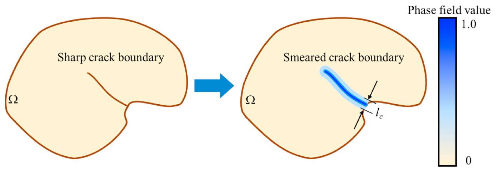

### 2.2. CMAS-induced strength degradation

During service, CMAS corrosion usually starts from the surface of the top coat, leading to a reduction of fracture resistance (Vidal-Setif et al., 2012; Fang et al., 2019). Many studies have investigated the mechanical behaviours of top coat before and after CMAS, including elastic modulus, tensile strength and fracture toughness (Li et al., 2021; Faucett and Choi, 2011). The previous study used the concentration of SiO₂ to describe the degree of CMAS corrosion (Holgate et al., 2021). Therefore, we define CMAS coverage $\theta_{\mathrm{CMAS}}$ here to characterize the corrosion process of the top coat ($\theta_{\mathrm{CMAS}}=0$ for intact state and $\theta_{\mathrm{CMAS}}=1$ for equilibrium state) (Martínez-Pañeda et al., 2018),

$$
\theta_{\mathrm{CMAS}}=C/\left[C+\exp\left(\frac{-\Delta g_b}{RT}\right)\right] \qquad (8)
$$

where $C$ denotes CMAS concentration, $\Delta g_b$ is the Gibbs free energy, $T$ is temperature and $R$ is the universal gas constant.

Considering CMAS corrosion-induced strength degradation, the critical energy release rate is written as,

$$
g_f(\theta_{\mathrm{CMAS}})=(1-\chi\theta_{\mathrm{CMAS}})g_{f0} \qquad (9)
$$

where $g_{f0}$ is the critical energy release rate of intact material, and $\chi$ is the damage coefficient conducted from experimental results. According to the research of Faucett et al. (Faucett and Choi, 2011) and Fang et al. (Fang et al., 2019), the critical stress of ceramics was reduced by about 66% after CMAS treatment, thereby set as 0.66 in this work.

### 2.3. Viscoplastic constitutive relation

This study is carried out based on small strain conditions, which are accepted for TBCs and easily extended to large deformation. Many experimental results indicate the top coat shows significant time-dependent inelastic behaviours at elevated temperatures. As a result, we employed a viscoplastic model proposed by Walker to describe the nonlinear deformation behaviours of the top coat. The model treats the deformation as irretrievable, and the strain rate is given by,

$$
\dot{\boldsymbol{\varepsilon}}=\left\langle\frac{\sqrt{\frac{2}{3}\left(\frac{3}{2}\mathbf{s}-\boldsymbol{\Omega}\right)\left(\frac{3}{2}\mathbf{s}-\boldsymbol{\Omega}\right)}}{K}\right\rangle^{n}\frac{\left(\frac{3}{2}\mathbf{s}-\boldsymbol{\Omega}\right)}{\sqrt{\frac{2}{3}\left(\frac{3}{2}\mathbf{s}-\boldsymbol{\Omega}\right)\left(\frac{3}{2}\mathbf{s}-\boldsymbol{\Omega}\right)}}\quad\text{where}\quad\langle x\rangle=\begin{cases}x,&x\ge 0\\0,&x<0\end{cases}. \qquad (10)
$$

The back stress $\boldsymbol{\Omega}$, deviatoric stress $\mathbf{s}$, drag stress $K$ and effective plastic strain $R$ are calculated by,

$$
\dot{\boldsymbol{\Omega}}=(n_1+n_2)\dot{\boldsymbol{\varepsilon}}-\left(\boldsymbol{\Omega}-\boldsymbol{\Omega}'-n_1\dot{\boldsymbol{\varepsilon}}\right)\dot{G}, \qquad (11)
$$

$$
K=K_1-K_2e^{-n_7R}, \qquad (12)
$$

$$
\dot{G}=\left(n_3+n_4e^{-n_5R}\right)\dot{R}+n_6\left(\frac{2}{3}\boldsymbol{\Omega}:\boldsymbol{\Omega}\right)^{\frac{m-1}{2}}, \qquad (13)
$$

$$
R=\sqrt{\frac{2}{3}\dot{\boldsymbol{\varepsilon}}:\dot{\boldsymbol{\varepsilon}}}, \qquad (14)
$$

$$
\mathbf{s}=\boldsymbol{\sigma}-\frac{1}{3}\delta\boldsymbol{\sigma}. \qquad (15)
$$

Accordingly, Eq. (6) can be rendered as,

$$
\psi=\max\int\left(\boldsymbol{\sigma}:\mathrm{d}\boldsymbol{\varepsilon}\right)\mathrm{d}t. \qquad (16a)
$$

Material constants $\Omega'$, $n$, $m$, $n1$, $n2$, $n3$, $n4$, $n5$, $n6$, $n7$, $K1$ and $K2$, can be calibrated from experimental results (Qi and Yang, 2012), plotted in Table 1.

**Table 1**  
Parameters values of constitutive models at 850 °C (Qi and Yang, 2012).

| Parameters | E (GPa) | ν | K1 (MPa) | K2 (MPa) | n-1 | m | n1 (MPa) |
|---|---:|---:|---:|---:|---:|---:|---:|
| Value | 11.5 | 0.12 | 59.3 | 0 | 0.23 | 1.2 | 0 |

| Parameters | n2 (MPa) | n3 | n4 | n5 | n6 (MPa¹⁻ᵐ·s⁻¹) | n7 | Ω′ (MPa) |
|---|---|---|---:|---:|---:|---:|---:|
| Value | 1.0 | 312.0 | 0 | 0 | 2.7 × 10⁻³ | 0 | −1.2 |

### 2.4. Diffusion coupled viscoplastic phase field model

Generally, the body force is neglected under the small deformation assumption. The virtual work principle of crack-embedded solid with CMAS diffusion is given by (Martínez-Pañeda et al., 2018),

$$
\begin{aligned}
\Phi=&\int_{\Omega}(1-d)^2\psi\,\mathrm{d}\Omega+\int_{\Omega}\frac{g_f(\theta)}{2l_c}\left(d^2+l_c^2\nabla d\cdot\nabla d\right)\mathrm{d}\Omega-\int_{\Omega}\left(\nabla\mathbf{J}+\frac{\mathrm{d}C}{\mathrm{d}t}\right)\mu\,\mathrm{d}\Omega\\
&-\int_{\partial\Omega}\mathbf{t}\cdot\mathbf{u}\,\mathrm{d}\Omega-\int_{\partial\Omega^h}q\mu\,\mathrm{d}\Omega
\end{aligned} \qquad (16b)
$$

where $\mu$ is chemical potential, driving the flux of CMAS, $\mathbf{J}$ is the flux of CMAS and $q$ is concentration flux through boundary $\partial\Omega^h$, defined as $q=\mathbf{J}\cdot\mathbf{n}$. The mass flux is assumed following the linear Onsager relationship,

$$
\mathbf{J}=-D\frac{C}{RT}\nabla\mu \qquad (17)
$$

where $D$ is the diffusion coefficient. The chemical free energy and concentration boundary conditions have been considered in the third and fifth terms of Eq. (16), respectively. Subsequently, a constitutive framework was developed, coupling deformation, fracture and diffusion, as shown Fig. 2.

Accordingly, the stress tensor $\boldsymbol{\sigma}$, phase field value $d$ and chemical potential $\mu$ can be calculated as followed,

$$
\begin{aligned}
\boldsymbol{\sigma}&=\frac{\partial\Phi}{\partial\boldsymbol{\varepsilon}}=\left[(1-d)^2+\kappa\right]\psi\\
w&=\frac{\partial\Phi}{\partial d}=-2(1-d)\psi+\frac{g_f(\theta)}{l_c}d\\
\mu&=\frac{\partial\Phi}{\partial C}=\mu^0+RTL+\frac{\partial g_f(\theta)}{\partial C}\left(\frac{d^2}{2l_c}+\frac{l_c}{2}\nabla d\cdot\nabla d\right)
\end{aligned} \qquad (18)
$$

where $L$ is the material constant related to the occupancy of lattice sites. It is worth mentioning that this study mainly focuses on the CMAS-induced strength degradation in TBCs, thus the volume expansion is neglected to simplify the calculation here. The simplification might lead to an over-optimistic result for TBCs under thermal fatigue load, where the CMAS volume swelling could induce the separation and buckling of TBCs (Zhu et al., 2020), worth to be considering in future studies.

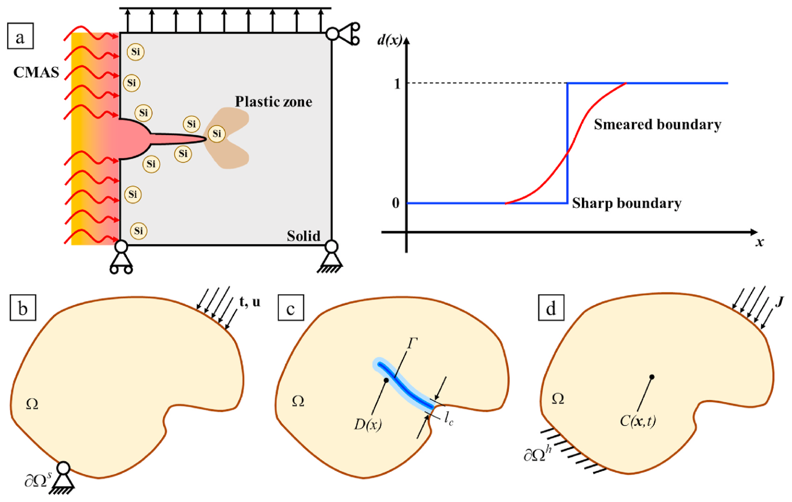

## 3. Numerical implementation

### 3.1. Finite element discretization

In this study, the deformation, fracture and diffusion problems in solids are weakly coupled. More specifically, the CMAS diffusion reduces the critical strength of the top coat first. Then, the strength degradation can lead to a mature fracture of the material. As a result, the stress and deformation field near the fracture process zone is redistributed. Accordingly, the redistributed stress field influences the diffusion rate of intact materials. The cycle repeats itself, stopping till the crack grows through the solid. It should be noted that diffusion-induced deformation is neglected. This simplification is acceptable as a consequence of unobvious volume change for TBCs with CMAS at elevated temperatures (Wu et al., 2011). The phase field method is complied by a user-defined subroutine (including user-defined material and element) of a commercial finite element software. A similar numerical framework has been employed in many previous studies (Song et al., 2022; Li et al., 2023; Askarinejad et al., 2021), with good accuracy and robustness in simulations.

The mechanical-diffusion-phase field coupled formulation is implemented by a user-defined element, where the nodal displacement, phase field value and CMAS concentration are interpolated as followed,

$$
\mathbf{u}=\sum_{i=1}^{Nnode}N_i^u\mathbf{u}_i,\quad d=\sum_{i=1}^{Nnode}N_i^dd_i,\quad C=\sum_{i=1}^{Nnode}N_i^cC_i \qquad (19)
$$

where $Nnode$ represents the number of integral nodes in each element. $\mathbf{N}^u$, $N^d$ and $N^c$ are shape functions. Accordingly, the corresponding gradient of Eq. (19) is given by,

$$
\boldsymbol{\varepsilon}=\sum_{i=1}^{Nnode}\mathbf{B}_i^u\mathbf{u}_i,\quad\nabla d=\sum_{i=1}^{Nnode}\mathbf{B}_i^dd_i,\quad\nabla C=\sum_{i=1}^{Nnode}\mathbf{B}_i^cC_i \qquad (20)
$$

where $\mathbf{B}^u$, $B^d$ and $B^c$ are derivatives of shape functions.

In this study, the deformation, diffusion and phase field fracture of solids are weakly coupled. The nonlinear equations are solved by the Newton-Raphson method,

$$
\left[\begin{array}{c}\mathbf{u}\\d\\C\end{array}\right]_{n+1}=\left[\begin{array}{ccc}\mathbf{K}^u&0&0\\0&\mathbf{K}^d&0\\0&0&\mathbf{K}^c\end{array}\right]\left[\begin{array}{c}\mathbf{u}\\d\\C\end{array}\right]_{n}+\left[\begin{array}{ccc}0&0&0\\0&0&0\\0&0&\mathbf{M}\end{array}\right]\left[\begin{array}{c}\dot{\mathbf{u}}\\\dot{d}\\\dot{C}\end{array}\right]_{n}-\left[\begin{array}{c}r^u\\r^d\\r^c\end{array}\right] \qquad (21)
$$

where $r^u$, $r^d$ and $r^c$ residual with respect to the displacement, phase field and concentration,

$$
\begin{aligned}
r_i^u&=\int_{\Omega}\left[(1-d)^2+\kappa\right](\mathbf{B}_i^u)^T\boldsymbol{\sigma}_0\mathrm{d}\Omega-\int_{\Omega}(N_i^u)^T\mathbf{b}\,\mathrm{d}\Omega-\int_{\partial\Omega}(N_i^u)^T\mathbf{t}\,\mathrm{d}\Omega\\
r_i^d&=\int_{\Omega}\left[-2(1-d)N_i^dH+g_f(\theta)\left(\frac{N_i^dd}{l_c}+l_c(\mathbf{B}_i^d)^T\nabla d\right)\right]\mathrm{d}\Omega\\
r_i^c&=\int_{\Omega}\left[N_i^c\left(\frac{1}{D}\frac{\mathrm{d}C}{\mathrm{d}t}\right)+(\mathbf{B}_i^c)^T\nabla C\right]\mathrm{d}\Omega+\frac{1}{D}\int_{\partial\Omega^h}(N_i^c)^Tq\mathrm{d}\Omega
\end{aligned} \qquad (22)
$$

Then, the stiffness matrices of displacement $\mathbf{K}^u$, phase field $\mathbf{K}^d$ and mass transport $\mathbf{K}^c$ can be calculated by differentiating the residual with respect to the incremental variables,

$$
\begin{aligned}
\mathbf{K}_{ij}^u&=\int_{\Omega}\left[(1-d)^2+\kappa\right](\mathbf{B}_i^u)^T\mathbf{C}_0\mathbf{B}_j^u\mathrm{d}\Omega\\
\mathbf{K}_{ij}^d&=\int_{\Omega}\left[\left(2H+\frac{g_f(\theta)}{l_c}\right)N_iN_j+g_f(\theta)l_c(\mathbf{B}_i^d)^T\mathbf{B}_j^d\right]\mathrm{d}\Omega\\
\mathbf{K}_{ij}^c&=\int_{\Omega}(\mathbf{B}_i^c)^T\mathbf{B}_j^c\mathrm{d}\Omega
\end{aligned} \qquad (23)
$$

The concentration capacity matrix $\mathbf{M}$ is defined as,

$$
\mathbf{M}_{ij}=\int_{\Omega}\frac{1}{D}(N_i^c)^TN_j^c\mathrm{d}\Omega. \qquad (24)
$$

The phase field model is conducted by user-defined elements. Furthermore, 2D plane strain dummy elements are used for phase field calculation results visualization. The dummy elements share the same nodes with the user-defined elements, and calculation results are transferred from the former to the latter at the end of each step. The fundamental code (i.e. the coupled visco-plasticity and phase field fracture model) is developed from our previous work (Song et al., 2022), and the diffusion part refers to study from Prof. Martínez-Pañeda (Martínez-Pañeda et al., 2018). More support could be found in the website (www.empaneda.com/codes).

### 3.2. Microstructural characteristic of top coat

The top coat of TBCs usually has a random microporous structure owing to the atmospheric plasma spraying process (Steinberg et al., 2018). Moreover, the random microstructure results in different mechanical properties of the top coat (Lima, 2022). It is worth mentioning that the porosity of the top coat might influence the corrosion rate of CMAS (Shan et al., 2021), but the factor is neglected to simplify the simulation process. Here, the top coat is regarded as a two-phase material, composed of ceramic solid and micropores. Then, two-phase rotary chord length distribution (TP-CLD) was employed to characterize the shape and volume fraction of micropores in the top coat.

Pores in the top coat are simplified as a spheroid, with an elliptical cross-section. The major and minor radii of pores ($r_1$ and $r_2$) are characterized by TP-CLD. The rotation angle $\theta$ is used to describe the different orientations of pores, equal to the angle between the major axial of pores and the horizontal direction of the image. The location of the pixel in the local coordinate system ($x'$, $y'$) can be derived from global coordinate ($x$, $y$), given by,

$$
\begin{aligned}
x'&=x\cdot\cos\theta-y\cdot\sin\theta\\
y'&=x\cdot\sin\theta+y\cdot\cos\theta
\end{aligned}. \qquad (25)
$$

According to TP-CLD, pores and solids can be classified in terms of the pixel value $P$ of binary images (i.e. $P=1$ for pores and $P=0$ for solids). Consequently, the boundary of pores is recognized by,

$$
P(Node_{i-1,j})=1,\ P(Node_{i,j})=0,\ P(Node_{i+1,j})=0\quad(\text{Front nodes}), \qquad (26)
$$

$$
P(Node_{i-1,j})=0,\ P(Node_{i,j})=0,\ P(Node_{i+1,j})=1\quad(\text{Back nodes}). \qquad (27)
$$

where the node passing into and leaving the pore along a certain direction is defined as a front node and back node respectively, as illustrated in Fig. 3.

Then, the major radius of pores is calculated by,

$$
r_1=\max\left(x_{F,ij}-x_{B,ij}\right). \qquad (28)
$$

In Eq. (28), the direction of $r_1$ is marked as $\theta_{\max}$, and the minor radius of pores is given by,

$$
r_2=y_{F,ij}\left(\theta_{\max}+\frac{\pi}{2}\right)-y_{B,ij}\left(\theta_{\max}+\frac{\pi}{2}\right). \qquad (29)
$$

Considering the random distributions of micropores, the detection probability of $r_1$ and $r_2$ is used to describe the statistic value of the porous shape, defined as,

$$
\mathbf{PR}_1=\frac{N_{r_1}}{\sum N_{r_1}}\quad\text{and}\quad\mathbf{PR}_2=\frac{N_{r_2}}{\sum N_{r_2}}, \qquad (30)
$$

where $N_i$ is the number of micropores with radius $r$.

Furthermore, because TP-CLD is applied on a two-dimensional image of a scanning electron microscope (SEM), the volume fraction of micropores is approximately given by,

$$
\omega=\left(\frac{N_{pore}^P}{N_{all}^P}\right)^{3/2} \qquad (31)
$$

where $N_{pore}^P$ and $N_{all}^P$ is the pixel of pores and images. The TP-CLD is conducted by MATLAB, which has good performance on computer graphics, image processing, visualization et al. (Latypov et al., 2018; Kim et al., 2022). The method also has been applied to the quantitative analysis of two-phase composite structures (Fan et al., 2021).

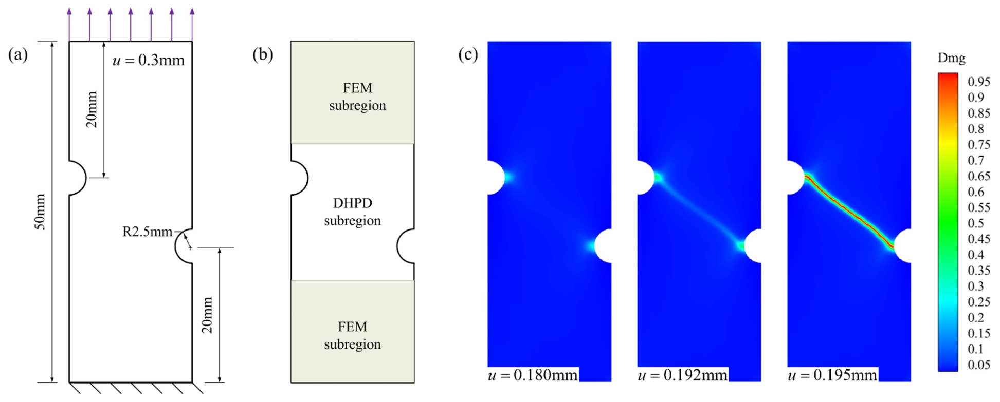

## 4. Results and discussion

### 4.1. Constitutive relation of solid with CMAS

#### 4.1.1. One-element model

A single 8 nodes 2D element (i.e. $1\times1\ \mathrm{mm}^2$ cube) is employed here to simulate the CMAS corrosion-induced strength degradation. Five models with different CMAS concentration, i.e. 0, 2, 4, 6, 8 mol%, were simulated with loading rate of 0.5%/s. The boundary conditions are shown in Fig. 4. It is worth mentioning that to pass the data between different user-defined subroutines, we employ a staggered method. Therefore, the fixed increment length is employed, increasing the accuracy of finite element simulations. A similar framework has been employed in many previous studies (Cui et al., 2022; Khalil et al., 2022; Simoes and Martínez-Pañeda, 2021).

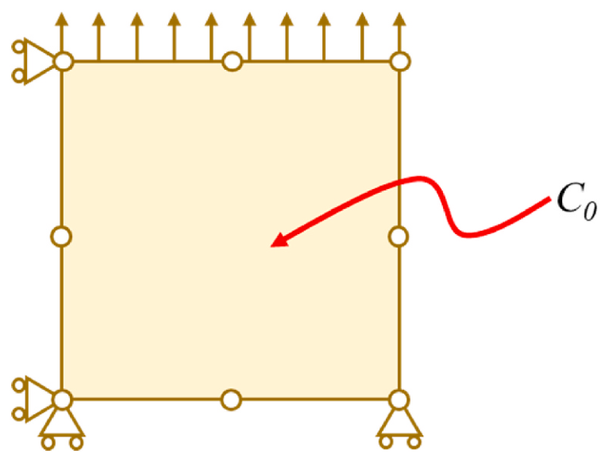

#### 4.1.2. Finite element simulation results

The constitutive relation of ceramic solids with homogenous phase field is shown in Fig. 5, as a function of CMAS concentrations. The results indicate that CMAS degrades the strength of the solid significantly. For solids without CMAS, the maximum tensile stress is about 132 MPa, then steadily declined to zero at 1.8% strain. While for a solid with CMAS of 8 mol%, the maximum stress drops to 61 MPa, and the solid loses its load capacity at 1% strain. In summary, the results indicate that the coupled phase field framework could describe the CMAS-induced fracture resistance degradation quantitatively, as observed in the first principle calculations (Zheng et al., 2017).

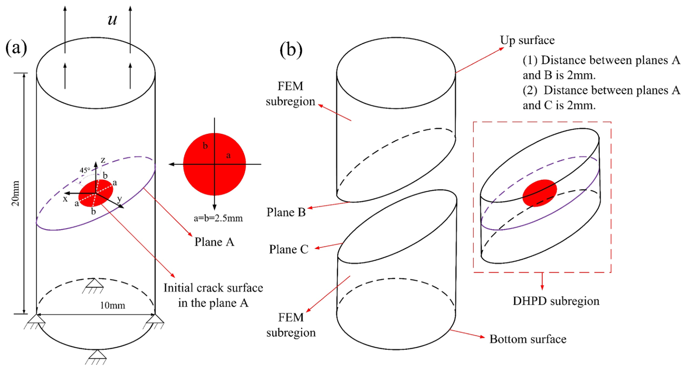

### 4.2. CMAS penetration behaviours

#### 4.2.1. Diffusion model

Before the CMAS-associated cracking simulation is conducted, a 1D diffusion model is built to investigate the accuracy of the coupled model on CMAS penetration behaviours, as shown in Fig. 6. Considering the penetration usually starts from the surface of the coatings, here we assumed that diffusion is operated along the thickness direction. The top coat is placed in contact with the compacted CMAS, with a CMAS concentration of 4 mol% on the top boundary, similar to experiments in Ref. (Holgate et al., 2021). The temperature is 1350 °C, with diffusion coefficient $D=5\times10^{-12}\ \mathrm{m^2/s}$. The diffusion time is ranged from 0 to 10 min.

#### 4.2.2. CMAS penetration in ceramic coating

The simulation results of CMAS penetration are shown in Fig. 7. At the beginning of the simulation, the ceramic solid is presented deposited state and the CMAS concentration equal to zero. The CMAS concentration of the upper surface is still 4 mol%, while the depth of CMAS penetration is increased over time. The penetration depth (i.e. CMAS concentration >1 mol%) is about 100 μm at 3 min, then increased to 175 μm at 10 min. Furthermore, when the corrosion time is greater than 6 min, the rate of CMAS penetration is decreased gradually. Notably, the penetration depth of high CMAS (i.e. concentration >2 mol%) is increased slightly, only 60 μm after 10 min corrosion. Furthermore, the results indicate that CMAS penetration would mainly affect ceramic coatings near the surface. That is the reason why the previous study found that CMAS-associated cracks are always found near the surface of the top coat (Vidal-Setif et al., 2012).

The distribution of CMAS concentration in solids with different durations is shown in Fig. 7. The rate of CMAS concentration − distance curve is negative and increased with distance. The CMAS concentration is 4 mol% on the surface and decreased to 0, about 225 μm from the surface. The simulation agreed well with experimental results in Ref. (Holgate et al., 2021), confirming the capability of diffusion calculation for the coupled model. It is worth mentioning that here we mainly focus on the diffusion-assisted cracking behaviors of micro-porous structures, therefore the void on the surface is neglected and the diffusion from the surface is assumed to be flat. Admittedly, the assumption might lead a conservation estimate in the CMAS-assisted failure, but helpful to understand the diffusion-cracking coupled failure mechanism of the structures. Moreover, the inhomogeneous diffusion coupled crack propagation is very worth to be considered in the future studies.

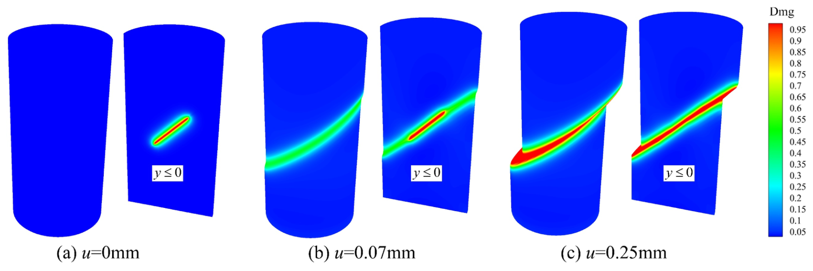

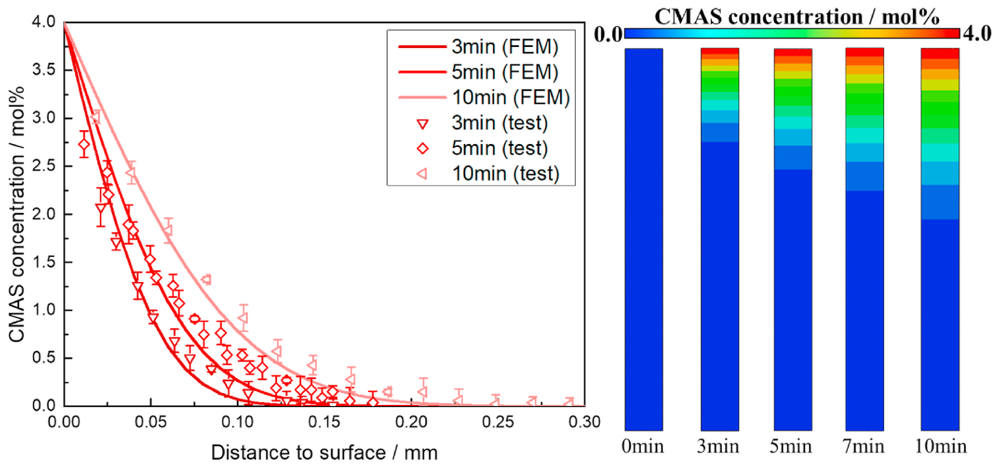

### 4.3. Effect of CMAS on tensile strength of the top coat

#### 4.3.1. Finite element model

Many previous studies indicated that the CMAS would decline bond strength and lead to the separation of the top coat during service (Wu et al., 2011; Steinberg et al., 2018). Therefore, the effect of CMAS penetration on out-plane tensile strength and crack propagation process is studied in this section. As previously stated, the radius of pores is assumed to obey Gaussian distribution.

The microstructural characterization using TP-CLD is shown in Fig. 8, based on our previous study (Song et al., 2018). Considering the randomly distributed pores, we choose five different areas to reduce the statistical error of TP-CLD. The mean value of major radius $r_1$ is about 6 μm, while the average of minor radius $r_2$ is 4.9 μm. The mean volume fraction $\omega$ of the pores is 9%. Moreover, considering the difference between $r_1$ and $r_2$ are relatively small, here we use a sphere with radius $r$ representing the pores to simplify the modelling process. The distribution of porous radius is shown in Fig. 8. It should be noticed that the results mentioned above are calculated based on the manufacturing process in Ref (Song et al., 2018), because the microstructure of the top coat is changed significantly with different spray (or deposition) parameters. However, it is easy to use TP-CLD to characterize the microstructure of different TBCs.

Based on the calculation results of TP-CLD, finite element models of top coat with random structures are built using Python script. The porous solids (i.e. $0.1\times0.1\ \mathrm{mm^2}$, $r\sim N(6\ \mathrm{\mu m}, 2.5\ \mathrm{\mu m})$, $\omega=9\%$) are employed to simulate the stress-strain response and crack growth behaviours of top coat with CMAS corrosions. The CMAS concentration on the upper boundary is set as 4 mol%, representing continuous corrosion for TBCs in service. The finite element model and boundary conditions are shown in Fig. 9. A tensile load was applied on the top of the model with a loading rate of 0.5%/s. Moreover, the mesh size is 1 μm to balance the accuracy and efficiency of simulations (Song et al., 2018). Due to the random distribution of micropores, three different models were built. The total element number of model 1 is 18984, model 2 for 19013, and model 3 for 19085. Here we only applied the out-plan tensile load on the top of the model, corresponding to the bond strength tests and service conditions (Geng et al., 2004; Gell et al., 1999).

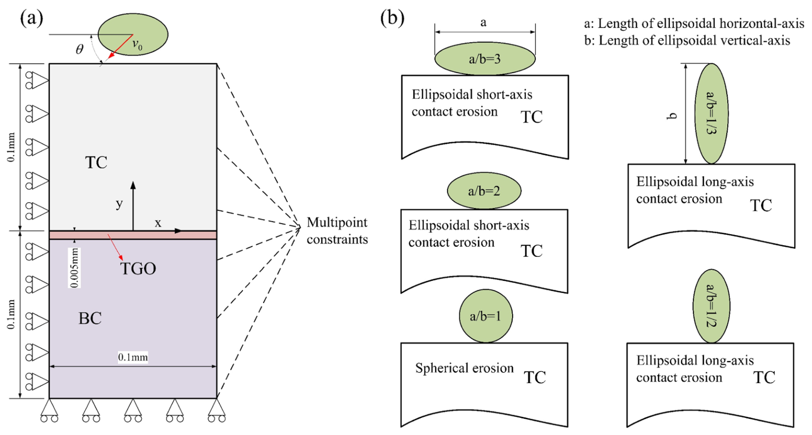

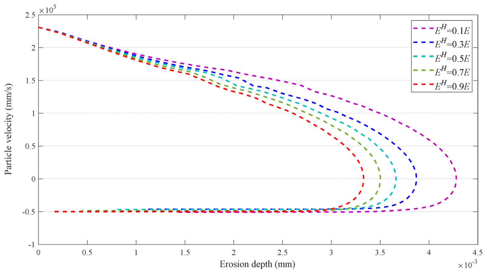

#### 4.3.2. Effect of penetration durations

The calculation of the CMAS penetration process in the top coat is shown in Figs. 10 and 11. As a deposited state, there is no CMAS penetration at the beginning of the simulation. Then, after 1-min penetration, the CMAS is detected at 30 μm depth from the upper boundary. After 5 min, the CMAS penetrated through the solid, and the minimum CMAS concentration increases to 0.6 mol%, located on the bottom boundary. After 10 min, the minimum value increases to 1.7 mol%. Finally, the CMAS concentration in the top coat becomes uniform and reaches 4 mol% after 100 min.

What is interesting in this simulation is the inhomogeneous penetration rate along the depth direction, which can be seen in Fig. 10 b, c, and d. The results indicate that the porous structures would lead to an inhomogeneous concentration in the solids, due to different contact areas of porous solids (Heijmans et al., 2022; Tartakovsky and Dentz, 2019). More specifically, because the defects in solid (i.e. micro-pores and cracks) would become storage space of diffusion materials and increase the diffusion rate in solids (Beving et al., 2020; Sheng et al., 2020), the different partial porosity in top coat leads to the difference of diffusion rate along the depth direction. However, considering the diffusion rate along the depth direction of the different areas is small, here we assumed that the penetration in the same depth is homogeneous. It should be noted that the diffusion part of the coupled model is based on the Onsager relationship, neglecting the absorption of micro-pores and cracks, which are worth to be considered in future studies.

The failure process of the top coat with different CMAS penetration durations is shown in Fig. 12. Cracks initiate from the edge of pores near the bottom left corner, then propagate between the pores and perpendicular to the loading directions. Furthermore, secondary cracks are also found at the upper-middle part and upper-right side of the model. The main crack growth through the model when the strain increases to 2.4%, indicating the separation and failure of the top coat.

The results indicate that CMAS penetration has little influence on the location of crack initiation but changes crack initiation time significantly. As shown in Fig. 13, for the model without CMAS penetration, the critical tensile stress is 11.9 MPa. For models with 5, 10 and 100 min CMAS penetration, the critical tensile stress reduces 11.2 MPa, 10.9 MPa and 10.2 MPa, respectively. In those cases, CMAS shows an obvious acceleration of crack generation and propagation. While, for models with 1 min CMAS penetration, the diffusion has little effect on the critical tensile stress. The results can be attributed to the CMAS penetration depth of different models. Because the main crack is initiated from the bottom part of the model, where the CMAS concentration is 0 mol% after 1 min penetration, CMAS has little effect on the tensile strength. After 5, 10 and 100 min penetration, the CMAS concentration at the crack initiation point increased to 0.7, 1.6 and 4 mol%, promoting crack propagation significantly. The results indicate that the strength of the top coat is influenced by both CMAS penetration durations and microstructures.

Interestingly, the results show that CMAS penetration could change the trend of crack growth between the main and secondary cracks, attributed to the competition propagation of cracks. Moreover, the effect is more significant for top coats with inhomogeneous CMAS concentration. For example, when the applied strain increases to 2.1%, the length secondary crack in the top coat with 1, 5 and 10 min CMAS penetration (see Fig. 12 b4, c4 and d4) is longer than those with 0 and 100 min penetration (see Fig. 12 a4 and e4). Conversely, the main crack has an opposite trend with the secondary crack. The results indicate the final failure morphology of the top coat after long CMAS corrosion might be similar to that without CMAS because the CMAS concentration in both cases is homogeneous (equal to 0 or 0.4 mol%, respectively), where the CMAS corrosion would lead to strength degradation of the whole model, accelerating the crack growth rate but with little influence on crack propagation path. However, for the top coat with inhomogeneous CMAS concentration, materials near the upper surface of the model have higher CMAS concentration than those near the bottom. Therefore, materials near the upper surface are more easily to crack, consuming strain energy in the top coat and delaying the main crack propagation near the bottom.

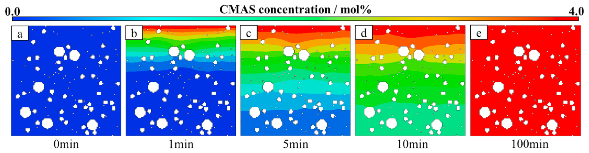

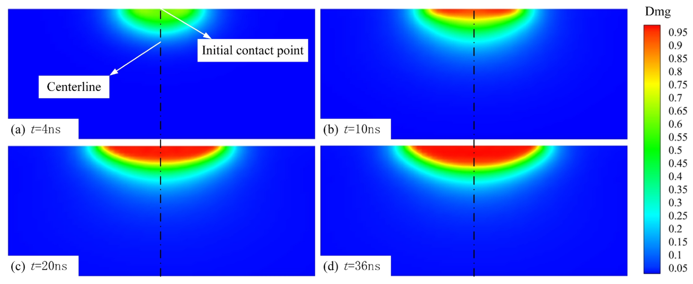

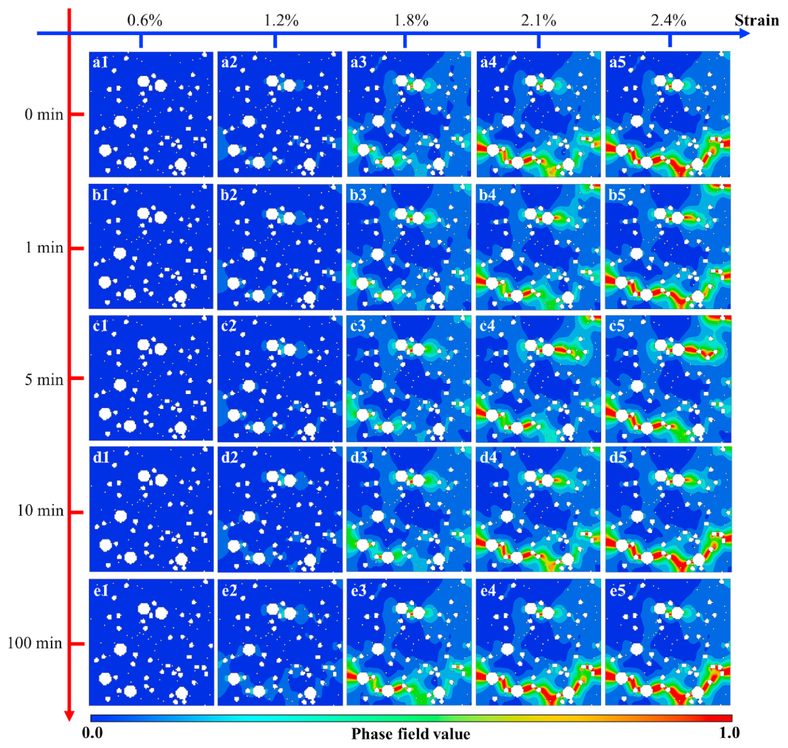

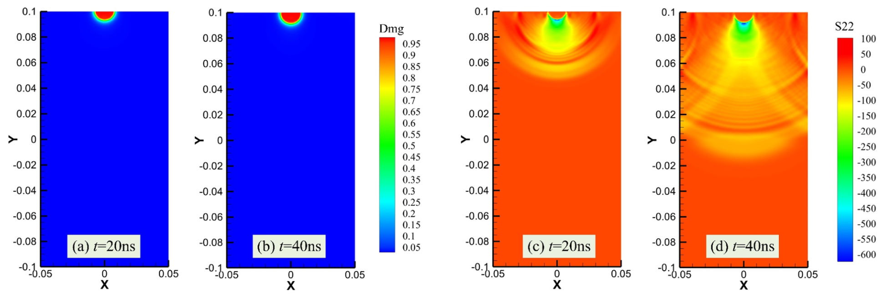

#### 4.3.3. Effect of random porous structures

The effect of CMAS penetration on strength is also related to the microstructures of the top coat. The simulation shows that the CMAS penetration-induced strength degradation presents a significant structural sensibility, as shown in Fig. 14. According to the simulations, model 3 has the best tensile performance, reaching 12.5 MPa before CMAS penetration. Furthermore, model 1 shows good resistance to CMAS-induced strength degradation. Specifically, after 10 min penetration, the critical stress in model 1 becomes 95% of the as-deposited one, while the value declines to 88% and 89% in models 2 and 3 respectively.

The failure process of the top coat with different microstructures and CMAS durations is shown in Fig. 15. The results indicate that the main cracks are more likely to be initiated on the minimum sectional area and propagate vertically to loading directions. The location of the main crack is different due to the random distribution of micro-pores in the top coat. As previously stated, the strength of the top coat is not only dependent on the penetration depth but also related to the main crack location. The main crack of model 1, for example, initiated near the bottom of the model, thus there is no strength degradation after 1 min CMAS penetration. While for models 2 and 3, main cracks initiate near the upper surface of the top coat, which is easily affected by CMAS penetration. The critical stress in those cases is decreased by about 5% after 1 min penetration.

As discussed above, because the growth of secondary cracks could consume strain energy and delay the propagation of main cracks, the competition cracking behaviour could be used to improve the strength of TBCs under CMAS. The top coat with gradient porous structures should be considered, which leads to the secondary cracks initiated near the surface and delays the growth of the main cracks in the deep of the top coat. Admittedly, the gradient-porous structure might be helpful only when CMAS does not penetrate through the top coat, acceptable for TBCs on turbine blades.

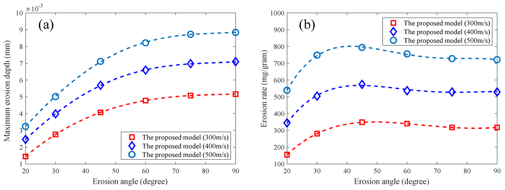

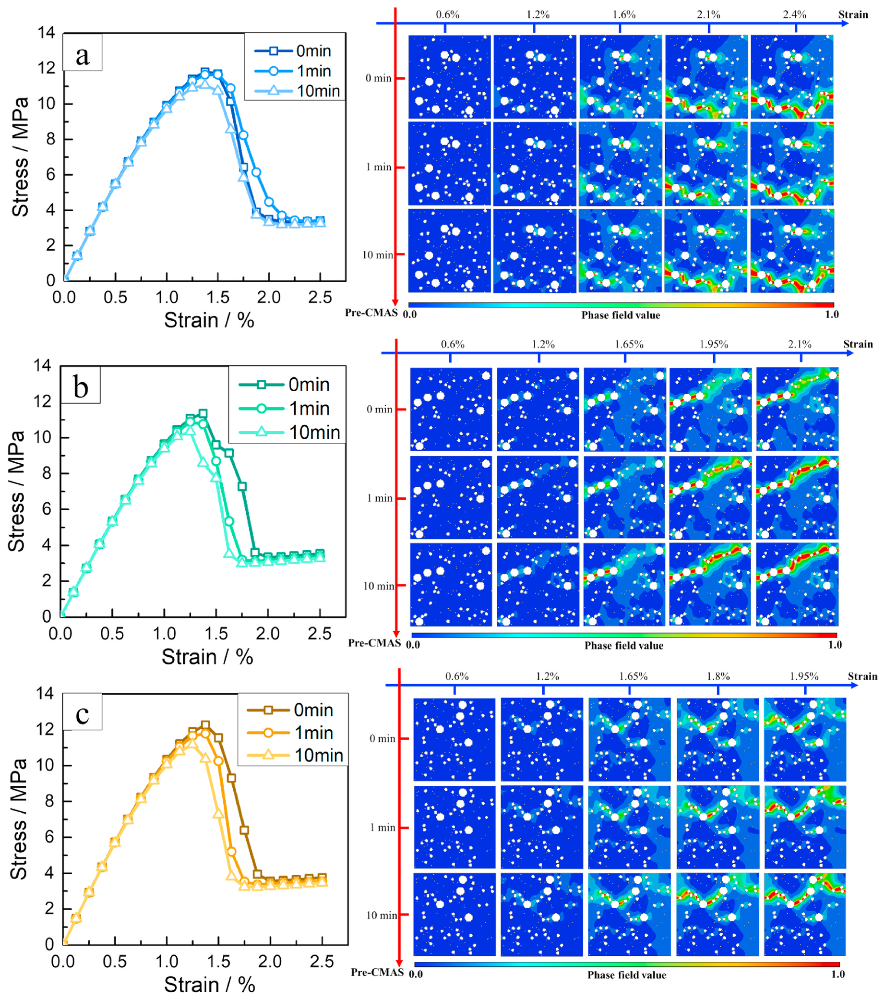

### 4.4. Effect of CMAS on fatigue crack propagation in top coat

#### 4.4.1. Finite element model

During service, the TBCs are deposited on the surface of the turbine blade suffering from both the CMAS corrosion and cyclic centrifugal load. Therefore, in this section, the coupled model was used to investigate the CMAS-assisted fatigue initiation and propagation in TBCs, providing insight into the corrosion-fatigue failure process of porous structures. The finite element model and boundary conditions are shown in Fig. 16, where the in-plane cyclic load is employed, perpendicular to the CMAS penetration direction. Here we only discuss the effect of CMAS penetration on small fatigue crack initiation, thus the calculation is stopped after 10 cycles. Here we employed model 1 (as described in section 4.3) to investigate the CMAS-assisted fatigue crack propagation. The cyclic loading was applied on the right side of the model with a strain range of 3%, a loading ratio of 0.1, and a loading rate of 0.5%/s.

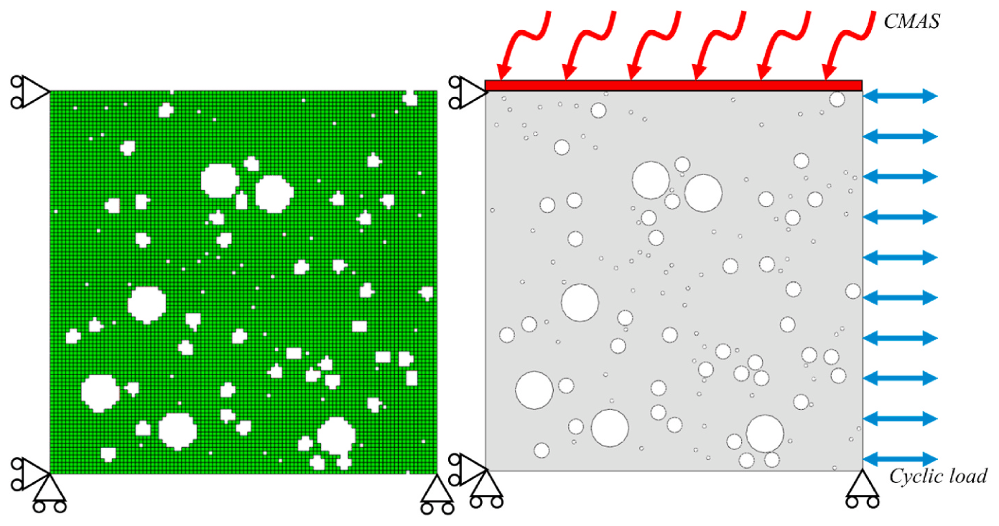

#### 4.4.2. CMAS-assisted fatigue crack propagation

The CMAS-assisted fatigue crack growth of the top coat with different penetrations is shown in Fig. 17. The results indicate that CMAS penetration would accelerate surface fatigue crack initiation and propagate perpendicular to the loading direction. Here we determine the crack generated when the length of the connection failure element is greater than 5 μm. As shown in Fig. 17 a, for the coat without CMAS penetration, cracks were initiated at the middle-upper and bottom-right side after 3 cycles, and a surface crack generates after 5 cycles. However, for the coat with 1 min CMAS penetration, the surface crack initiated after 3 cycles due to the corrosion-induced strength degradation, as shown in Fig. 17 b. Furthermore, because CMAS has penetrated through the upper half part after 1 min, the length of the crack at the middle-upper location after 5 cyclic loading is greater than that without CMAS.

To investigate the CMAS penetration on different cracks initiation quantitatively, the model is divided into top and bottom half parts and the number of failure elements is counted, as shown in Fig. 18. The number of failure elements in the bottom half part increases rapidly in first three cycles, and then keeps almost unchanged. In contrast, the failure elements in the top half part emerge after 2 cycles and increased gradually. Furthermore, the CMAS penetration seems to have more effect on elements failure in the top half part. For example, the number of failure elements in the bottom half part is almost the same for the top coat with 0 min and 1 min CMAS penetrations and increased slightly even with 10 min penetration. While for the top half part, the number of failure elements in the top half part is increased with CMAS penetration durations significantly. Moreover, the CMAS penetration accelerates the element failure process in the top half part. For the coat without CMAS penetration, the failure elements in the top half part emerge after 3 cycles. While the number of cycles decreases to 2 after CMAS penetration.

The proportion of the failure element in the top and bottom half part is calculated to understand the failure process of the top coat with different CMAS penetration durations, as shown in Fig. 19, where the blue bars represent the proportion of the failure element in the bottom half part and red bars is the proportion in the top half part. The results indicate the proportion of the bottom half part is decreased with loading cycles. For example, the bottom half part proportion is 100% representing the crack initiated from the bottom half part firstly after 1 cycle. While, the value decreases and stays at about 30% after 10 cycles, indicating more cracks in the top half part (i.e. surface cracks or subsurface cracks) initiated during cyclic loadings, as observed in Ref. (Shi et al., 2019). Furthermore, the proportion of the top half part is increased with CMAS penetration durations. Specifically, for the top coat with 0 min CMAS penetration, the proportion of the top half part is about 17% after 3 cycles, while for the coat with 10 min CMAS penetration, the proportion increases to 60%. The results indicate that there might be a suitable porous structure which makes the surface and inside crack grow gradually, and delay the lifetime of cracks propagating through the top coat.

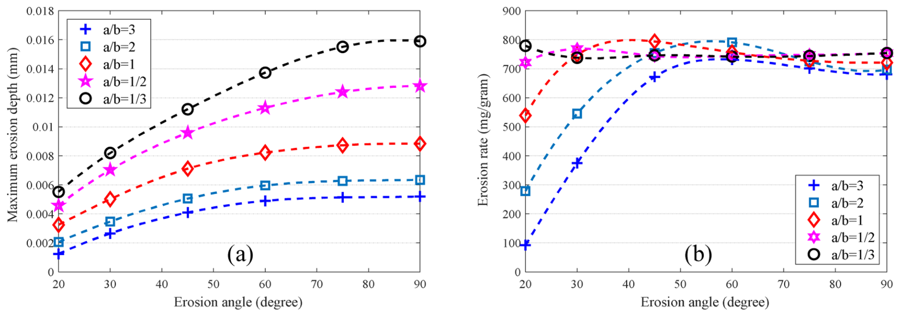

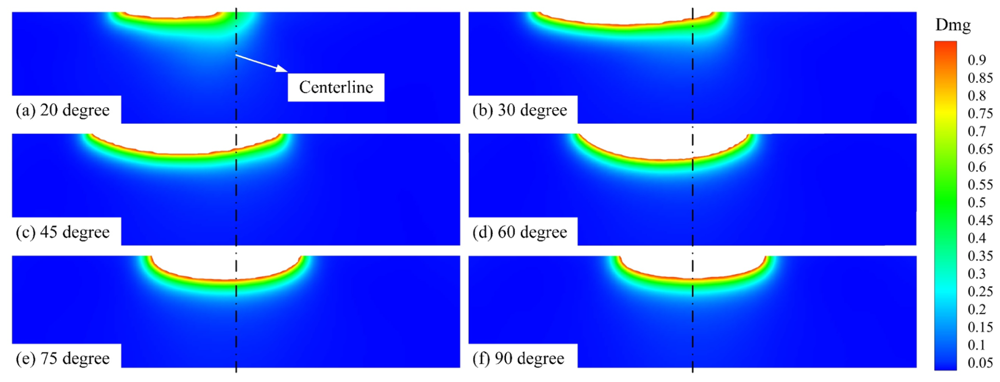

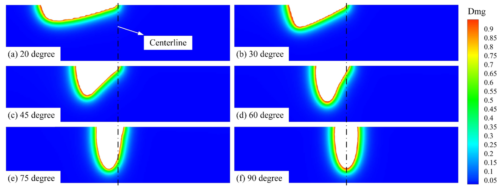

### 4.5. CMAS associate cracking behaviours of TBCs under cyclic loading

The coupled model not only can describe the cracking behaviours of the top coat but also can capture the failure process of TBCs with CMAS. According to our previous study (Li et al., 2018), the TBCs are composed of a top coat (thickness of 100 μm), bond coat (70 μm) and substrate (400 μm), as shown in Fig. 20. Similar to previous simulations, 4 mol% of CMAS concentration is applied on the top surface for 10 min. The TBCs deposited on the surface of turbine bases, and during service, the deformation of coatings is restricted by the substrate. Therefore, the cyclic loading is applied on the right side of the substrate with a load ratio of 0.1, and a load rate of 0.5%/s, as shown in Fig. 20. The mesh size of the top coat is refined to 1 μm to capture the micro pores in the top coat. Here we mainly focus on CMAS-associated cracking behaviours of the top coat where the random porous structure is applied. The bond coat and substrate are regarded as homogeneous elastic bodies as plotted in Table 2.

**Table 2**  
Mechanical behaviours of bond coat and substrate (Jiang et al., 2018; Song et al., 2019).

| Layer | $E$ (GPa) | $\nu$ | $\alpha\ (\times10^{-6}\,{}^{\circ}\mathrm{C}^{-1})$ |
|---|---:|---:|---:|
| Bond coat | 109 | 0.35 | 10.2 |
| Substrate | 150 | 0.3 | 15 |

The failure process of TBCs with CMAS penetration and cyclic loading is shown in Fig. 21. After 10 min CMAS penetration, the penetration depth increases to 17 μm, where the CMAS concentration is greater than 3 mol%. Due to the CMAS-induced strength degradation, cracks initiated from the surface of the top coat at locations 4, 7 and 8 after 3 cycles, then propagate perpendicular to the loading direction. After 5 cycles, more cracks are generated from locations 3, 6 and 9. When the number of cycles is greater than 9, the number of vertical cracks reaches a saturation point. Furthermore, the interfacial cracks initiate from locations 1 and 10 in this loading cycle, and grow slightly with the number of cycles.

The CMAS-assisted crack growth path is shown in Fig. 22. The cracks show different morphology due to the effect of microstructures. Most cracks are initiated from the surface and growth through adjacent micro-pores, representing declivous (Fig. 22 b), vertical (Fig. 22 d) and branching (Fig. 22 e) propagation paths. Some cracks also generate from the micro-pores in the top coat (Fig. 22 c) and the edge of the interface (Fig. 22 a). In those cases, vertical cracks show significant periodic distribution, as observed in Ref. (Xie et al., 2004). The crack spacing, related to competition between the coat and interfacial strength (Suo and Hutchinson, 1989), ranges from 0.14 mm to 0.4 mm. According to the share leg theory (Mao et al., 2018), the interfacial strength could be estimated from the crack spacing at the saturation point. The theory is assumed the coat a continuum, in which all cracks are initiated from the surface and observable during tests. However, for TBCs with random porous structures, the assumption neglects the effect of inside cracks (see Fig. 22 c), and might bring great error in test results. The theory should be perfected in future studies, especially for coats with porous structures (such as TBCs, nano-silver and ink-jet films).

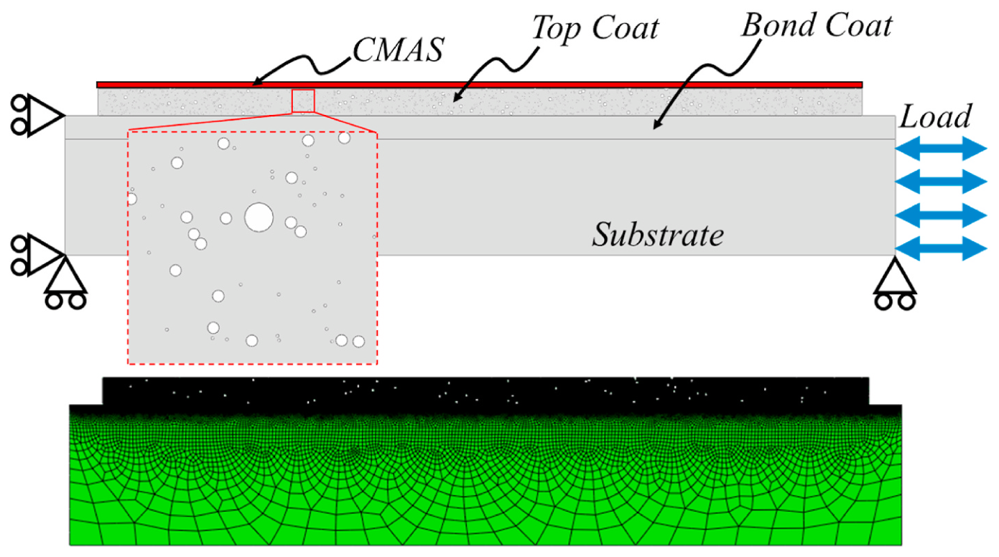

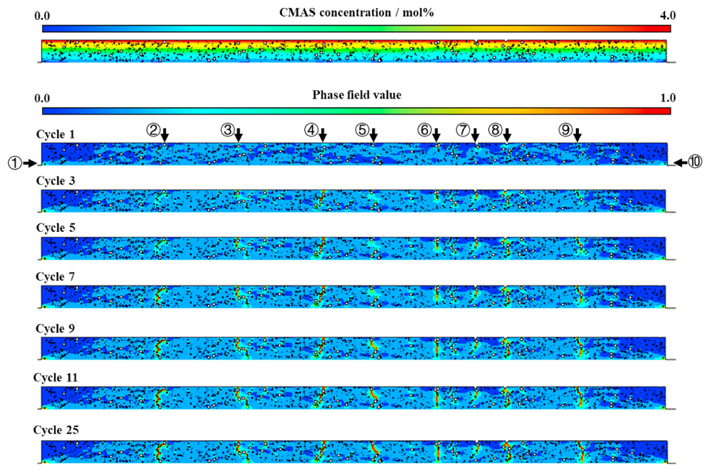

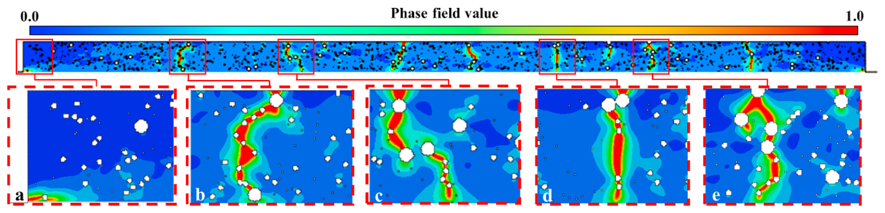

## 5. Conclusion

In this study, a coupled diffusion-viscoplasticity-phase field model, developed in the framework of the finite element method, is formulated for the long-standing problem of CMAS-assisted cracking in TBCs. The coupled model is grounded on CMAS-dependent surface energy degradation, adequately characterizing the sensitivity of the fracture energy to CMAS concentration. Firstly, the one-element model is built to examine the influence of CMAS on the stress-strain response. Then, the 1D CMAS diffusion model is presented and agreed well with the test results. On this basis, the coupled model was applied to the top coat with different microstructures. The results indicate that the CMAS penetration could lead to strength degradation of the top coat, especially for those with a main crack near the surface. Furthermore, because diffusion-induced strength degradation is more significant for materials near the surface, fatigue cracks in the top coat show a competition cracking behaviour, which is related to the CMAS penetration depth. Finally, the multi-source fatigue crack initiation and propagation in TBCs under CMAS penetration are investigated. The results show that the variable multi-source crack could lead to different failure morphology of TBCs, which depend on both CMAS penetration depth and random microstructures of the top coat. The simulations show that the coupled phase field model is a suitable method to achieve the elusive goal of understanding the failure process of components with complex porous structures undergoing CMAS-assisted cracking.

## Declaration of competing interest

The authors declare that they have no known competing financial interests or personal relationships that could have appeared to influence the work reported in this paper.

## Data availability

No data was used for the research described in the article.

## Acknowledgements

This research was supported by a grant from the Natural Science Foundation of Hunan Province, China (2021JJ40741), the National Natural Science Foundation of China (52205176) and the National Science and Technology Major Project (J2019-IV-0017-0085).

## References

Askarinejad, S., Martínez-Pañeda, E., Cuesta, I.I., et al., 2021. Mode II fracture of an MMA adhesive layer: theory versus experiment. Eur. J. Mech. Solid. 86, 104133.

Bakan, E., Vaßen, R., 2017. Ceramic top coats of plasma-sprayed thermal barrier coatings: materials, processes, and properties. J. Therm. Spray Technol. 26 (6), 992–1010.

Bäker, M., 2012. Finite element simulation of interface cracks in thermal barrier coatings. Comput. Mater. Sci. 64, 79–83.

Bäker, M., Rösler, J., 2012. Simulation of crack propagation in thermal barrier coatings with friction. Comput. Mater. Sci. 52 (1), 236–239.

Beving, M., Frijns, A.J.H., Rindt, C.C.M., et al., 2020. Effect of cycle-induced crack formation on the hydration behaviour of K2CO3 particles: experiments and modelling. Thermochim. Acta 692, 178752.

Bie, Y.H., Cui, X.Y., Li, Z.C., 2018. A coupling approach of state-based peridynamics with node-based smoothed finite element method. Comput. Methods Appl. Mech. Eng. 331, 675–700.

Borden, M.J., Hughes, T.J.R., Landis, C.M., et al., 2014. A higher-order phase-field model for brittle fracture: formulation and analysis within the isogeometric analysis framework. Comput. Methods Appl. Mech. Eng. 273, 100–118.

Borom, M.P., Johnson, C.A., Peluso, L.A., 1996. Role of environment deposits and operating surface temperature in spallation of air plasma sprayed thermal barrier coatings. Surf. Coating. Technol. 86, 116–126.

Cui, C., Ma, R., Martínez-Pañeda, E., 2022. A generalised, multi-phase-field theory for dissolution-driven stress corrosion cracking and hydrogen embrittlement. J. Mech. Phys. Solid., 104951.

Fan, Y.S., Yang, X.G., Shi, D.Q., et al., 2021. Quantitative mapping of service process-microstructural degradation-property deterioration for a Ni-based superalloy based on chord length distribution imaging process. Mater. Des. 203, 109561.

Fang, H., Wang, W., Huang, J., et al., 2019. Corrosion resistance and thermal-mechanical properties of ceramic pellets to molten calcium-magnesium-alumina-silicate (CMAS). Ceram. Int. 45 (16), 19710–19719.

Fang, J., Wu, C., Rabczuk, T., et al., 2019. Phase field fracture in elasto-plastic solids: abaqus implementation and case studies. Theor. Appl. Fract. Mech. 103, 102252.

Faucett, D.C., Choi, S.R., 2011. Strength degradation of oxide/oxide and SiC/SiC ceramic matrix composites in CMAS and CMAS/salt exposures//Turbo Expo: power for Land. Sea, and Air 54617, 497–504.

Fuentes-Alonso, S., Martínez-Pañeda, E., 2022. Fracture in distortion gradient plasticity. Int. J. Eng. Sci. 156, 103369.

Gell, M., Eric, J., Krishnakumar, V., et al., 1999. Bond strength, bond stress and spallation mechanisms of thermal barrier coatings. Surf. Coating. Technol. 120, 53–60.

Geng, R., Zhou, B.Z., Qi, H.Y., et al., 2004. The bonding strength and failure modes of thermal barrier coatings. J. Aero. Power 19 (1), 50–53.

Griffith, A.A., 1921. VI. The phenomena of rupture and flow in solids. Philos. Trans. R. Soc. Lond. - Ser. A Contain. Pap. a Math. or Phys. Character 221 (582–593), 163–198.

Guo, L., Gao, Y., Ye, F., et al., 2021. CMAS corrosion behavior and protection method of thermal barrier coatings for aeroengine. Acta Metall. Sin. 57 (9), 1184–1198.

Guo, Y., Wei, L., He, Q., et al., 2021. PS–PVD alumina overlayer on thermal barrier coatings against CMAS attack. J. Therm. Spray Technol. 30 (4), 864–872.

Heijmans, K., Holkenborg, B.K., Gaastra-Nedea, S., et al., 2022. Advanced diffusion methods for H2O in salt hydrates. Comput. Mater. Sci. 205, 111154.

Holgate, C.S., Seward, G.G.E., Ericks, A.R., et al., 2021. Dissolution and diffusion kinetics of yttria-stabilized zirconia into molten silicates. J. Eur. Ceram. Soc. 41 (3), 1984–1994.

Jahed, H., Varvani-Farahani, A., 2006. Upper and lower fatigue life limits model using energy-based fatigue properties. Int. J. Fatig. 28 (5–6), 467–473.

Jha, A., Singh, I.V., Mishra, B.K., et al., 2021. Numerical Study of Coupled Elasto-Plastic Hydrogen Diffusion at Crack Tip Using XFEM//Recent Advances in Computational Mechanics and Simulations. Springer, Singapore, pp. 177–186.

Jiang, J., Wang, W., Zhao, X., et al., 2018. Numerical analyses of the residual stress and top coat cracking behavior in thermal barrier coatings under cyclic thermal loading. Eng. Fract. Mech. 196, 191–205.

Khalil, Z., Elghazouli, A.Y., Martínez-Pañeda, E., 2022. A generalised phase field model for fatigue crack growth in elastic–plastic solids with an efficient monolithic solver. Comput. Methods Appl. Mech. Eng. 388, 114286.

Kim, H.N., Iskakov, A., Liu, X., et al., 2022. Digital protocols for statistical quantification of microstructures from microscopy images of polycrystalline nickel-based superalloys. Integrating Materials and Manufacturing Innovation 11 (3), 313–326.

Latypov, M.I., Kühbach, M., Beyerlein, I.J., et al., 2018. Application of chord length distributions and principal component analysis for quantification and representation of diverse polycrystalline microstructures. Mater. Char. 145, 671–685.

Li, S.L., Yang, H.W., Qi, H.Y., et al., 2018. Experimental study and numerical modeling of the damage evolution of thermal barrier coating systems under tension. Sci. China Technol. Sci. 61 (12), 1882–1888.

Li, D., Jiang, P., Gao, R., et al., 2021. Experimental and numerical investigation on the thermal and mechanical behaviours of thermal barrier coatings exposed to CMAS corrosion. J. Adv. Ceramics 10 (3), 551–564.

Li, Y., Yu, T., Natarajan, S., et al., 2023. A dynamic description of material brittle failure using a hybrid phase-field model enhanced by adaptive isogeometric analysis. Eur. J. Mech. Solid. 97, 104783.

Lima, R.S., 2022. Porous APS YSZ TBC manufactured at high powder feed rate (100 g/min) and deposition efficiency (70%): microstructure, bond strength and thermal gradients. J. Therm. Spray Technol. 1–19.

Liu, D., Seraffon, M., Flewitt, P.E.J., et al., 2013. Effect of substrate curvature on residual stresses and failure modes of an air plasma sprayed thermal barrier coating system. J. Eur. Ceram. Soc. 33 (15–16), 3345–3357.

Mao, W.G., Chen, Y.Y., Wang, Y.J., et al., 2018. A multilayer structure shear lag model applied in the tensile fracture characteristics of supersonic plasma sprayed thermal barrier coating systems based on digital image correlation. Surf. Coating. Technol. 350, 211–226.

Martínez-Pañeda, E., Golahmar, A., Niordson, C.F., 2018. A phase field formulation for hydrogen assisted cracking. Comput. Methods Appl. Mech. Eng. 342, 742–761.

Martínez-Pañeda, E., Deshpande, V.S., Niordson, C.F., Fleck, N.A., 2019. The role of plastic strain gradients in the crack growth resistance of metals. J. Mech. Phys. Solid. 126, 136–150.

Mercer, C., Faulhaber, S., Evans, A.G., et al., 2005. A delamination mechanism for thermal barrier coatings subject to calcium–magnesium–alumino-silicate (CMAS) infiltration. Acta Mater. 53 (4), 1029–1039.

Miehe, C., Welschinger, F., Hofacker, M., 2010. Thermodynamically consistent phase-field models of fracture: variational principles and multi-field FE implementations. Int. J. Numer. Methods Eng. 83 (10), 1273–1311.

Moës, N., Dolbow, J., Belytschko, T., 1999. A finite element method for crack growth without remeshing. Int. J. Numer. Methods Eng. 46 (1), 131–150.

Nguyen, T.T., Réthoré, J., Baietto, M.C., 2017a. Phase field modelling of anisotropic crack propagation. Eur. J. Mech. Solid. 65, 279–288.

Nguyen, T.T., Réthoré, J., Yvonnet, J., Baietto, M.C., 2017b. Multi-phase-field modeling of anisotropic crack propagation for polycrystalline materials. Comput. Mech. 60 (2), 289–314.

Ortiz, M., Pandolfi, A., 1999. Finite-deformation irreversible cohesive elements for three-dimensional crack-propagation analysis. Int. J. Numer. Methods Eng. 44, 1267–1282.

Padture, N.P., Gell, M., Jordan, E.H., 2002. Thermal barrier coatings for gas-turbine engine applications. Science 296 (5566), 280–284.

Qi, H., Yang, X., 2012. Computational analysis for understanding the failure mechanism of APS–TBC. Comput. Mater. Sci. 57, 38–42.

Seiler, P., Bäker, M., Rösler, J., 2013. Multi-scale failure mechanisms of thermal barrier coating systems. Comput. Mater. Sci. 80, 27–34.

Shan, X., Cai, H., Luo, L., et al., 2021. Influence of pore characteristics of air plasma sprayed thermal barrier coatings on calcia-magnesia-alumino-silicate (CMAS) attack behavior. Corrosion Sci. 190, 109636.

Sheng, G., Su, Y., Zhao, H., et al., 2020. A unified apparent porosity/permeability model of organic porous media: coupling complex pore structure and multimigration mechanism. Adv. Geo-Energy Res. 4 (2), 115.

Shi, D., Song, J., Li, S., et al., 2019. Cracking behaviors of EB-PVD thermal barrier coating under temperature gradient. Ceram. Int. 45 (15), 18518–18528.

Simoes, M., Martínez-Pañeda, E., 2021. Phase field modelling of fracture and fatigue in Shape Memory Alloys. Comput. Methods Appl. Mech. Eng. 373, 113504.

Song, J., Li, S., Yang, X., et al., 2018. Numerical investigation on the cracking behaviors of thermal barrier coating system under different thermal cycle loading waveforms. Surf. Coating. Technol. 349, 166–176.

Song, J., Qi, H., Shi, D., et al., 2019. Effect of non-uniform growth of TGO layer on cracking behaviors in thermal barrier coatings: a numerical study. Surf. Coating. Technol. 370, 113–124.

Song, J., Zhao, L.G., Qi, H., et al., 2022. Coupling of phase field and viscoplasticity for modelling cyclic softening and crack growth under fatigue. Eur. J. Mech. Solid. 92, 104472.

Steinberg, L., Naraparaju, R., Heckert, M., et al., 2018. Erosion behavior of EB-PVD 7YSZ coatings under corrosion/erosion regime: effect of TBC microstructure and the CMAS chemistry. J. Eur. Ceram. Soc. 38 (15), 5101–5112.

Suo, Z., Hutchinson, J.W., 1989. Steady-state cracking in brittle substrates beneath adherent films. Int. J. Solid Struct. 25 (11), 1337–1353.

Tao, P., Ye, F., Liu, H., et al., 2021. Dual-phase cohesive zone modelling and experimental validation for hydrogen-assisted cracking of 2205 duplex stainless steel. Int. J. Pres. Ves. Pip. 190, 104296.

Tartakovsky, D.M., Dentz, M., 2019. Diffusion in porous media: phenomena and mechanisms. Transport Porous Media 130 (1), 105–127.

Thakare, J.G., Pandey, C., Mahapatra, M.M., et al., 2021. Thermal barrier coatings—a state of the art review. Met. Mater. Int. 27 (7), 1947–1968.

Vidal-Setif, M.H., Chellah, N., Rio, C., et al., 2012. Calcium–magnesium–alumino-silicate (CMAS) degradation of EB-PVD thermal barrier coatings: characterization of CMAS damage on ex-service high pressure blade TBCs. Surf. Coating. Technol. 208, 39–45.

Wang, L., Li, D.C., Yang, J.S., et al., 2016. Modeling of thermal properties and failure of thermal barrier coatings with the use of finite element methods: a review. J. Eur. Ceram. Soc. 36 (6), 1313–1331.

Wu, J., Guo, H., Gao, Y., et al., 2011. Microstructure and thermo-physical properties of yttria stabilized zirconia coatings with CMAS deposits. J. Eur. Ceram. Soc. 31 (10), 1881–1888.

Wu, J.Y., Mandal, T.K., Nguyen, V.P., 2020. A phase-field regularized cohesive zone model for hydrogen assisted cracking. Comput. Methods Appl. Mech. Eng. 358, 112614.

Xie, W., 2003. Development and Implementation of a Viscoplastic Model for Air Plasma Sprayed Thermal Barrier Coatings. University of Connecticut.

Xie, L., Jordan, E.H., Padture, N.P., et al., 2004. Phase and microstructural stability of solution precursor plasma sprayed thermal barrier coatings. Mater. Sci. Eng., A 381 (1–2), 189–195.

Zheng, H., Chen, Z., Li, G., et al., 2017. High-temperature corrosion mechanism of YSZ coatings subject to calcium–magnesium–aluminosilicate (CMAS) deposits: first-principles calculations. Corrosion Sci. 126, 286–294.

Zhou, X., Wang, J., Yuan, J., et al., 2018. Calcium-magnesium-alumino-silicate induced degradation and failure of La2(Zr0.7Ce0.3)2O7/YSZ double-ceramic–layer thermal barrier coatings prepared by electron beam-physical vapor deposition. J. Eur. Ceram. Soc. 38 (4), 1897–1907.

Zhu, W., Chen, H.Y., Yang, L., et al., 2020. Phase field model for diffusion-reaction stress field in the thermal barrier coatings corroded by the molten CMAS. Eng. Fail. Anal. 111, 104486.
