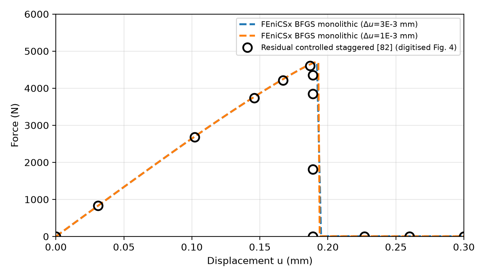
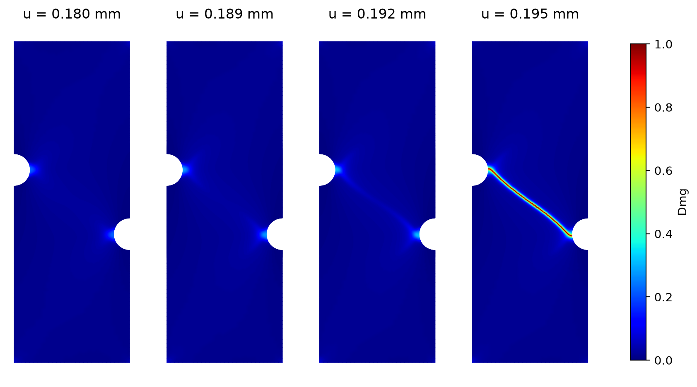

# 论文 13 §3.1 复现：二维非对称缺口试件延性损伤（FEniCSx + BFGS 整体耦合）

复现 Bie et al. *Simulation of foreign particle erosion-induced failure in thermal barrier coatings: A novel coupling plastic damage model of dual-horizon peridynamics and FEM* 第 3.1 节（Fig. 3、Fig. 4）。
按要求**只使用论文提出的 BFGS 整体（monolithic）求解**，不做交错（staggered）求解。

## 文件

| 文件 | 说明 |
|---|---|
| `notched_bfgs.py` | 主程序：gmsh 建模 + dolfinx 0.9 弹塑性相场 + BFGS 整体求解 |
| `plot_results.py` | 绘制力–位移曲线（对照 Fig. 4）与损伤云图（对照 Fig. 3c） |
| `force_displacement.png` | 力–位移曲线，与论文 Fig. 4 中残差控制交错算法 [82] 的数据点（从图中数字化）对比 |
| `results_du3e-3/` | $\Delta u=3\times10^{-3}$ mm（Fig. 4 图例中 BFGS 曲线的增量） |
| `results_du1e-3/` | $\Delta u=1\times10^{-3}$ mm（正文中给出的 BFGS 增量） |
| `results_*/force_displacement.csv` | `u_mm, F_N, iterations, K0_refreshes, dmax, substeps` |
| `results_*/damage_evolution.png` | $u=0.180, 0.189, 0.192, 0.195$ mm 的损伤场 |
| `results_*/log.txt`, `run_info.json` | 每个载荷步的 BFGS 迭代次数、参数、耗时 |

## 模型

**几何/边界**（Fig. 3a）：$18\times50$ mm 矩形（宽度由 Fig. 3a 比例量得），两个 $R=2.5$ mm 半圆缺口，左缺口圆心距顶面 20 mm，右缺口圆心距底面 20 mm；底边固定，顶边 $u_x=0$、$u_y=u$ 单调增加至 0.3 mm；平面应变，厚度 1 mm。

**材料**：$E=71.48$ GPa，$\nu=0.3$，$\sigma_y=345$ MPa，线性硬化 $\sigma_f=\sigma_y+E^H\varepsilon^p$，$E^H=0.1E$，$G_c=9.31$ N/mm，$l_c=3\Delta x=0.18$ mm。

**本构与相场**（论文 Eq. 9–20, 27–31, 33）：
- J2 径向返回（线性硬化闭式解），一致切线由 UFL 自动微分得到；
- 应力整体退化 $\boldsymbol\sigma=\omega(d)\,\boldsymbol\sigma_{\rm eff}$，$\omega(d)=(1-d)^2+k$，$k=10^{-6}$；
- 驱动力 $\overline{\mathcal H}=\max_{[0,t]}\psi_e^+ + \int\sigma_{eq}\,\mathrm d\varepsilon^p$，$\psi_e^+$ 采用弹性应变谱分解（Eq. 31）；
- 相场方程 $G_c l_c\nabla^2 d - \dfrac{G_c}{l_c}d + 2(1-d)\overline{\mathcal H}=0$（Eq. 27–28 的局部极限）。

**BFGS 整体求解**（Eq. 39–42）：未知量 $\mathbf z=\{\mathbf u,\mathbf d\}$ 同时迭代；
初始近似矩阵取非耦合对称块对角阵 $\overline{\mathbf K}^{(0)}={\rm diag}(\mathbf K_{uu},\mathbf K_{dd})$（Eq. 42），两块分别做 MUMPS LU 分解；
用 Eq. (41) 的 BFGS 逆更新（双循环递归实现）得到搜索方向，配合 Matthies–Strang 割线线搜索。
$\overline{\mathbf K}^{(0)}$ 只在每个载荷步开始、每 25 次迭代或残差爆增（超过本步初始残差 50 倍）时重新组装（此时退回上一迭代点）（论文 "updated roughly after several iterations"）。
收敛准则：位移与相场残差范数分别下降到本步初值的 $10^{-5}$。
为防止 BFGS 在断裂瞬间发散，加入了两项保护：相场单次迭代变化量 $|\Delta d|\le0.5$；$d$ 投影到 $[0,1.2]$（只是防爆界，收敛解 $d_{\max}\approx1.03$，约束不起作用；不可逆性由历史变量 $\overline{\mathcal H}$ 保证，与论文一致）。
程序带有增量二分备用机制，但最终两组计算中**所有载荷步都用固定增量收敛**（`substeps` 列全为 1）。

## 与论文的差异（说明）

1. **DHPD 区用 FEM 代替**：dolfinx 无近场动力学离散。论文 DHPD 区（中部 $15\le y\le35$）在本复现中用同尺度 $h=0.06$ mm 的三角形网格（$17\le y\le33$，向外渐变到 0.6 mm）离散，即 Eq. (33) 积分型方程的局部（梯度）极限；上下 FEM 区不变。因此不需要 DB-CA 耦合。约 18.9 万单元、9.5 万节点。
2. **$G_c$ 单位**：正文写作 9.31 N/m。若取 N/m，则 $G_c/l_c\approx0.05$ MPa，远小于屈服时 $\psi_e^+\approx0.8$ MPa，试件在弹性阶段就会整体损伤，与 Fig. 3(c)（背景损伤 <0.05）、Fig. 4（近似线性到峰值）矛盾。故按参考文献 [82] 取 9.31 N/mm。
3. **硬化模量**：$E^H$ 按塑性硬化模量（$\sigma_f=\sigma_y+E^H\varepsilon^p$）使用。

## 结果



| | 本复现 $\Delta u=3\times10^{-3}$ | 本复现 $\Delta u=1\times10^{-3}$ | 论文 Fig. 4（BFGS / [82]） |
|---|---|---|---|
| 初始刚度 | 26.8 kN/mm | 26.8 kN/mm | ≈26.8 kN/mm（点 (0.031, 830)） |
| $u=0.102$ mm 时的力 | 2693 N | 2693 N | ≈2680 N |
| 峰值力 / 对应位移 | 4697 N / 0.192 mm | 4702 N / 0.191 mm | ≈4600 N / 0.187 mm |
| 突降（贯穿裂纹）位移 | 0.192→0.195 mm | 0.193→0.194 mm | ≈0.189 mm |
| 断后残余力（$u=0.3$ mm） | 6.0 N | 5.7 N | ≈0 |
| BFGS 总迭代 / 单步最大迭代 | 1178 / 275 | 2929 / 204 | – |
| 增量二分次数 | 0 | 0 | – |

- 两种增量得到的曲线几乎重合，说明 BFGS 整体求解对载荷增量不敏感，这与论文结论一致（交错格式需要 $\Delta u\sim10^{-5}$ mm 才收敛，BFGS 用 $10^{-3}$ 量级即可）。峰值力比论文高约 2%，失效位移晚约 0.004 mm。
- 断裂步里，裂纹在单个载荷步内贯穿整个试件（脆性式 snap-back）：BFGS 用 200–275 次迭代、11–12 次 $\overline{\mathbf K}^{(0)}$ 刷新收敛；其余步 4–33 次迭代。
- 损伤演化（`results_du3e-3/damage_evolution.png`，与 Fig. 3c 对照）：$u=0.180$ mm 时损伤集中在两个缺口根部；$u=0.192$ mm 时两缺口之间出现斜向弱损伤带；$u=0.195$ mm 时形成连接两缺口的斜向贯穿裂纹，与论文一致。



## 运行

```bash
# 环境（见仓库其它 fenicsx 目录）：micromamba create -p /opt/fenicsx -c conda-forge \
#   python=3.12 fenics-dolfinx=0.9 mpich matplotlib scipy gmsh python-gmsh
/opt/fenicsx/bin/python notched_bfgs.py --du 3e-3 --out results_du3e-3
/opt/fenicsx/bin/python notched_bfgs.py --du 1e-3 --out results_du1e-3
/opt/fenicsx/bin/python plot_results.py results_du3e-3 results_du1e-3
```
串行运行（2 核机器上 $\Delta u=3\times10^{-3}$ 约 9 min，$\Delta u=1\times10^{-3}$ 约 23 min）。运行时每步写出 `checkpoint_{0,1}.npz`（体积大，未提交），可用 `--restart` 断点续算，`--verbose` 打印每次 BFGS 迭代残差。
