# A thermo-chemo-mechanical fatigue phase-field model of thermal barrier coatings under cyclic high-temperature gas exposure

Weidong Wanga, Biao Lia,b,*, Baishun Yanga, Yazhi Lia,b

aSchool of Aeronautics, Northwestern Polytechnical University, Xi'an 710072, China  
bNational Key Laboratory of Strength and Structural Integrity, Xi'an 710072, China

*International Journal of Fatigue* **201** (2025) 109134  
journal homepage: www.elsevier.com/locate/ijfatigue

## Abstract

This study develops a fully coupled thermo-chemo-mechanical phase-field (PF) model that integrates fatigue-induced deterioration mechanisms into the phase-field theoretical framework, enabling simulation of thermal barrier coatings (TBC) failure processes under multiphysics coupling in cyclic high-temperature combustion environments. By integrating computational fluid dynamics (CFD) temperature field analysis with finite element (FE) cyclic loading simulations, we established a phase-field-based FE computational framework. This framework leverages the intrinsic correlation between thermo-chemo-mechanical constitutive equations and fatigue phase-field variables to elucidate the interactive processes of crack evolution and fatigue damage accumulation under synergistic multiphysics interactions. The proposed model reproduces characteristic layered and segmented crack morphologies near the thermally grown oxide (TGO) interface, demonstrating its capability to capture fatigue crack pattern evolution under multiphysics coupling. Compared to conventional models, the proposed framework predicts substantially earlier crack initiation and accelerated progression at higher fatigue damage accumulation rates, confirming the critical role of fatigue degradation in failure processes. The coupled effects of thermal strain and cyclic loading not only accelerate crack nucleation but also induce pronounced segmented crack propagation, revealing the synergistic mechanism of thermo-chemo-mechanical coupling and fatigue damage in TBC failure.

**Keywords:** TBC; Thermo-chemo-mechanical; Fatigue phase-field; Cyclic gas exposure; Crack

**Nomenclature**

| Symbol | Description |
|---|---|
| $\chi$ | Vector micro force in phase-field |
| $\pi$ | Scalar micro force in phase-field |
| $d$ | Phase field variable |
| $e$ | Internal energy density |
| $\Psi$ | Helmholtz free energy |
| $T$ | Temperature |
| $c$ | Concentration of oxygen |
| $c_{\max}$ | The dissolved number of moles of $O_2$ per unit reference volume |
| $c_0$ | Scaling constant of phase-field |
| $c_p$ | Specific heat capacity |
| $c_{ref}$ | Referenced concentration |
| $j_d$ | Mass flux |
| $j_q$ | Heat flux |
| $s$ | Entropy |
| $\kappa$ | Heat conductivity |
| $\mu$ | Chemical potential |
| $r$ | Consuming number of $O_2$ due to oxidation |
| $\xi$ | Dimensionless reaction extent |
| $\mathcal{R}$ | Consuming number per volume for chemical reaction in solid |
| $\alpha(d)$ | Crack geometric function |
| $\alpha^{\text{exp}}$ | Thermal expansion coefficient |
| $G_c$ | Fracture energy density |
| $b_0$ | The phase-field length scale |
| $f_t$ | Tensile strength of material |
| $\gamma$ | Crack surface density function |
| $\omega$ | Degradation function of phase-field |
| $\bar{\alpha}$ | The history variable that modulates the rate at which the cumulative variable grows based on the load level attained |
| $f(\bar{a})$ | Function related with fatigue degradation |
| $k$ | Material parameter related with fatigue damage accumulation rate |
| $\varepsilon^g_v$ | Mean volumetric swelling strain in oxide growth |
| $A$ | Chemical affinity |
| $\Lambda$ | Phenomenological parameter between chemical reaction rate and reaction driving force |
| $\mathcal{F}$ | Driving force of chemical reaction |
| $Q_s$ | Activation energy for reaction |
| $Q_d$ | Activation energy for diffusion |
| $R$ | Gas constant |
| $p_{ref}$ | Reference pressure |
| $p_{O_2}$ | Partial pressure of oxygen |
| $\rho$ | Density |
| $E$ | Elastic modulus |
| $\nu$ | Poisson's ratio |
| $\bar{\mathbf{F}}$ | Traction vector acting on the geometric boundary |
| $\mathbf{n}$ | Outward unit normal vector |
| $W_{ext}$ | External power |
| $W_{int}$ | Internal power |
| $q$ | Heat source |
| $T$ | Temperature |
| $T_0$ | Ambient temperature |
| $\varepsilon^{th}$ | Thermal strain |
| $\varepsilon^g$ | TGO growth strain |
| $H$ | Heaviside function |
| $\bar{F}_n$ | Cracking driving force |
| $D$ | Diffusion coefficient |
| $\mu^0_{O_2}$ | Reference value of diffusion coefficient |

## 1. Introduction

Thermal barrier coatings (TBC) is widely used to protect superalloys by preventing direct contact between the substrate and high-temperature gases, thanks to their low thermal conductivity and high-temperature resistance [1–5]. Under actual operating conditions, frequent operational tasks subject aero-engines and gas turbines to repeated start-up, operation, and shutdown cycles. The cyclic heating and cooling processes create a thermal fatigue environment [6–9]. The primary drivers of coating failure include not only creep deformation, thermal mismatch, and sintering effects, but also thermally grown oxide (TGO) growth and fatigue damage during thermal cycling [10], which can alter the stiffness of the coating system under prolonged high-temperature exposure.

The thermo-chemo-mechanical coupling effect primarily arises during the TGO growth. On one hand, chemical phase transformations induce irreversible volumetric expansion in TGO. Due to constrained conditions, the strain energy within the coating cannot be released, leading to significant residual stresses [11]. It has been reported that these residual stresses can reach levels of several gigapascals (GPa) [12–14]. On the other hand, stresses around the TGO alter reactant transport conditions: tensile stresses predominantly promote oxidant diffusion and modify reaction activation energy, thereby influencing chemical reaction rates.

The repeated loading and unloading process introduces fatigue effects, which further accelerate the thermo-chemo-mechanical failure process of TBC [9,15,16]. During prolonged heating-cooling cycles, pre-existing defects such as microcracks and pores within the TBC material undergo gradual propagation and coalescence. The continuous accumulation of damage progressively deteriorates the structural integrity of the coating, thereby lowering the threshold for crack initiation caused by thermo-chemo-mechanical coupling. Concurrently, the growth of TGO in TBC structures, combined with the mismatch in thermal expansion coefficients between different material layers, triggers the volumetric expansion of oxides and interlayer thermal mismatch effects [17], further accelerating the fatigue-driven deterioration of the coating. However, most previous studies have focused solely on stress analysis and oxidation kinetics, lacking in-depth exploration of the interplay between thermal fatigue and thermo-chemo-mechanical mechanisms. Therefore, investigating the influence of thermal fatigue degradation on the thermo-chemo-mechanical response and failure processes of TBC is critically important for improving the service performance of coatings.

The failure process of TBC is highly complex, prompting the adoption of numerical methods, which have been pivotal in advancing the analysis. Some studies primarily relied on growth kinetics models to describe the growth of the TGO layer and used stress analysis to identify crack initiation locations and times [18,19]. These studies contributed to understanding coating cracking behavior but did not fully account for crack propagation. Consequently, some studies have introduced fracture mechanics-based numerical methods, such as the node-releasing technique [20–22], the Virtual Crack Closure Technique (VCCT) [23], the Cohesive Zone Model (CZM) [24–26], and the Extended Finite Element Method (XFEM) [27]. These approaches have advanced TBC spallation research and uncovered new failure mechanisms. However, these methods are often limited by inherent drawbacks, and cannot fully capture the entire process of crack initiation, propagation, and through-thickness penetration leading to TBC failure. The intricate thermo-chemo-mechanical coupling effect inherent in TBC failure mechanisms, particularly under thermal fatigue loading conditions, renders conventional fracture mechanics simulations inadequate for capturing the pronounced nonlinearities. Such critical gaps in current numerical frameworks demand paradigm-shifting computational approaches to address these fundamental limitations.

In recent years, the phase-field (PF) method, based on fracture mechanics variational principles, has been extensively used to simulate crack propagation. By incorporating factors such as temperature, electromagnetic fields, and chemical interactions, the PF method has been integrated with multiphysics theories [28–31]. The multiphysics coupled fatigue phase-field method has been extensively applied in a range of cutting-edge fields, including hydrogen embrittlement fatigue and the cyclic degradation of lithium batteries. In studies of hydrogen-induced fracture, researchers have developed PF models that couple deformation, diffusion, and fracture, effectively uncovering the mechanisms of hydrogen uptake and crack propagation in materials [32–37]. These contributions have significantly improved the understanding and predictive capabilities regarding hydrogen embrittlement phenomena. For lithium battery systems, the method has likewise demonstrated strong versatility. By integrating phase-field modeling with mechanical and electrochemical theories, it has successfully simulated crack evolution and material degradation in electrode materials, thereby promoting research into battery lifespan and safety [38–45]. Overall, the multiphysics PF method offers a robust modeling framework and theoretical basis for tackling fatigue and fracture issues under complex service conditions and holds substantial promise for broader engineering applications.

Recently, the PF method has been preliminarily applied to studies on the failure mechanisms of TBC. Xiao et al. [46–48] integrated the classical fracture phase-field model with the thermo-chemo-mechanical coupling process to simulate crack evolution during TGO layer formation under thermal cyclic loading. Zhou et al. [49] developed a framework that combines brittle PF modeling and cohesive zone modeling (CZM), demonstrating significant potential for simulating TBC failure. Min et al. [50] proposed a thermo-chemo-mechanical coupling phase-field model that effectively captures the interactions between oxidation, heat conduction, and damage in TBC. Bie et al. [51], using PFM and near-field dynamics, introduced non-local crack phase-field and interface phase-field models to address geometric discontinuities in large material blocks and material discontinuities at the thermally conductive top-coat (TC)/TGO interface, respectively. These studies have significantly advanced the application of the PF method in simulating coating failure induced by chemo-mechanical coupling processes. However, existing studies lack systematic consideration of actual thermal fatigue processes in TBC modeling, particularly failing to adequately characterize damage accumulation effects under cyclic loading conditions. This oversight results in persistent deviations between numerical simulations and the authentic service behavior of coatings. Notably, simulation results from current models still fail to sufficiently capture the distinctive lamellar segmented crack propagation characteristics inherent to TBC systems. These limitations reveal fundamental deficiencies in conventional approaches for simulating cyclic thermal loading in TBC, highlighting the necessity for substantial model refinements.

In this work, a thermodynamic framework for simulating TBC failure under thermo-chemo-mechanical coupled fatigue fracture is proposed. The phase-field fracture model for TBC under cyclic thermal loading conditions is established. Section 2 introduces the theoretical framework for simulating TBC fatigue fracture; Section 3 validates the fatigue phase-field model through classical fracture examples; Section 4 presents the basic setup and mesh discretization of the TBC model for simulation; Section 5 displays and discusses the results; and finally, Section 6 concludes the study.

## 2. A theoretical framework to simulate TBC fatigue degradation

### 2.1. Basic equations

For a macroscopically isotropic and homogeneous body, the local equilibrium equation can be localized as:

$$ \nabla \cdot \boldsymbol{\sigma} + \mathbf{b} = 0. \qquad (1) $$

where $\sigma$ is the stress tensor; $\mathbf{b}$ is the body force per unit volume; $\nabla \sigma$ represents the divergence of the stress tensor, which captures the spatial variation of stress.

Under the surface forces on the system boundary, the boundary condition can be expressed as:

$$ \bar{\mathbf{t}} = \boldsymbol{\sigma} \cdot \mathbf{n}, \qquad (2) $$

where $\mathbf{n}$ is the outward unit normal vector to the boundary surface; $\bar{\mathbf{t}}$ is the traction vector acting on the boundary.

In phase-field fracture mechanics, the fracture process is governed by a microscale balance system. The “micro forces” involved are not physical forces in the traditional sense but rather driving factors associated with the energy distribution and damage evolution within the material’s microstructure, which are interpreted as dissipative forces related to damage motion [52].

In this work, the vector micro force $\chi(\mathbf{x}, t)$ and the scalar micro force $\pi(\mathbf{x}, t)$ are conjugate to the phase-field gradient $\nabla d$ and the phase-field $d$, respectively. Additionally, a scalar external micro force $\tau(\mathbf{x}, t)$ acts on the system boundary. The local equilibrium equation can then be expressed as:

$$ \nabla \cdot \boldsymbol{\chi} - \pi = 0 \quad \text{in the domain,} \qquad (3) $$

$$ \tau = \boldsymbol{\chi} \cdot \mathbf{n} \quad \text{on the boundary.} \qquad (4) $$

The internal power expression for the system can be defined as:

$$ W_{\text{int}} = \int_{\Omega} [\boldsymbol{\sigma} : \dot{\boldsymbol{\varepsilon}} + \pi \dot{d} + \boldsymbol{\chi} \cdot \nabla \dot{d}]\, dV, \qquad (5) $$

while the external power is expressed as

$$ W_{\text{ext}} = \int_{\Omega} \mathbf{b} \cdot \mathbf{v} \, dV + \int_{\partial\Omega} \bar{\mathbf{t}} \cdot \mathbf{v} \, dS + \int_{\partial\Omega} \tau \dot{d} \, dS. \qquad (6) $$

Based on the principle of equality between internal and external work, the equilibrium condition of the system can be written as

$$ W_{\text{int}} = W_{\text{ext}}. \qquad (7) $$

During the diffusion-oxidation process, the ion concentration satisfies the mass conservation equation, which can be expressed as

$$ \begin{cases} \frac{\partial c}{\partial t} = -\nabla \cdot \mathbf{j}_d + \mathbf{r}, \\ \dot{\mathbf{r}} = -\mathcal{R} \frac{\partial \xi}{\partial t}. \end{cases} \qquad (8) $$

where $c$ denotes the concentration of $O_2$ for TBC; $\mathbf{j}_d$ represents the mass flux; $\mathbf{r}$ is the consuming number of $O_2$ due to oxidation; $\mathcal{R}$ is the consuming number per volume for chemical reaction in solid; $\xi$ denotes the dimensionless reaction extent; $t$ represents the oxidation time.

The heat transfer differential equation was shown as

$$ \nabla \cdot \mathbf{j}_q = -T\dot{s}, \qquad (9) $$

where $\mathbf{j}_q$ stands for the heat flux. $s$ is the entropy; $T$ is the temperature.

### 2.2. Thermodynamics laws and constitutive equations

According to the first law of thermodynamics, under conditions involving heat transfer and mass transfer, the energy balance of a static open thermodynamic system can be given by

$$ \frac{d}{dt} \int_{\Omega} e \, dV = W_{\text{ext}} - \int_{\partial\Omega} \mathbf{j}_q \cdot \mathbf{n} \, dS + \int_{\Omega} \dot{q} \, dV - \int_{\partial\Omega} \mu \mathbf{j}_d \cdot \mathbf{n} \, dS, \qquad (10) $$

where $e$ represents the internal energy density; $q$ is the heat source and $\mu$ accounts for the chemical potential.

Referring to Eq. (7) and applying the divergence theorem to Eq. (10), the local equilibrium condition can be arrived at

$$ \dot{e} = \boldsymbol{\sigma} : \dot{\boldsymbol{\varepsilon}} + \pi \dot{d} + \boldsymbol{\chi} \cdot \nabla \dot{d} - \nabla \cdot \mathbf{j}_q + \dot{q} - (\nabla \mu) \cdot \mathbf{j}_d + \mu \dot{c} - \mu \dot{r}. \qquad (11) $$

According to the second law of thermodynamics, the entropy production rate is non-negative, thus:

$$ \frac{d}{dt} \left( \int_{\Omega} s \, dV \right) \geq - \int_{\partial\Omega} \frac{\mathbf{j}_q \cdot \mathbf{n}}{T} \, dS + \int_{\Omega} \frac{\dot{q}}{T} \, dV. \qquad (12) $$

Correspondingly, it can be localized as

$$ \dot{s} \geq -\nabla \cdot \left( \frac{\mathbf{j}_q}{T} \right) + \frac{\dot{q}}{T}. \qquad (13) $$

Introducing the Helmholtz free energy density function $\Psi$

$$ \Psi = e - Ts. \qquad (14) $$

Substituting Eq. (11) and (13) into Eq. (14), the Clausius-Duhem inequality can be obtained.

$$ \boldsymbol{\sigma} : \dot{\boldsymbol{\varepsilon}} - \dot{\Psi} + \pi \dot{d} + \boldsymbol{\chi} \cdot \nabla \dot{d} - (\nabla \mu) \cdot \mathbf{j}_d + \mu \dot{c} - \mu \dot{r} - \dot{T}s - \mathbf{j}_q \cdot \left( \frac{\nabla T}{T} \right) \geq 0. \qquad (15) $$

Under the condition of small deformations, the total strain of TGO and bond-coat (BC) can be decomposed as

$$ \boldsymbol{\varepsilon}_{\text{TGO}} = \boldsymbol{\varepsilon}_{\text{TGO}}^{\text{e}} + \boldsymbol{\varepsilon}_{\text{TGO}}^{\text{th}} + \boldsymbol{\varepsilon}^{\text{s}}, \qquad (16) $$

$$ \boldsymbol{\varepsilon}_{\text{BC}} = \boldsymbol{\varepsilon}_{\text{BC}}^{\text{e}} + \boldsymbol{\varepsilon}_{\text{BC}}^{\text{th}}, \qquad (17) $$

where the thermal strain $\boldsymbol{\varepsilon}_{\text{TGO(BC)}}^{\text{th}}$ and TGO growth strain $\boldsymbol{\varepsilon}^{\text{s}}$ are respectively expressed as

$$ \boldsymbol{\varepsilon}_{\text{TGO(BC)}}^{\text{th}} = \alpha_{\text{TGO(BC)}}^{\text{exp}}(T - T_0)\mathbf{I}, \qquad (18) $$

$$ \boldsymbol{\varepsilon}^{\text{s}} = \varepsilon_{\text{TGO}}^{\text{s}} \mathbf{I}, \qquad (19) $$

where $\alpha_{\text{TGD(BC)}}^{\text{exp}}$ is the thermal expansion coefficient; $\varepsilon_0^g = 0.003$ denotes the mean volumetric swelling strain [53]. $\mathbf{I}$ is the unit matrix.

For the TC and substrate layer, only elastic strain and thermal strain are considered

$$ \begin{aligned} \boldsymbol{\varepsilon}_{\text{TC}} &= \boldsymbol{\varepsilon}_{\text{TC}}^{\text{e}} + \boldsymbol{\varepsilon}_{\text{TC}}^{\text{th}}, \\ \boldsymbol{\varepsilon}_{\text{Substrate}} &= \boldsymbol{\varepsilon}_{\text{Substrate}}^{\text{e}} + \boldsymbol{\varepsilon}_{\text{Substrate}}^{\text{th}}. \end{aligned} \qquad (20) $$

Assuming the form of the free energy is

$$ \Psi = \Psi(\boldsymbol{\varepsilon}^e, T, c, \xi, d, \nabla d). \qquad (21) $$

Then,

$$ \dot{\Psi} = \frac{\partial \Psi}{\partial \boldsymbol{\varepsilon}^e} : \dot{\boldsymbol{\varepsilon}}^e + \frac{\partial \Psi}{\partial T} \dot{T} + \frac{\partial \Psi}{\partial c} \dot{c} + \frac{\partial \Psi}{\partial \xi} \dot{\xi} + \frac{\partial \Psi}{\partial d} \dot{d} + \frac{\partial \Psi}{\partial \nabla d} \cdot \nabla \dot{d}. \qquad (22) $$

Substituting Eqs. (16), (18), (19), and (22) into Eq. (15), one obtains:

$$ \begin{aligned} &\left(\boldsymbol{\sigma} - \frac{\partial \Psi}{\partial \boldsymbol{\varepsilon}^e}\right):\dot{\boldsymbol{\varepsilon}}^e + \left(\boldsymbol{\sigma} : \alpha^{\text{exp}}\mathbf{I} - \frac{\partial \Psi}{\partial T} - s\right)\dot{T} + \left(\mu - \frac{\partial \Psi}{\partial c}\right)\dot{c} \\ &+ \left(\boldsymbol{\sigma} : \varepsilon_0^g \mathbf{I} - \frac{\partial \Psi}{\partial \xi} + \mu \mathcal{R}\right)\dot{\xi} + \left(\pi - \frac{\partial \Psi}{\partial d}\right)\dot{d} + \left(\boldsymbol{\chi} - \frac{\partial \Psi}{\partial \nabla d}\right)\cdot\nabla \dot{d} \\ &- (\nabla \mu)\cdot\mathbf{j}_d - \mathbf{j}_q\cdot\left(\frac{\nabla T}{T}\right) \ge 0. \end{aligned} \qquad (23) $$

Thus, the constitutive equation and dissipation equation can be obtained as

$$ \begin{aligned} &\boldsymbol{\sigma} = \frac{\partial \Psi}{\partial \boldsymbol{\varepsilon}^e},\quad s = \boldsymbol{\sigma} : \alpha^{\text{exp}}\mathbf{I} - \frac{\partial \Psi}{\partial T},\quad \mu = \frac{\partial \Psi}{\partial c},\quad \pi = \frac{\partial \Psi}{\partial d},\quad \boldsymbol{\chi} = \frac{\partial \Psi}{\partial \nabla d}, \\ &A = \frac{\partial \Psi}{\partial \xi},\quad \mathcal{F} = \boldsymbol{\sigma} : \varepsilon_0^g \mathbf{I} + A + \mu \mathcal{R} \ge 0,\quad -(\nabla \mu)\cdot \mathbf{j}_d \ge 0,\quad -\mathbf{j}_q \cdot \left(\frac{\nabla T}{T}\right) \ge 0, \end{aligned} \qquad (24) $$

where $A$ is the chemical affinity; $\mathcal{F}$ represents the driving force of chemical reaction.

### 2.3. Specialization of the constitutive equations

The specific form of the Helmholtz free energy $\Psi$ is chosen as follows. Here, the free energy is simply decomposed into the sum of elastic strain energy $\Psi^e$, thermal energy density $\Psi^{th}$, diffusion expansion energy density $\Psi^{ch}$, and fracture energy density $\Psi^f$, i.e.

$$ \Psi = \Psi^e + \Psi^{th} + \Psi^{ch} + \Psi^f. \qquad (25) $$

These energy densities are specified as follows:

$$ \begin{aligned} \Psi^e &= \frac{1}{2}\boldsymbol{\sigma} : \boldsymbol{\varepsilon}^e = \frac{1}{2}\omega(d)\bar{\boldsymbol{\sigma}} : \boldsymbol{\varepsilon}^e, \\ \Psi^{th} &= \rho c_p (T - T_0) - \rho c_p T \ln \frac{T}{T_0}, \\ \Psi^{ch} &= \mu_0 c + RTc\left(\ln \frac{c}{c_{\max}} - 1\right), \\ \Psi^f &= f(\bar{a}) G_c \gamma(d, \nabla d), \end{aligned} \qquad (26) $$

where $\bar{\sigma}$ is the nominal stress tensor, representing the stress calculated without considering phase-field damage. $\rho$ is density. $c_p$ represents the specific heat capacity of material at constant strain per unit mass. $c_{\max}$ the dissolved number of moles of $O_2$ per unit reference volume. $G_c$ is the energy parameter, and needs to satisfy the energy criterion for length-scale dependent $G_c = 256f_c^2 b_0 / 27\bar{E}$, as described in [49], $f_c$ represents the tensile strength of materials. $\bar{E} = \lambda_0 + 2\mu_0$. $\gamma(d, \nabla d)$ is the crack surface density function, given as [54]

$$ \gamma(d, \nabla d) = \frac{1}{c_0 b_0} \left[ \alpha(d) + b_0^2 |\nabla d|^2 \right], \qquad (27) $$

where $c_0$ is the scaling constant, expressed as $c_0 = 4 \int_0^1 \sqrt{\alpha(s)} ds$; $b_0$ the phase-field length scale; $\alpha(d)$ represents the crack geometric function, obtained from

$$ \alpha(d) = 2d - d^2, \qquad (28) $$

$\omega(d)$ is the degradation function, can be expressed as [55]

$$ \omega(d) = \frac{(1-d)^p}{(1-d)^p + a_1 d(1+a_2 d + a_3 d^2)}, \qquad (29) $$

with $p = 2$, $a_1 = \frac{4l_{ch}}{b_0}$, $a_2 = -0.5$, $a_3 = 0$, $l_{ch} = \frac{E_0 G_c}{f_c}$, $l_{ch}$ measures the brittleness of materials, the smaller it is, the more brittle the material is. In addition, $f(\bar{a})$ is the function accounting for fatigue degradation, and has the following properties [56]

$$ f(\bar{a} \le \alpha_T) = 1,\quad f(\bar{a} > \alpha_T) \in [0, 1],\quad f'(\bar{a}) \le 0 \text{ when } 0 \le f(\bar{a}) \le 1, \qquad (30) $$

expressed as

$$ f(\bar{a}(t)) = \begin{cases} 1 & \text{if } \bar{a}(t) \le \alpha_T, \\ \left( \frac{2\alpha_T}{\bar{a}(t) + \alpha_T} \right)^2 & \text{if } \bar{a}(t) > \alpha_T, \end{cases} \qquad (31) $$

where $\alpha_T$ denotes the threshold that controls the fatigue damage initiation, expressed as

$$ \alpha_T = \frac{G_c}{k b_0}, \qquad (32) $$

where $k$ is a material parameter, it controls the fatigue damage accumulation rate and has influences on the fatigue lifetime of TBC [56]. In addition, $\bar{a}$ represents the history variable that modulates the rate at which the cumulative variable grows based on the load level attained, given by

$$ \bar{a} = \int_0^t H(\alpha_s \dot{\alpha}_s) |\dot{\alpha}_s| dt, \qquad (33) $$

where $H(\alpha_s \dot{\alpha}_s)$ is the Heaviside function, $H(\alpha_s \dot{\alpha}_s) = 1$ for $\alpha_s \dot{\alpha}_s \ge 0$ means loading and $H(\alpha_s \dot{\alpha}_s) = 0$ otherwise means unloading. $\alpha_s$ is defined as

$$ \alpha_s = \omega(d) \bar{Y}_n, \qquad (34) $$

where $\bar{Y}_n$ denotes the crack driving force.

Substituting Eq. (25) and (26) into Eq. (24), the specialized constitutive relations are obtained

$$ \begin{aligned} \boldsymbol{\sigma} &= \frac{\partial \Psi}{\partial \boldsymbol{\varepsilon}^e} = \omega(d)\mathbf{D} : (\boldsymbol{\varepsilon} - \boldsymbol{\varepsilon}^{th} - \boldsymbol{\varepsilon}^{g}), \\ s &= \boldsymbol{\sigma} : \alpha^{\text{exp}}\mathbf{I} + \rho c_p \ln \frac{T}{T_0} + Rc\left(\ln \frac{c}{c_{\max}} - 1\right), \\ \mu &= \mu_0 + RT \ln \frac{c}{c_{\max}}, \\ \pi &= \frac{1}{2}\omega'(d) \bar{\boldsymbol{\sigma}} : \boldsymbol{\varepsilon}^e + f(\bar{a}) \frac{G_c}{c_0 b_0} \alpha'(d), \\ \boldsymbol{\chi} &= f(\bar{a}) \frac{2G_c b_0}{c_0} \nabla d, \\ \mathcal{F} &= \boldsymbol{\sigma} : \varepsilon_0^g \mathbf{I} + \mu \mathcal{R} \ge 0, \\ \mathbf{j}_d &= -D \nabla c,\quad \mathbf{j}_q = -\kappa \nabla T. \end{aligned} \qquad (35) $$

where $D$ is the diffusivity of oxygen in materials; $\kappa$ is the heat conductivity.

At high temperatures, the effects of mass diffusion, chemical reactions, and crack propagation on heat transfer are negligible compared to the contributions from convection, conduction, and radiation of the hot gas. As a result, the terms related to mechanical behavior and mass transfer are omitted in the second equation in Eq. (35). Finally, the conventional partial differential equation of heat transfer was utilized, written as

$$ \rho c_p \dot{T} = -\nabla \cdot \mathbf{j}_q. \qquad (36) $$

Assuming a linear relationship between the chemical reaction rate $\dot{\xi}$ and the chemical reaction driving force $\mathcal{F}$, the following expression can be written

$$ \dot{\xi} = \Lambda \mathcal{F} = \Lambda(\boldsymbol{\sigma} : \varepsilon_0^g \mathbf{I} + \mu \mathcal{R}), \qquad (37) $$

where $\Lambda$ denotes the phenomenological parameter.

In practice, Eq. (37) can be expressed in a more concise form. The detailed derivation and explanation can be found in our previous work [57]. The simplified representation is given as

$$ \dot{\xi} = (1 - \xi)[\boldsymbol{\sigma} : \varepsilon_0^g \mathbf{I} + M(T)c], \qquad (38) $$

where $M(T) = \omega \mathcal{R} \frac{kT}{c_{ref}}$, $c_{ref}$ represents the referenced concentration, $\omega = k_{pre}e^{\frac{Q}{RT}}$ denotes the reaction constant determined by Arrhenius law with $Q_0$ as the activation energy for reaction. $\gamma$ and $\varepsilon_{kk}^0$ represent the chemical volumetric expansion parameter and elastic volume strain, respectively. $k_{pre}$ is the pre-parameter of reaction. Specific values of these parameters can be found in [57].

For the phase transformation region, the transition in material properties must be considered. Thus, the constitutive equation can be expressed as

$$ \boldsymbol{\sigma} = \xi \boldsymbol{\sigma}_{\text{TGO}} + (1 - \xi) \boldsymbol{\sigma}_{\text{BC}}. \qquad (39) $$

Similarly, the material parameters for the phase transformation region can be written as

$$ \begin{aligned} \rho_p &= \xi \rho_{\text{ox}} + (1-\xi)\rho_{\text{bc}}, \quad \kappa = \xi \kappa_{\text{ox}} + (1-\xi)\kappa_{\text{bc}}, \\ C_p &= \xi C_{p,\text{ox}} + (1-\xi)C_{p,\text{bc}}, \quad \alpha^{\text{exp}} = \xi \alpha_{\text{ox}}^{\text{exp}} + (1-\xi)\alpha_{\text{bc}}^{\text{exp}}, \\ E &= \xi E_{\text{ox}} + (1-\xi)E_{\text{bc}}, \quad \nu = \xi \nu_{\text{ox}} + (1-\xi)\nu_{\text{bc}}. \end{aligned} \qquad (40) $$

### 2.4. Boundary concentration

On the TC/TGO interface, the $O_2$ concentration is significantly influenced by the gas temperature, pressure, velocity, etc., which leads to the establishment of the interfacial $O_2$ concentration. Chemical potential equilibrium must be satisfied and can be expressed as

$$ \mu_{O_2} = 2\mu_{O^{2-}}. \qquad (41) $$

According to physical chemistry, the chemical potential of $O_2$ can be written as

$$ \mu_{O_2} = \mu_{O_2}^0 + RT \ln \left( \frac{p_{O_2}}{p_{ref}} \right), \qquad (42) $$

where $\mu_{O_2}^0 = 0$, is the referential chemical potential for oxygen; $p_{O_2}$ denotes the partial pressure of oxygen in mixed gas, and can be represented as $p_{O_2} = p_{total} \cdot n_{O_2}$, where $p_{total}$ and $n_{O_2}$ are respectively the total pressure and volume fraction of $O_2$; $p_{ref}$ is the reference pressure with a value of 1 bar.

As for the chemical potential of $O^{2-}$, it follows the form of

$$ \mu_{O^{2-}} = \mu_{O^{2-}}^0 + RT \ln \left( \frac{c}{c_{\max}} \right), \qquad (43) $$

where $\mu_{O^{2-}}^0$ is the referential chemical potential for oxygen anion in solid; $c$ denotes the concentration of $O_2$ on the interface of gas and solid.

Substituting Eq. (42) and Eq. (43) into Eq. (41), one can arrive at

$$ c = c_{\max} \exp \left( - \frac{\mu_{O^{2-}}^0}{RT} \right) \sqrt{\frac{p_{O_2}}{p_{ref}}} \qquad (44) $$

Diffusivity is temperature-dependent, written as

$$ D = D_0 \exp \left( - \frac{Q_d}{RT} \right), \qquad (45) $$

where $D_0$ represents the reference value of diffusion coefficient; $Q_d$ is the activation energy for diffusion.

### 2.5. Numerical implementation

#### 2.5.1. Weak form of thermo-chemo-mechanical constitutive

The governing equations of thermo-chemo-mechanical coupling process are shown as Eq. (1), (8), (36) and (38). By applying the above equations to the entire coupled region, the following expression of weak form is obtained

$$ \int_{\Omega} \delta \mathbf{u} (\nabla \cdot \boldsymbol{\sigma} + \mathbf{b}) \, dV = 0, \qquad (46) $$

$$ \int_{\Omega} \delta c \left[ \frac{\partial c}{\partial t} - D \nabla \cdot (\nabla c) + \mathcal{R}\frac{\partial \xi}{\partial t} \right] dV = 0, \qquad (47) $$

$$ \int_{\Omega} \delta \xi \left[ \dot{\xi} - (1-\xi)\left(\boldsymbol{\sigma} : \varepsilon_0^g \mathbf{I} + M(T)c\right) \right] dV = 0, \qquad (48) $$

$$ \int_{\Omega} \delta T \left[ \rho c_p \dot{T} - \kappa \nabla \cdot (\nabla T) \right] dV = 0. \qquad (49) $$

#### 2.5.2. Weak form of phase-field with fatigue damage

The governing equation of phase-field for the whole structure could be obtained by integrating Eq. (3), thus,

$$ \int_{\Omega} (\nabla \cdot \boldsymbol{\chi} - \pi) dV = 0. \qquad (50) $$

Substituting Eqs. (28), (29)) and the fourth and fifth equations of Eq. (35) into Eq. (50), and applying integration by parts, the resulting local strong form can be obtained as follows:

$$ \int_{\Omega} \left\{ \frac{f(\bar{a}) G_c}{c_0} \left[ \frac{1}{b_0} \alpha'(d) - 2b_0 \Delta d \right] - \frac{G_c}{c_0} 2b_0 \nabla f(\bar{a}) \cdot \nabla d + \omega'(d) \mathcal{H} \right\} dV = 0. \qquad (51) $$

In COMSOL, directly computing the term “$\nabla f$” is quite challenging. Therefore, this study primarily follows the phase-field governing equation from Ref. [56], where the influence of the gradient term is neglected. Accordingly, the following simplified form is adopted

$$ \int_{\Omega} \left\{ \frac{f(\bar{a}) G_c}{c_0} \left[ \frac{1}{b_0} \alpha'(d) - 2b_0 \Delta d \right] + \omega'(d) \mathcal{H} \right\} dV = 0. \qquad (52) $$

Applying divergence theorem to it, the weak form of Eq. (52) was arrived at

$$ \begin{aligned} &\int_{\Omega} \left[ f(\bar{a}) \frac{2b_0}{c_0} G_c \nabla d \cdot \nabla \delta d + \omega'(d) \mathcal{H} \delta d + f(\bar{a}) \alpha'(d) \frac{G_c}{c_0 b_0} \delta d \right] dV = 0, \\ &\int_{\Omega} \nabla d \cdot \mathbf{n} \, d\alpha = 0, \\ &\mathcal{H} = \max \left( \bar{Y}_0, \max_{n \in \{0,1\}} \bar{Y}_n \right), \end{aligned} \qquad (53) $$

where $\bar{Y}_n$ denotes the crack driving force, and materials remain elastic when $\bar{Y}_n \le \bar{Y}_0$. These two parameters could be expressed as [55]

$$ \bar{Y}_n = \frac{1}{2E_0} \langle \bar{\sigma}_1^2 \rangle, \quad \bar{Y}_0 = \frac{f_t^2}{2E_0}. \qquad (54) $$

TBC consists of multilayer materials. Herein, we adopted the discontinuous material properties $f(x)$ in TBC expressed as

$$ f(x) = \begin{cases} f_A & \text{if } x \in \Omega_A \\ f_B & \text{if } x \in \Omega_B \end{cases}, \qquad (55) $$

where $\Omega_A$ and $\Omega_B$ are the domains for two different materials A and B in TBC respectively.

The validation of fatigue degradation is presented in Appendix A. There, results from a ceramic quenching test and a PMMA plate test, as well as a three-point bending beam test under cyclic loading, are provided, confirming the effectiveness of the fatigue phase-field model.

Finally, the thermo-chemo-mechanical coupled phase-field model was implemented in COMSOL Multiphysics using the solid mechanics, heat transfer, and PDE modules to simultaneously solve the coupled equations.

## 3. Simulation architecture and model setup

To illustrate the computational approach for TBC failure under cyclic gas exposure, Fig. 1 provides a flowchart of the process. CFD simulations are performed to extract thermal loads under cyclic conditions, while interfacial $O_2$ concentration is determined via chemical potential equilibrium (Section 2.4) at corresponding boundary temperatures. These inputs define the cyclic thermal conditions and chemical conditions for the unit-cell model. The thermo-chemo-mechanical coupled fatigue phase-field model (Sections 2.2 and 2.3) is implemented in COMSOL via finite element (FE) analysis, enabling detailed failure predictions including damage evolution, crack propagation, and coalescence under thermal cycling. Finally, fatigue effects and coupled failure mechanisms are systematically analyzed.

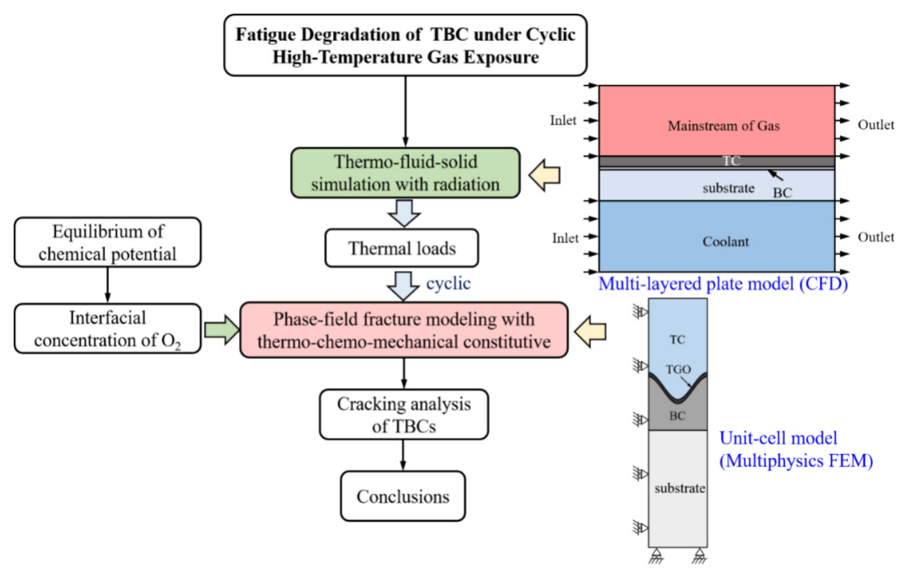

**Fig. 1.** Flowchart of TBC failure simulation considering fatigue effects under cyclic gas exposure conditions.

The finite element model of the TBC, shown in Fig. 2(a) includes four layers: TC, TGO, BC, and substrate. The TC, BC, and substrate are 200 µm, 100 µm, and 3 mm thick, respectively, with an initial 1 µm TGO layer that grows over time. Sinusoidal interfaces at TC/TGO and TGO/BC mimic coating roughness. The left boundary is fixed in the x-direction, and the bottom in the y-direction, with periodic boundaries applied laterally to ensure structural continuity. The TC surface is subjected to a high-temperature Dirichlet condition, while the bottom of the substrate is maintained at a prescribed cooling temperature. Heat conduction determines the temperature distribution. Material properties for mechanics, heat, and TGO growth are listed in Tables 1–3. All layers are modeled as elastic, homogeneous, and isotropic.

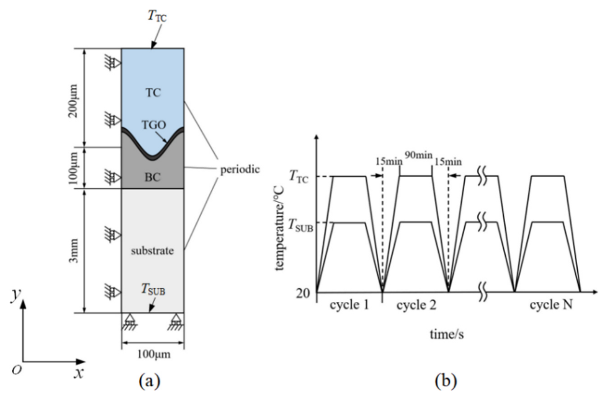

**Fig. 2.** (a) Sketch of the FE model, and (b) cyclic thermal loading imposed on the TBC boundary.

**Table 1.** Mechanical properties for TBC [49].

| Material | $E$ (GPa) | $\nu$ | $f_t$ (MPa) | $b_0$ (m) |
|---|---:|---:|---:|---:|
| TC | 30 | 0.12 | 380 | 1.2e-6 |
| TGO | 320 | 0.25 | 900 | 1.2e-6 |
| BC | 110 | 0.33 | 600 | 1.2e-6 |
| Substrate | 160 | 0.33 | \ | \ |

**Table 2.** Material properties for heat conduction of TBC [46].

| Material | $\rho$ (kg/m³) | $\kappa$ (W/(m·K)) | $C_p$ (J/(kg·K)) | $\alpha^{exp}$ (×10-6/K) |
|---|---:|---:|---:|---:|
| TC | 5650 | 1.16 | 450 | 9.8 |
| TGO | 3978 | 4.4 | 1000 | 9.2 |
| BC | 7320 | 14.5 | 780 | 14 |
| Substrate | 8110 | 26 | 680 | 15 |

**Table 3.** Material properties for TGO growth of TBC [53,57].

| Properties | Values |
|---|---:|
| $D_{0}$ (m²/s) | 5.1e-9 |
| $c_{\max}$ (mol/m³) | 1.11e5 |
| $\varepsilon_0^g$ | 0.003 |

We conducted a time step sensitivity analysis using step sizes of 100 s, 450 s, and 900 s. The results showed that the crack morphology, initiation time, and other key outputs remained highly consistent across these settings, confirming the reliability of the simulation outcomes. Considering the balance between computational efficiency and file size, a uniform time step of 450 s was adopted for all simulations.

It is worth noting that, similar to previous studies [47–49,51,58], all material parameters used in this work are treated as constants, and creep effect is neglected. Although this simplification neglects the variations in material properties caused by factors such as high-temperature sintering, the focus of this study is on the thermo-chemo-mechanical coupling effects and phase-field calculations in the TBC system. Therefore, the use of constant material parameters does not affect the validity of the conclusions drawn in this work.

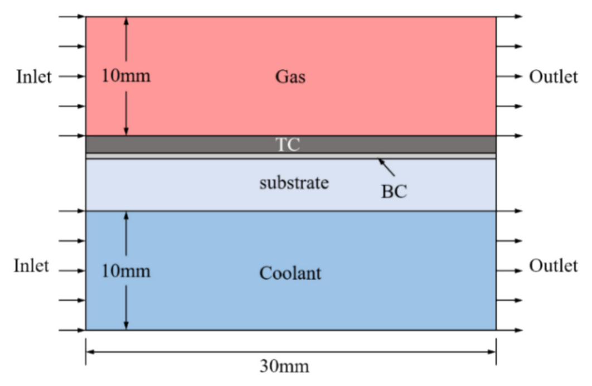

**Fig. 3.** Conjugated heat transfer model for CFD calculation.

Fig. 2(b) presents the temperature history of the TC surface and BC bottom, obtained from CFD simulations of gas flow. The simulation details are provided in [57], with radiative effects incorporated via the P-1 model [59]. The CFD model is illustrated in Fig. 3. Both boundary temperatures rise to the service temperature within 15 min, followed by a 90-minute hold, then cool to 20 °C—completing one thermal cycle. Assuming layered segment crack formation as the failure criterion, a maximum of 1,000 cycles is set for TBC failure.

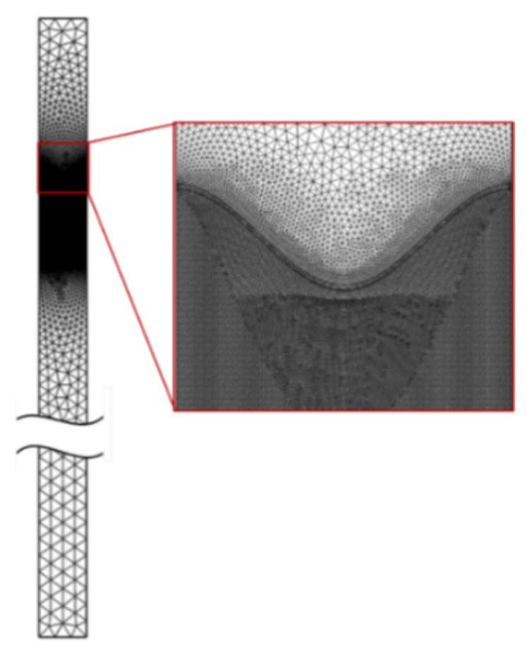

**Fig. 4.** Meshes of the TBC model.

Mesh refinements are applied to the BC layer and the region around the TC/TGO interface. As shown in Fig. 4, a total number of 107,390 triangular elements are generated in this work, the maximum element size was set to 0.4 µm, which is small enough to accurately capture the initiation and propagation of cracks during TGO growth.

## 4. Result and discussion

### 4.1. TGO growth and evolution of stress and damage

In this section, two types of cracks are considered: ideal cracks and diffusion-affecting cracks. The ideal crack assumes no influence on the diffusion process, whereas the realistic crack accounts for the impact of cracks on diffusion. As for the heat conduction process, due to the dominant effect of thermal radiation, the influence of cracks on heat transfer is considered negligible.

#### 4.1.1. TBC containing ideal cracks

In this section, boundary input temperatures for the TBC were obtained from CFD calculations using fluid parameters in Table 4. The model from Section 2 was used to simulate crack evolution and stress distribution during TGO growth under thermal fatigue. The results were subsequently validated.

The boundary oxygen concentration is determined by chemical potential equilibrium. Fig. 5(a) shows TGO thickness evolution with thermal cycles, following an approximate power-law trend. The BC layer gradually transforms into TGO, with faster oxidation at the TBC peaks than at the valleys. This thickness difference increases with more thermal cycles.

**Table 4.** Parameters and values (or schemes) of gas and coolant.

| Factors | Variable | value |
|---|---|---:|
| Gas | Temperature (K) | 1573 |
| Gas | Velocity (m/s) | 125 |
| Gas | Radiation | P-1 model |
| Gas | Pressure (atm) | 15 |
| Coolant | Temperature (K) | 1000 |
| Coolant | Velocity (m/s) | 106 |

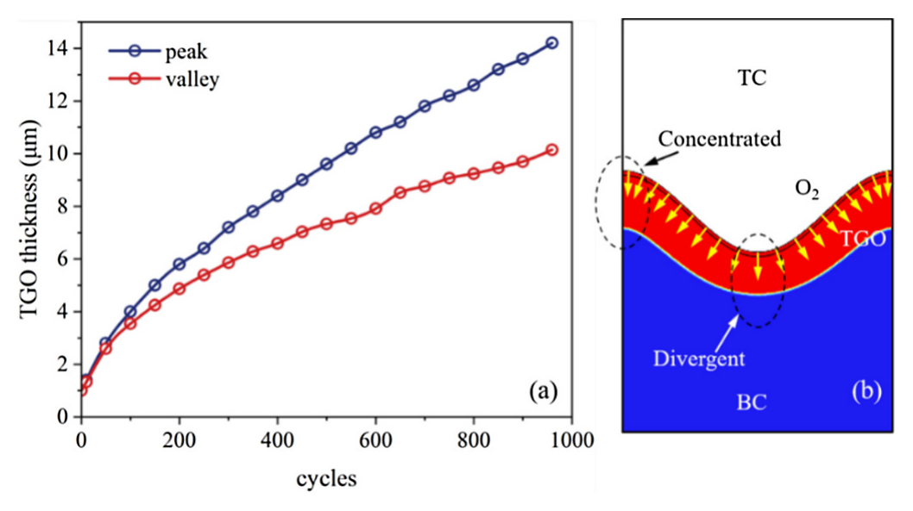

**Fig. 5.** (a) TGO thickness at the peak and valley location versus thermal cycle number; (b) uneven TGO thickness induced by diffusion direction of oxygen.

Fig. 5(b) explains the non-uniform TGO thickness. The convex morphology at wave peaks directs oxygen diffusion inward, maintaining high concentration and accelerating BC oxidation. In contrast, concave troughs promote lateral diffusion along the TC/TGO interface, limiting oxygen supply and resulting in slower oxidation and thinner TGO. Additionally, tensile stress at peak enhances oxygen diffusion and reaction rates, while compressive stress at valleys hinders both, further amplifying the TGO thickness difference between peaks and valleys.

To better describe the process of TBC crack propagation, the four fracture modes classified by Echler et al. [60] are introduced. For APS-TBC, the fracture patterns near the TGO layer are illustrated in Fig. 6, which are characterized by: 1) TC/TGO interface valley cracks (Type A): Cracks that appear in the valley region of the TC/TGO interface. 2) TGO interior cracks (Type B): Cracks located within the TGO layer. 3) TGO/BC interface peak cracks (Type C): Cracks present in the TGO/BC interfacial peak region. 4) Penetrating cracks (Type D): Cracks originating within the TGO layer and subsequently penetrating the TC layer.

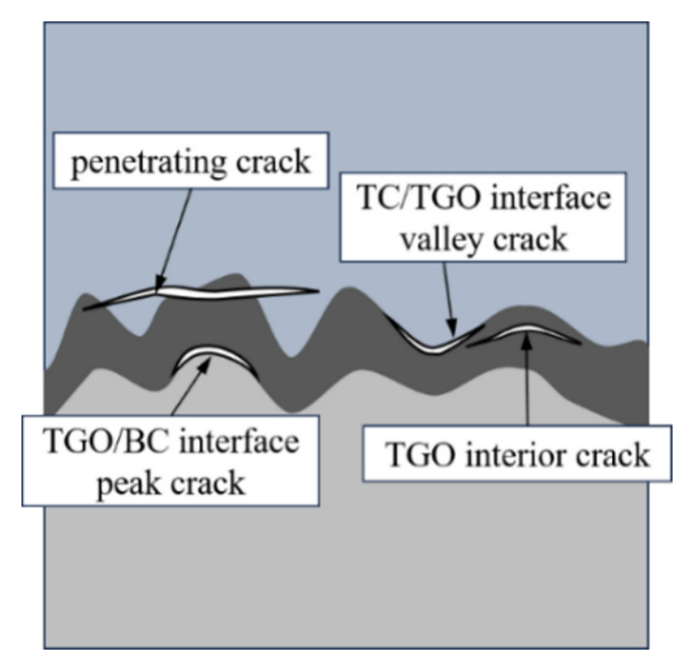

**Fig. 6.** Schematic illustration of various types of cracks in the APS-TBC system.

Since the formation of penetrating cracks is influenced by factors such as interface wave amplitude, it is not emphasized here. In the following section, we will analyze the first three types of cracks, focusing on their formation mechanisms and interactions.

Fig. 7 shows the evolution of maximum principal stress $(\sigma_{1})$ and related cracks during TBC oxidation. Unlike intact TBCs, $\sigma_{1}$ does not follow a clear trend with increasing cycles due to damage accumulation, crack initiation, and propagation, which release strain energy and cause stress redistribution. Initially, stress distribution matches conventional findings, concentrating at TC/TGO valleys and off-peak/off-valley regions of the TGO/BC interface during high temperatures (Fig. 7(a)). By cycle 132, a crack forms at the TC/TGO interface, releasing strain energy and rebalancing stress in the TC layer (Fig. 7(c)), consistent with common valley cracks shown in Fig. 8(a).

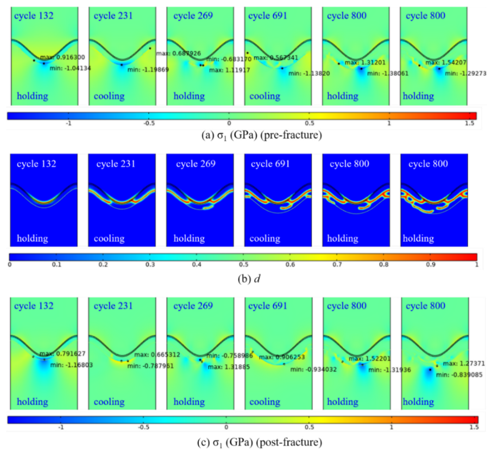

**Fig. 7.** Evolution of maximum principal stress and phase-field variable d: (a) the first principal stress σ1 before cracks initiation; (b) phase-field cracks; (c) the first principal stress σ1 after cracks initiation.

As the number of thermal cycles increases, the coating system exhibits progressive failure characteristics. At 232 cycles, cracks initiate at the TGO/BC interface peaks, and by 231 cycles, they connect with pre-existing cracks at the TC/TGO interface, leading to the first failure event. During the subsequent cycles (269–691 cycles), TGO thickening induces lateral short cracks and secondary layered cracking, ultimately resulting in segmented delamination at 800 cycles. The mechanism of interface crack initiation shows spatiotemporal differences. TC/TGO valley cracks mainly form during the holding stage, dominated by thermal mismatch and material fatigue, while TGO/BC peak cracks develop during the cooling stage, driven by thermal mismatch and phase transformation.

Experimental observations (Fig. 8(a)-(d)) confirm the validity of the theoretical model and numerical result (Fig. 8(e)-(g)), providing a comprehensive depiction of the four-stage evolution process: interface cracking, crack penetration, layered cracking, and segmented delamination.

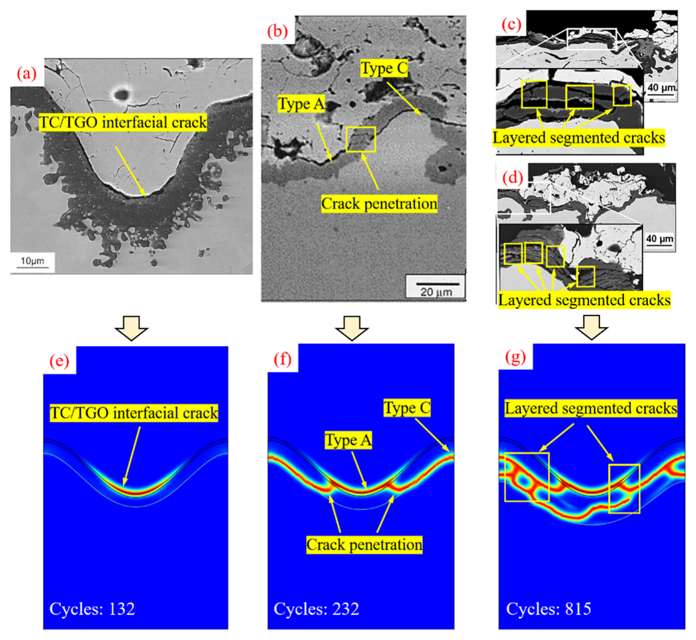

**Fig. 8.** A comparison between simulation results and SEM-observed crack morphologies in APS-TBCs under thermal cycling [60–62] is shown: (a) experimentally observed interface crack; (b) experimentally observed penetrating cracks; (c) and (d) experimentally observed layered segmented cracks; (e) simu

Monitoring points were set to analyze the phase-field variable evolution at specific TBC locations. As shown in Fig. 9(a), damage first appears at point C, then at A and B with increasing cycles. Due to the high number of cycles and long duration, capturing finer crack evolution details would greatly increase computational cost and storage. Thus, a coarser time interval was used to capture the overall mechanical property evolution during cycling.

Fig. 9(b) shows that damage accumulates slowly during early crack nucleation, but accelerates rapidly once the damage value reaches 0.08. The slope indicates that crack growth at point B is slower than at points C and A. This is likely due to the relatively intact structure at point B in the early stages, allowing more strain energy to build up before crack initiation. By the time cracking begins at point B, cracks at C and A have already penetrated, causing the first coating spallation. Following this, the reduced strain energy slows crack evolution at point B.

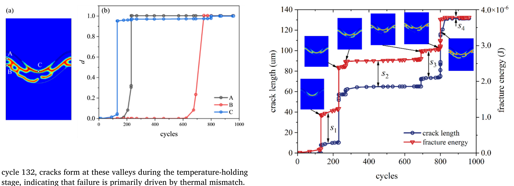

**Fig. 9.** Evolution of phase-field variable at locations A, B, and C.

Fig. 10 shows the evolution of total crack length and fracture energy during thermal cycling, both exhibiting consistent, cumulative growth with increasing cycles. This highlights the irreversibility of crack formation and energy release, as well as their strong correlation.

During each crack nucleation and propagation event, crack length and fracture energy rise sharply, followed by slower growth until the next nucleation. This indicates that after a major energy release, instability remains, promoting further cracking. In later stages, damage accumulation causes only minor elastic energy release. Notably, fracture energy does not scale proportionally with crack length during major propagation events. This is due to two factors: (1) early cracking causes delamination, reducing strain energy; and (2) phase-field fatigue parameters introduce added material degradation under cycling. As shown in Fig. 10, the decreasing gap between the curves $(s_1 > s_2, s_3 > s_4)$ reflects the nonlinear relationship between crack length and fracture energy.

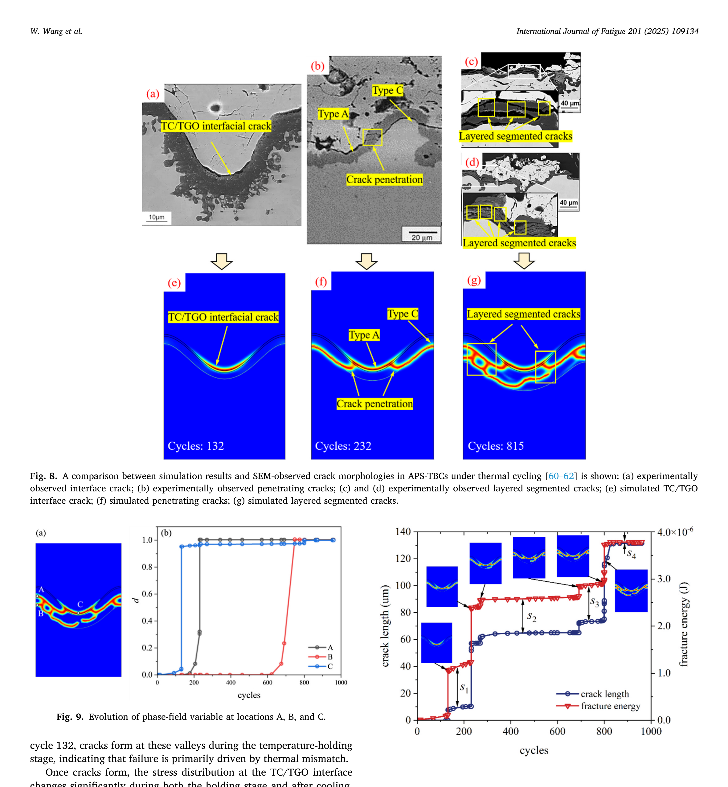

**Fig. 10.** Variation of fracture energy and crack length with cycles.

Crack initiation and propagation significantly impact stress distribution in TBC. As shown in Fig. 11, before cracking, the temperature-holding stage induces high tensile stress at the TC/TGO interface valley, with compressive stress elsewhere. After cooling, the overall stress pattern remains, but the tensile stress at the valleys drops notably. At cycle 132, cracks form at these valleys during the temperature-holding stage, indicating that failure is primarily driven by thermal mismatch.

Once cracks form, the stress distribution at the TC/TGO interface changes significantly during both the holding stage and after cooling. Stress at the crack regions drops to zero, indicating no load-bearing, while stress increases sharply near the cracks, showing tensile effects typical of crack tips and stress concentration. As thermal cycling progresses, out-of-plane stress remains nearly constant during both stages, with slight stress variations observed at the left crack tip after cooling. These differences result from additional cracks forming in the off-peak regions of the TGO/BC interface during later oxidation stages, altering the residual stress at the TC/TGO interface.

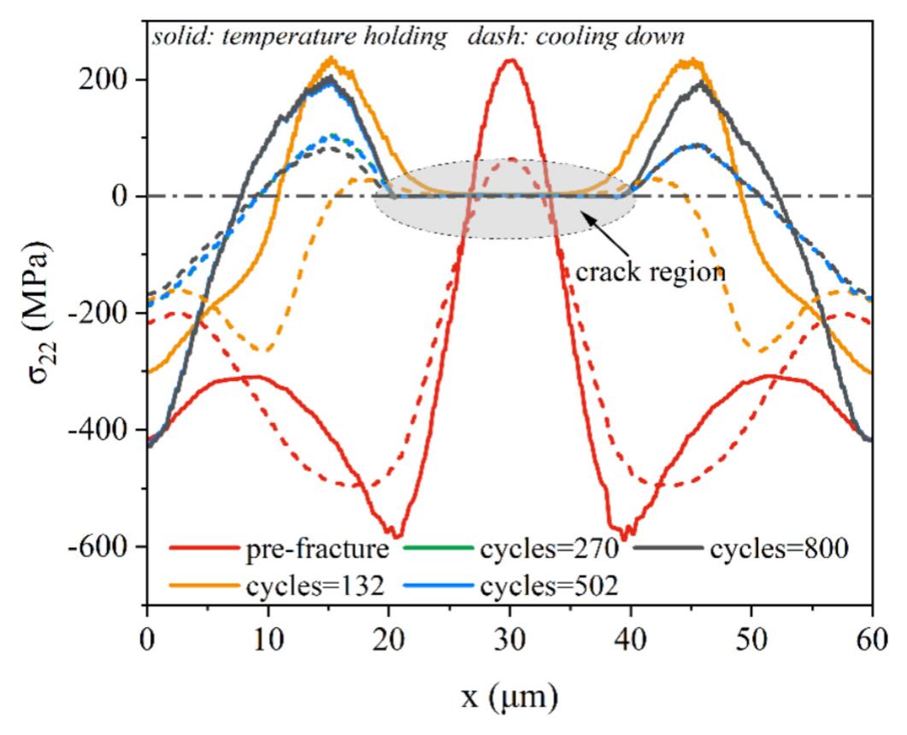

**Fig. 11.** σ22 distribution along the TC/TGO interface.

#### 4.1.2. Cracks affecting diffusion process

To account for the influence of cracks on the diffusion process, an auxiliary parameter is introduced [63].

$$ D = D_0(1 + k_d(d - d_{th})) \qquad (56) $$

where $k_d = 4.737 \times 10^8$ is an amplification factor calibrated using the diffusion coefficient of oxygen in the air. Specifically, the calibration is performed by setting the corrected diffusion coefficient equal to that of oxygen in air once cracks have formed. A damage threshold of $d_{th} = 0.8$ is used [63].

Eq. (56) characterizes the mechanism by which cracks influence the diffusion process. When the phase-field variable is below 0.8, the material is considered to be in the damage evolution stage, and diffusion remains largely similar to that in the undamaged state. Once the phase-field variable exceeds 0.8, cracks begin to form rapidly and start to significantly affect the diffusion behavior. When the phase-field variable reaches 1, indicating a fully developed crack, the diffusion rate of oxygen within the crack is approximately equal to that in air.

Fig. 12 illustrates the TGO growth process under diffusion conditions that account for the influence of cracks. Compared with Fig. 5(a), it can be observed that the TGO growth behavior in the valley regions shows relatively minor changes, whereas significant alterations occur at the peak regions. Specifically, under the influence of cracks, the TGO at the peak regions grows at a faster rate, resulting in a substantially increased final thickness. Moreover, each major crack formation event induces a re-emergence of the staged secondary parabolic growth behavior at the peaks. This phenomenon arises because the formation of cracks alters the existing oxygen diffusion pathways, leading to renewed gas-solid interfacial diffusion along the crack surfaces.

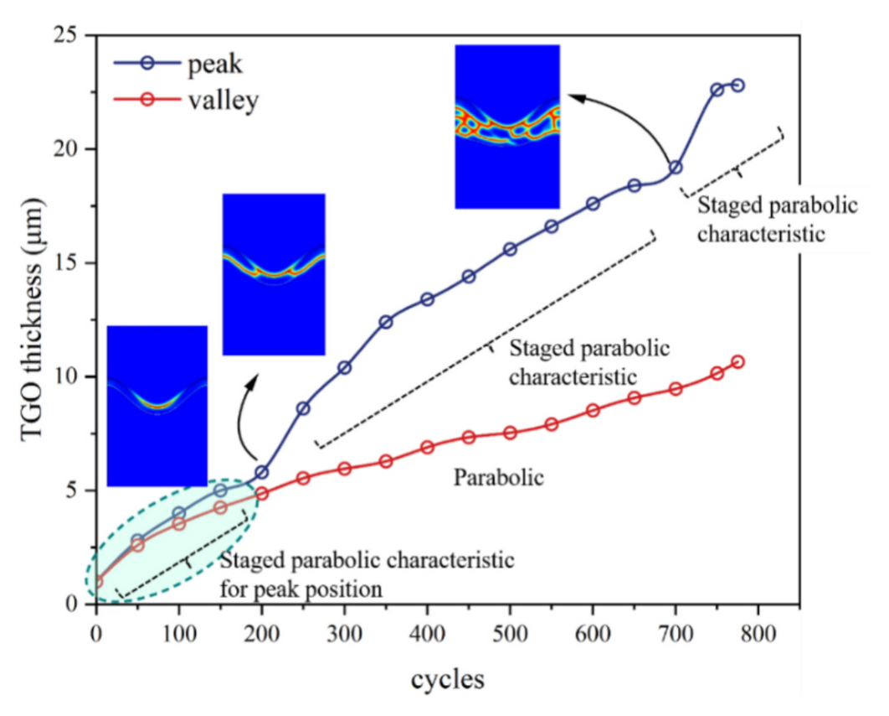

**Fig. 12.** TGO growth at peak and valley position considering the effect of cracks on diffusion.

The coupled diffusion-reaction and crack propagation processes in the TBC system are illustrated in Fig. 13. When no cracks are present in the TGO and BC layers, oxygen diffusion and TGO growth behavior remain consistent with the case that neglects crack-diffusion interactions. However, once cracks form near the TGO/BC interface, the chemo-mechanical-crack coupling behavior of the TBC system is significantly altered. As shown in Fig. 13(a), each crack formation event substantially enhances oxygen transport and accelerates the oxidation process, leading to the development of a non-uniform TGO growth morphology (Fig. 13(b)). This undulating oxidation front further complicates the stress distribution along the TGO/BC interface and ultimately results in more pronounced segmented interfacial cracking (Fig. 13(c)). In fact, when the effect of cracks on diffusion is considered, such segmented cracks tend to occur at earlier stages.

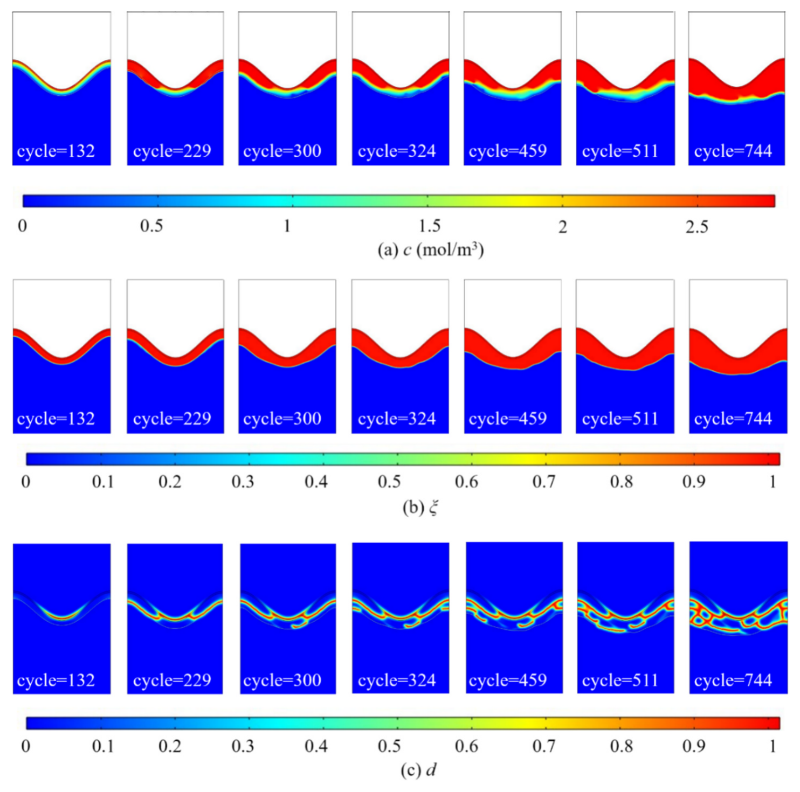

**Fig. 13.** Evolution of oxygen concentration, TGO thickness, and crack morphology.

As shown in Fig. 14, the crack length increases significantly, accompanied by a corresponding rise in the energy release rate. Throughout the process, a total of seven distinct crack propagation events occur, which is greater than the five events observed in Fig. 10.

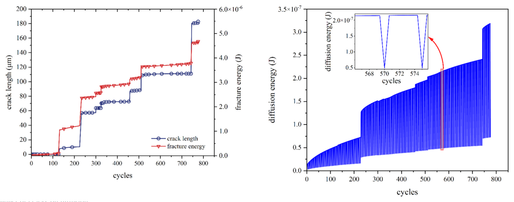

**Fig. 14.** Evolution of crack length and fracture energy when considering the effect of cracks on diffusion.

Fig. 15 shows the variation of diffusion energy during the crack evolution process. It can be observed that the diffusion energy exhibits a pronounced cyclic variation characteristic corresponding to thermal fatigue. After crack formation, the diffusion energy sharply increases, clearly reflecting the enhanced mass transport effect within the crack regions, which is intuitively manifested as an increase in the number of oxygen diffusion pathways.

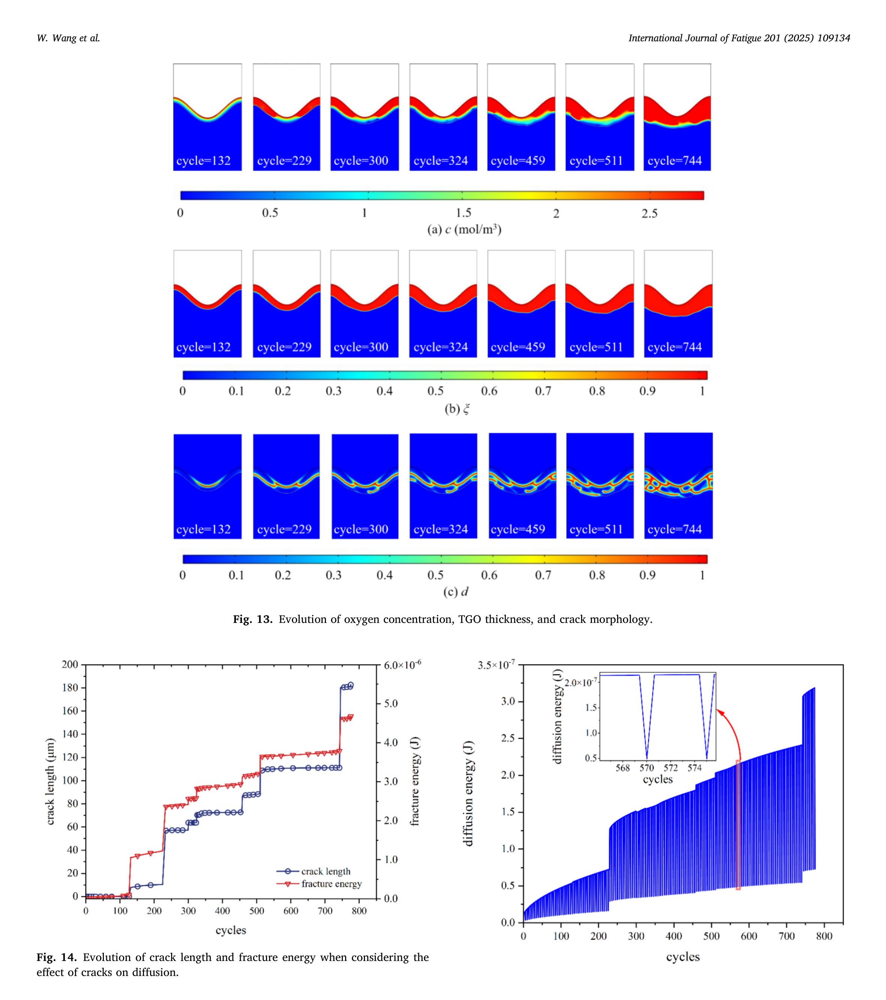

**Fig. 15.** Evolution of diffusion energy under the influence of cracks on diffusion.

It is worth noting that due to the high service temperature of the TBC, thermal radiation plays a significant role in the heat transfer process, resulting in negligible temperature differences between adjacent crack surfaces. Considering this, the present study does not incorporate the influence of cracks on heat transfer, nor does it analyze variations in thermal energy density.

For the purpose of simplifying analysis, the following study focuses on the crack propagation process while neglecting its influence on the diffusion process.

### 4.2. The effect of fatigue damage accumulation rate

The parameter $k$ in the phase-field model controls fatigue damage accumulation. A higher $k$ accelerates damage accumulation, leading to premature failure. While previous studies on TBC thermal cycling haven't fully addressed thermally induced fatigue degradation, in service, periodic temperature variations cause thermal expansion and contraction within the TBC, leading to stress fluctuations. These fluctuations result in grain boundary sliding, microcrack formation, and propagation, contributing to fatigue degradation. This weakens the material, reducing strength, toughness, and ductility, accelerating crack growth, and shortening the TBC's fatigue life. To assess this effect, this section compares TBC crack propagation models with and without fatigue degradation, highlighting the advantages of the proposed approach. Four scenarios were modeled with $k$ values of 2, 7, 12, and a degradation-free case, maintaining consistency with the conditions in Table 4 for other parameters.

Fig. 16 shows the effect of the fatigue damage accumulation coefficient ($k$) on crack propagation and residual stress evolution in TBC after thermal cycling. As $k$ increases, crack density and structural damage severity rise. For $k = 2$, crack morphology aligns with the non-degraded case, indicating fatigue mechanisms don't dominate at low $k$. For $k \ge 7$, phase-field fatigue degradation causes cracks to propagate along the TGO/BC interface ($k = 7$) or penetrate the TGO layer ($k = 12$), leading to interfacial spallation and multi-crack propagation. Notably, in the case of $k = 12$, the coalescence of cracks c1 and c2 at the 'Junction' illustrates a crack path transition driven by cumulative fatigue damage. At high $k$ values, crack interactions, such as stress shielding and energy competition, dominate over interface-governed mechanisms, resulting in the redirection of propagation paths.

Residual stress distribution shows that stresses in the TC layer concentrate at the TC/TGO interface valley, with magnitudes (max $\sigma_{\text{TC}} \approx 0.243-0.246$ GPa) largely unaffected by $k$, indicating minimal impact of TGO/BC crack propagation on TC stress. In contrast, the maximum principal stress at the TGO/BC interface ($\sigma_{1\text{TGO/BC}}$) correlates strongly with crack propagation modes. At $k = 7$, interfacial crack growth reduces $\sigma_{1\text{TGO/BC}}$ to 0.114 GPa by releasing strain energy at the oxidation front. However, at $k = 12$, crack penetration into the TGO traps strain energy, resulting in a smaller stress reduction ($\sigma_{1\text{TGO/BC}}$ remains at 0.606 GPa). This highlights how crack paths control strain energy release, affecting interfacial stress relaxation. Additionally, intensified layered cracks degrade structural integrity, making delamination more likely at higher $k$ values.

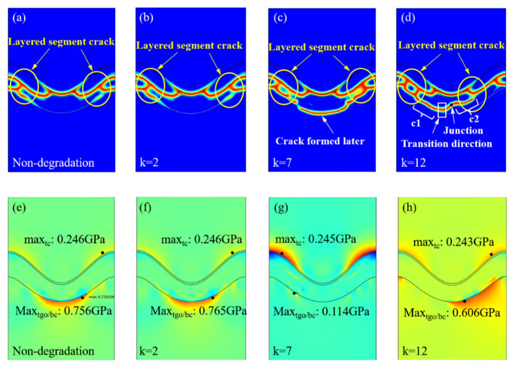

**Fig. 16.** The distributions of crack and the residual first principal stress after 2000 thermal cycles under different values of phase-field parameter k.

These phenomena reveal two mechanisms of fatigue degradation. First, higher $k$ lowers resistance to crack propagation, accelerating damage. Second, the crack mode (interfacial delamination vs. internal penetration) redistributes strain energy, alters the stress field, and shifts failure from single-interface to multi-crack cooperative damage. This insight supports strategies to enhance TBC fatigue resistance, such as adjusting interface toughness or limiting layered segmentation.

### 4.3. Analysis of crack initiation and propagation mechanisms considering fatigue effect

Fig. 17 illustrates the crack initiation process under thermal cycling conditions incorporating the fatigue degradation effects. The concept of cohesive strength limit ($\sigma_0$) is introduced as an important criterion for describing the material's degradation behavior, expressed as

$$ \sigma_0 = \begin{cases} \sqrt{\frac{4EG_c}{c_0 b_0 a_1}}, & \text{without fatigue degradation} \\ \sqrt{\frac{4Ef(\bar{a})G_c}{c_0 b_0 a_1}}, & \text{with fatigue degradation} \end{cases} \qquad (57) $$

When thermal fatigue degradation effects are disregarded, the cohesive strength threshold remains constant, with crack initiation arising exclusively from the progressive accumulation of stress and damage induced by TGO growth. In contrast, consideration of thermal fatigue degradation leads to a marked reduction in effective fracture toughness ($f(\bar{a}) G_c$), thereby lowering the critical threshold for crack nucleation, as shown in Fig. 17. More pronounced the fatigue degradation effect, the faster the cohesive strength limit declines and the earlier formation of cracks.

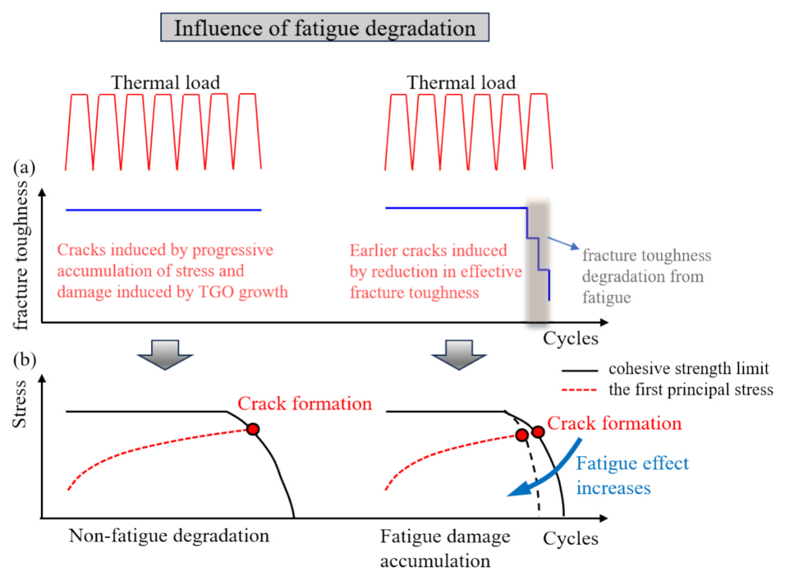

**Fig. 17.** Schematic of crack initiation mechanisms in TBC considering thermally cycled fatigue degradation.

It is worth noting that this study does not explore the effects of stress ratio and fatigue limit in depth, primarily for the following reasons. First, as a thin-film system, TBCs lack sufficient experimental studies on the influence of stress ratio on fatigue life, and the current understanding of whether and how stress ratio affects fatigue mechanisms remains limited. Second, in engine applications, the thermal cycling life of general APS-TBC is far below $10^7$ cycles, rendering the consideration of a fatigue limit less relevant in this context. Nevertheless, compared with previous studies in the TBC field, the proposed thermo-chemomechanical coupled phase-field fatigue model still captures key fatigue-related damage behaviors, such as segmented interfacial cracking and premature failure induced by fatigue degradation, and is capable of reproducing observed fatigue failure modes.

## 5. Conclusion

This study is the first to develop a thermo-chemomechanical coupled phase-field fracture model incorporating fatigue degradation for thermal barrier coatings (TBC). The thermal loads obtained from computational fluid dynamics (CFD) are applied to the finite element (FE) model to assess TBC fatigue degradation and fracture under cyclic gas exposure. Additionally, the impact of the fatigue damage accumulation rate (parameter $k$) on fracture behavior is analyzed. The main findings are as follows:

(1) The novel model incorporates TBC fatigue degradation, effectively simulating crack initiation and evolution, and reproducing the layered segmentation cracking near the thermally grown oxide (TGO) observed in real coatings. Compared to models without fatigue degradation, it captures material deterioration, accelerates crack formation, and intensifies layered segmentation cracking. Moreover, when the influence of cracks on diffusion is taken into account, the oxygen diffusion characteristics change significantly, leading to faster TGO growth and more pronounced layered segmentation cracking.

(2) The introduction of the phase-field fatigue parameter results in additional material degradation, and the continued crack propagation further limits the accumulation of fracture energy. Consequently, the energy release and the increment in crack length no longer maintain a specific proportional relationship.

(3) The material parameter $k$, which governs the rate of fatigue damage accumulation, plays a crucial role in the fatigue degradation of TBC. This study specifically investigates how varying $k$ values influence crack evolution. When $k \le 2$, the simulation results align closely with those of models excluding fatigue degradation. However, for $k > 2$, fatigue effects become increasingly evident due to the combined influence of material degradation, stress state redistribution, and damage accumulation mechanisms.

(4) When thermal fatigue degradation is considered, the effective fracture toughness ($f(\bar{a}) G_c$) decreases significantly during TGO growth, thereby lowering the critical threshold for crack nucleation. The more pronounced the fatigue degradation effect, the faster the decline in cohesive strength limit, leading to earlier crack formation.

## CRediT authorship contribution statement

**Weidong Wang:** Writing – review & editing, Writing – original draft, Visualization, Validation, Software, Methodology, Investigation, Data curation. **Biao Li:** Writing – review & editing, Supervision, Project administration, Methodology, Funding acquisition, Data curation. **Baishun Yang:** Visualization, Software, Investigation. **Yazhi Li:** Supervision, Project administration.

## Declaration of competing interest

The authors declare that they have no known competing financial interests or personal relationships that could have appeared to influence the work reported in this paper.

## Acknowledgments

This work was supported by the National Natural Science Foundation of China (12072272); the National Science and Technology Major Project (J2019-I-0016-0015); the Science and Technology on Scramjet Laboratory Project of China (2022-XXXX-LB-020-04).

## Appendix A

The validation of the CFD model, as well as the oxidation kinetics combining diffusion and reaction, has been thoroughly discussed in our previous work. For further details, please refer to Ref. [57].

Herein, several classic numerical examples, involving quasi-static and fatigue, are employed to verify the correctness of the fatigue phase-field implementation.

(1) Quenching test of ceramic plate  
The FE model used for quenching test has a dimension of 50 mm × 10 mm × 1 mm. The ceramic plate was initially heated to 300°C and then cooled to 20°C by thermal shock. Ten minutes later, the ceramic plate was removed from the cooling environment. The fracture of the specimen is shown in Fig. A1(a).

The quick brown fox jumps over the lazy dog.

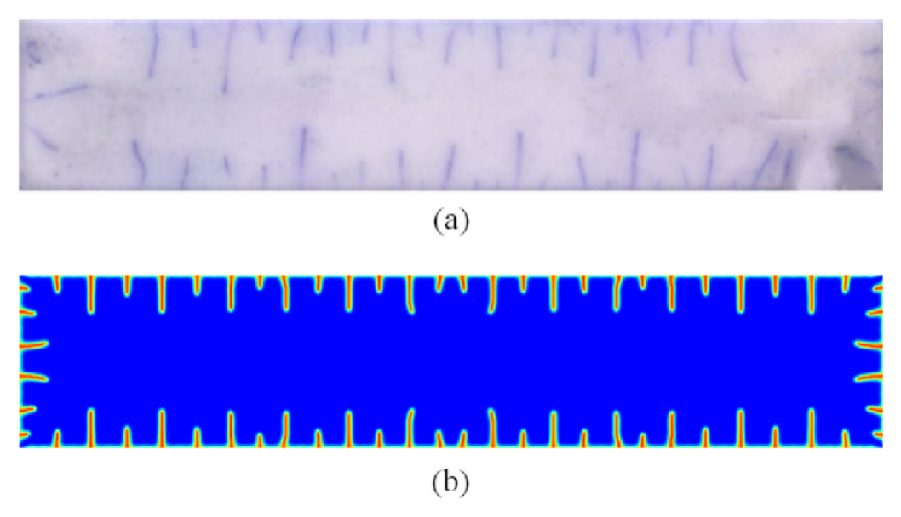

**Fig. A1.** Comparison of the results between (a) the experimental result for quenching test of a heated ceramic plate [55], and (b) numerical prediction.

The material properties are $\rho = 3980$ kg/m³, $E_0 = 370$ GPa, $\nu_0 = 0.3$, $f_t = 180$ MPa, $G_c = 42.47$ J/m², $\alpha^{exp} = 7.5\times 10^{-6}$ K⁻¹. The plane stress assumption is adopted in the simulation. The simulation result is shown in Fig. A1(b). It could be observed that the numerical model can capture the underlying pattern of experimental results.

(2) Mixed-mode fracture of a PMMA plate  
The PMMA plate model was reported by Pham et al. [64], and the further detailed geometric parameters of the model can be found in [55]. In the simulation, the following mechanical properties are adopted: $E_0 = 2.98\times 10^3$ MPa, $\nu_0 = 0.35$, $f_t = 50$ MPa, $G_c = 0.285$ J/mm. After taking the weak form of phase-field into COMSOL Multiphysics, the numerical result was arrived, as shown in Fig. A2(a). Comparison between the predicted result and experimental result (Fig. A2(b)) indicates that the fracture pattern from the numerical model matches the experimental result well.

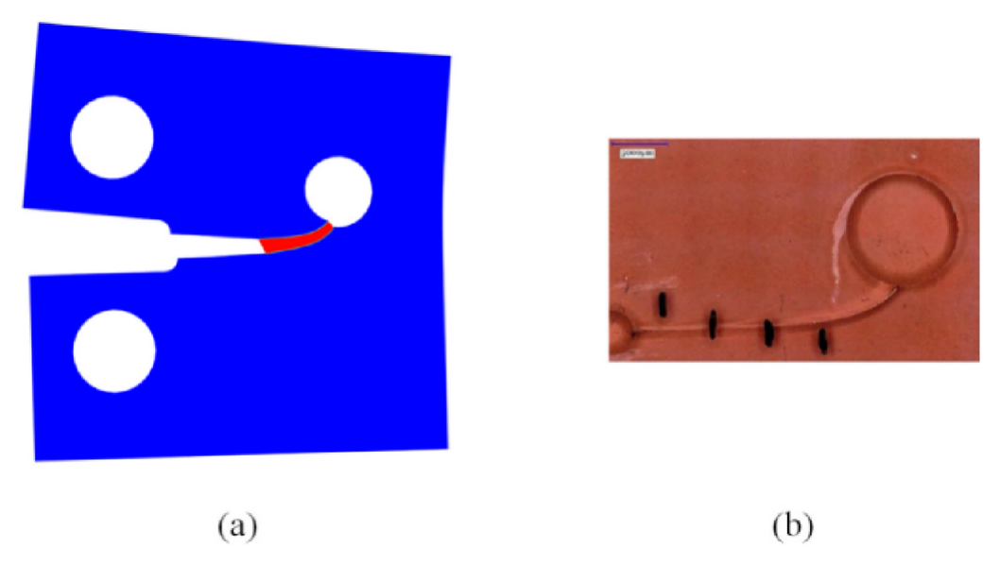

**Fig. A2.** Comparison between (a) numerical result and (b) experimentally observed crack path in Ref. [55].

(3) Monotonic and cyclic loading of three-point bending  
Three loading scenarios of three-point bending tests (Fig. A3) from Refs. [56,65] are selected to validate the fatigue phase field model. A systematic summarization of these loading conditions is listed in Table A1. The first loading scenario (LS1) displays a monotonic increase in crack tip opening displacement (CTOD). The second loading scenario (LS2) presents a cyclically increased load controlled by CTOD. The third loading scenario (LS3) involves 100 cycles controlled by the applied force, where every 10 cycles constitute one load level. The strength of the specimen is set as 18.65 MPa. The first load level started at $S^{\max} = 0.50$, and the increment remains $\Delta S = 0.05$ until the tenth load level.

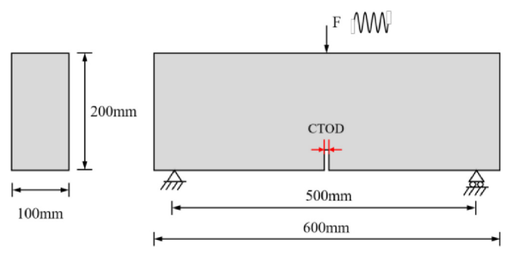

**Fig. A3.** Geometry of the specimen with a notch in three-point bending test.

**Table A1.** Description of the loading scenarios used in the phase-field simulation.

| Loading scenario | Description | Loading rate/frequency | Figure |
|---|---|---|---:|
| LS1 | Monotonic loading | 1.0 mm/min | CTOD–time |
| LS2 | Cyclic loading | 1.0 mm/min | CTOD–time |
| LS3 | Cyclic step-wise increased loading with 10 cycles at each level. | 0.05 Hz | F–N |

Fig. A4(a) and (b) show the results under LS1 and LS2. The numerical results under monotonic and cyclic loading match the experimental data well. Fatigue degradation lowers the post-cycle load-bearing capacity compared to monotonic loading, unlike the model without degradation (dashed line). Fig. A4(c) displays the failure process with fatigue degradation—after 5 cycles, the concrete beam nearly loses all load-bearing capacity, consistent with experimental results.

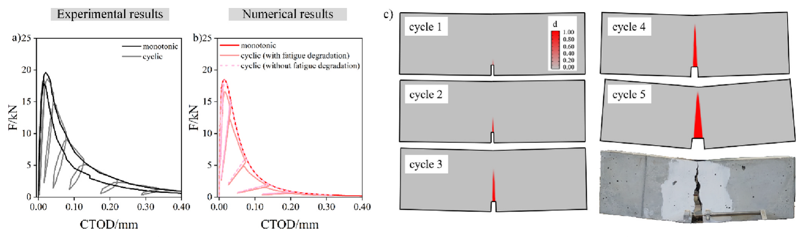

**Fig. A4.** Comparison between experimental results [65] and numerical results under LS1 and LS2.

LS3 represents a more complex cyclic loading condition. The specimen experiences 86 cycles before failure (Fig. A5(a)), while the fatigue phase-field model predicts 81 cycles (Fig. A5(d)), which is acceptable. The fatigue creep curves for upper and lower load levels are shown in Fig. A5(b) and (e), with corresponding stiffness degradation observed in both figures.

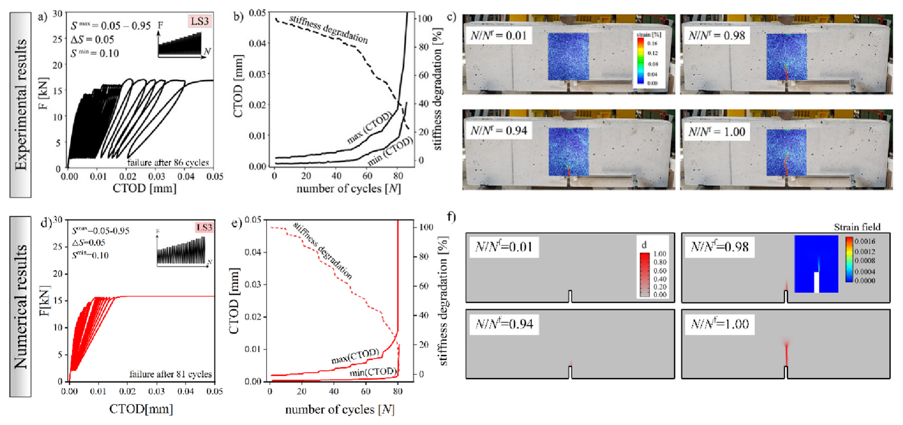

**Fig. A5.** Comparison of the experimental results [56] and numerical results under LS3.

Fig. A5(c) and (f) compare the failure process from experiments and simulations. Both results show that the fatigue crack appears later (around 94% of fatigue life) before failure. The fracture strength is lower than monotonic strength due to fatigue-induced material deterioration. The longitudinal strain field from the numerical simulation aligns well with the experimental results.

## Data availability

Data will be made available on request.

## References

[1] Li L, Zhang W. Thickness effects on the delamination energy release rate of thermal barrier coating subjected to thermo-mechanical loads. Int J Solids Struct 2022; 254–255:111937.

[2] Pi YH, Park JS. Effect of the thermal barrier coating set up and modeling in numerical analysis for prediction gas turbine blade temperature and film cooling effectiveness. Int Commun Heat Mass Transfer 2025;164:108860.

[3] He H, Zhang X. Local high temperature phenomena near the complex interfaces of thermal barrier coatings based on non-Fourier model. Int Commun Heat Mass Transfer 2024;159:107940.

[4] Fartash AH, Poursaeidi E. Thermal analysis of thermal barrier coating systems under transient and time harmonic thermal loads. Appl Therm Eng 2022;208: 118225.

[5] Ebrahimi H, Nakhodchi S. Thermal fatigue testing and simulation of an APS TBC system in presence of a constant bending load. Int J Fatigue 2017;96:1–9.

[6] Moverare J, Lancaster RJ, Jones J, Stekovic S, Whittaker MT. A review of recent advances in the understanding of thermomechanical fatigue durability and failure mechanisms in nickel-based superalloys. Metall Mater Trans A 2025;56:1115–34.

[7] Grilli ML, Valerini D, Slobozeanu AE, Postolnyi BO, Balos S, Rizzo A, et al. Critical raw materials saving by protective coatings under extreme conditions: a review of last trends in alloys and coatings for aerospace engine applications. Materials 2021; 14:1656.

[8] Krishnasamy J, Ponnusami SA, Turteltaub S, van der Zwaag S. Thermal cyclic behavior and lifetime prediction of self-healing thermal barrier coatings. Int J Solids Struct 2021;222–223:111034.

[9] Kim D, Park K, Kim K, Seok C-S, Lee J, Kim K. A method for predicting the delamination life of thermal barrier coatings under thermal gradient mechanical fatigue condition considering degradation characteristics. Int J Fatigue 2021;151: 106402.

[10] Padture NP, Gell M, Jordan EH. Thermal barrier coatings for gas-turbine engine applications. Science 2002;296:280–4.

[11] Song J, Sun B, Xing Y. Thermo-structural behavior of thermal barrier coatings for thrust chamber applications. Int Commun Heat Mass Transfer 2022;130:105776.

[12] Lim LY, Meguid SA. Thermomechanical simulations of the transient coupled effect of thermal cycling and oxidation on residual stresses in thermal barrier coatings. Ceram Int 2022;48:3133–47.

[13] Jiang P, Yang L, Sun Y, Li D, Wang T. Nondestructive measurements of residual stress in air plasma-sprayed thermal barrier coatings. J Am Ceram Soc 2021;104: 1455–64.

[14] Jiang P, Yang L, Sun Y, Li D, Wang T. Local residual stress evolution of highly irregular thermally grown oxide layer in thermal barrier coatings. Ceram Int 2021; 47:10990–5.

[15] Yao Y, Ai Y, Guan P, Tian J, Bao T, Hu X, et al. Minimum life point determination and fatigue life prediction of thermal barrier coatings based on extended stress and strain method. Int J Fatigue 2024;186:108419.

[16] Yao Y, Ai Y, Guan P, Bao T, Tian J, Hu X. Interaction effects of anisotropic roughness interface and component shape characteristics on fatigue life of thermal barrier coatings. J Am Ceram Soc 2025;108:e20380.

[17] Du J, Yu G, Xue B, Gao Q, Li J, Gao X, et al. Mechanism of stress evolution in environmental barrier coatings considering the presence of crack channels. Ceram Int 2024;50:27737–48.

[18] Chai Y, Lin C, Wang X, Li Y. Study on stress development in the phase transition layer of thermal Barrier coatings. Materials (Basel) 2016;9:773.

[19] Wei Z, Cai H, Li C. Comprehensive dynamic failure mechanism of thermal barrier coatings based on a novel crack propagation and TGO growth coupling model. Ceram Int 2018;44:22556–66.

[20] Li B, Fan X, Okada H, Wang T. Mechanisms governing the failure modes of dense vertically cracked thermal barrier coatings. Eng Fract Mech 2018;189:451–80.

[21] Li B, Shu Y, Li Y. Interface cracking behavior in high-temperature coatings with non-uniformly distributed segmentation cracks. Eur J Mech A Solids 2022;96: 104674.

[22] Li B, Yang B, Wang S, Chen J, Jiang W. Numerical study of thermomechanical delamination mechanisms in segmented high-temperature coatings. Eng Fail Anal 2023;153.

[23] Wei Z-Y, Cai H-N, Zhao S-D. Comprehensive understanding of horizontal and vertical crack effects on failure mechanism of lamellar structured thermal barrier coatings. Ceram Int 2022;48:8143–54.

[24] Yu M, Liu N, Dou R, Huang L, Sun J, Wen Z, et al. Numerical study on effects of interfacial roughness and microcracks on stress distribution in thermal barrier coatings with temperature drop. Heliyon 2024;10:e40167.

[25] Fartash AH, Lyavoli HF, Poursaeidi E, Schmauder S. Interfacial delamination of porous thermal barrier coatings based on SEM image processing in finite element model. Theor Appl Fract Mech 2023;125:103915.

[26] Song J, Qi H, Shi D, Yang X, Li S. Effect of non-uniform growth of TGO layer on cracking behaviors in thermal barrier coatings: a numerical study. Surf Coat Technol 2019;370:113–24.

[27] Zhang L, Wang Y, Fan W, Gao Y, Sun Y, Bai Y. In: Zhang L, Wang Y, Fan W, Gao Y, Sun Y, Bai Y. A simulation study on the crack propagation behavior of nanostructured thermal barrier coatings with tailored microstructure. Coatings 2020;10:722.

[28] Zhang D, Ma S, Nachtsheim J, Zhang S, Markert B. A variational phase-field framework for multiphysics modelling of degradation and stress corrosion cracking in biodegradable magnesium alloys. J Mech Phys Solids 2024;190:105694.

[29] Ruan H, Peng X-L, Yang Y, Gross D, Xu B-X. Phase-field ductile fracture simulations of thermal cracking in additive manufacturing. J Mech Phys Solids 2024;191: 105756.

[30] Kiran R, Nguyen-Thanh N, Zhou K. On the phase-field modeling of thermoelectromechanical brittle fracture in piezoceramics using an adaptive isogeometric approach. Eng Fract Mech 2024;304:110068.

[31] Noii N, Ghasabeh M, Wriggers P. Phase-field modeling of fracture for ferromagnetic materials through Maxwell’s equation. Eng Fract Mech 2024;303: 110078.

[32] Díaz A, Alegre JM, Cuesta II, Martínez-Pa˜neda E. A COMSOL framework for predicting hydrogen embrittlement, Part I: coupled hydrogen transport. Eng Fract Mech 2025;319:111007.

[33] Díaz A, Alegre JM, Cuesta II, Martínez-Pa˜neda E. A COMSOL framework for predicting hydrogen embrittlement, Part II: phase field fracture. Eng Fract Mech 2025;319:111008.

[34] Martínez-Pa˜neda E, Golahmar A, Niordson CF. A phase field formulation for hydrogen assisted cracking. Comput Methods Appl Mech Eng 2018;342:742–61.

[35] Kristensen PK, Niordson CF, Martínez-Pa˜neda E. Applications of phase field fracture in modelling hydrogen assisted failures. Theor Appl Fract Mech 2020;110: 102837.

[36] Golahmar A, Kristensen PK, Niordson CF, Martínez-Pa˜neda E. A phase field model for hydrogen-assisted fatigue. Int J Fatigue 2022;154:106521.

[37] Ma K, Zhang R, Lu C, Peng W, Zheng J. Phase field model for hydrogen-assisted fatigue crack growth considering dynamic hydrogen adsorption behavior. Theor Appl Fract Mech 2025;138:104960.

[38] Makuch M, Kovacevic S, Wenman MR, Martínez-Pa˜neda E. A nonlinear phase-field model of corrosion with charging kinetics of electric double layer. Model Simul Mater Sci Eng 2024;32:075012.

[39] Ai W, Wu B, Martínez-Pa˜neda E. A coupled phase field formulation for modelling fatigue cracking in lithium-ion battery electrode particles. J Power Sources 2022; 544:231805.

[40] Cui C, Ma R, Martínez-Pa˜neda E. Electro-chemo-mechanical phase field modeling of localized corrosion: theory and COMSOL implementation. Eng Comput 2023;39: 3877–94.

[41] Hageman T, Martínez-Pa˜neda E. A phase field-based framework for electro-chemomechanical fracture: Crack-contained electrolytes, chemical reactions and stabilisation. Comput Methods Appl Mech Eng 2023;415:116235.

[42] Noii N, Milijasevic D, Khodadadian A, Wick T. An efficient FEniCS implementation for coupling lithium-ion battery charge/discharge processes with fatigue phasefield fracture. Eng Fract Mech 2024;306:110251.

[43] Noii N, Milijasevic D, Waisman H, Khodadadian A. Fatigue failure theory for lithium diffusion induced fracture in lithium-ion battery electrode particles. Comput Methods Appl Mech Eng 2024;428:117068.

[44] Xue R, Li X, Zhao H, Chen Z. Phase field model coupling with strain gradient plasticity for fracture in lithium-ion battery electrodes. Eng Fract Mech 2022;269: 108518.

[45] Cao X, Lu Y, Chen Z, Zhang K, Wang F. A chemo-mechanical phase-field framework for dynamic fracture with viscoplastic flow for large-deformed electrode in lithiumion batteries. J Alloys Compd 2023;965:171387.

[46] Xiao YQ, Yang L, Zhu W, Zhou YC, Pi ZP, Wei YG. Delamination mechanism of thermal barrier coatings induced by thermal cycling and growth stresses. Eng Fail Anal 2021;121:105202.

[47] Xiao YQ, Liu ZY, Peng XM, Zhu W, Zhou YC, Yang L. Spallation mechanism of thermal barrier coatings with real interface morphology considering growth and thermal stresses based on fracture phase field. Surf Coat Technol 2023;458: 129356.

[48] Xiao YQ, Liu ZY, Zhu W, Peng XM. Interfacial delamination mechanism of thermal barrier coatings with real microstructure considering gradient thermal and growth strains based on the fracture phase field. Mater Charact 2024;212:114014.

[49] Zhou QQ, Yang L, Luo C, Chen FW, Zhou YC, Wei YG. Thermal barrier coatings failure mechanism during the interfacial oxidation process under the interaction between interface by cohesive zone model and brittle fracture by phase-field. Int J Solids Struct 2021;214:18–34.

[50] Min L, Wang Z, Hu X, Zhao D, Sun Z, Zhang P, et al. A chemo-thermo-mechanical coupled phase field framework for failure in thermal barrier coatings. Comput Methods Appl Mech Eng 2023;411:116044.

[51] Bie Y, Ren H, Bui TQ, Madenci E, Rabczuk T, Wei Y. Dual-horizon peridynamics modeling of coupled chemo-mechanical-damage for interface oxidation-induced cracking in thermal barrier coatings. Comput Methods Appl Mech Eng 2024;430: 117225.

[52] Wilbuer H, Kurzeja P, Mosler J. Phase field modeling of hyperelastic material interfaces – theory, implementation and application to phase transformations. Comput Methods Appl Mech Eng 2024;426:116972.

[53] Hille TS. Materials innovation institute. Delft: Delft University of Technology; 2009.

[54] Wu J-Y. A unified phase-field theory for the mechanics of damage and quasi-brittle failure. J Mech Phys Solids 2017;103:72–99.

[55] Chen W-X, Wu J-Y. Phase-field cohesive zone modeling of multi-physical fracture in solids and the open-source implementation in comsol multiphysics. Theor Appl Fract Mech 2022;117:103153.

[56] Baktheer A, Martínez-Pa˜neda E, Aldakheel F. Phase field cohesive zone modeling for fatigue crack propagation in quasi-brittle materials. Comput Methods Appl Mech Eng 2024;422:116834.

[57] Wang W, Li B, Liu K, Liu H, Li Y. Coupled modeling of thermal-fluid-solid and chemo-mechanical behaviors in thermal barrier coatings under flowing gas environment. Appl Therm Eng 2024;123731.

[58] Zhou QQ, Yang L, Nie M. A chemo-thermo-mechanically constitutive theory of high-temperature interfacial oxidation in alloys under deformation. Sci China Technol Sci 2023:1–20.

[59] Sazhin SS, Sazhina EM, Faltsi-Saravelou O, Wild P. The P-1 model for thermal radiation transfer: advantages and limitations. Fuel 1996;75:289–94.

[60] Echsler H, Shemet V, Schütze M, Singheiser L, Quadakkers WJ. Cracking in and around the thermally grown oxide in thermal barrier coatings: a comparison of isothermal and cyclic oxidation. J Mater Sci 2006;41:1047–58.

[61] Nowak W, Naumenko D, Mor G, Mor F, Mack DE, Vassen R, et al. Effect of processing parameters on MCrAlY bondcoat roughness and lifetime of APS–TBC systems. Surf Coat Technol 2014;260:82–9.

[62] Schlichting KW, Padture NP, Jordan EH, Gell M. Failure modes in plasma-sprayed thermal barrier coatings. Mater Sci Eng A 2003;342:120–30.

[63] Cupertino-Malheiros L, Mandal TK, Th´ebault F, Martínez-Pa˜neda E. On the suitability of single-edge notch tension (SENT) testing for assessing hydrogenassisted cracking susceptibility. Eng Fail Anal 2024;162.

[64] Pham KH, Ravi-Chandar K, Landis CM. Experimental validation of a phase-field model for fracture. Int J Fract 2017;205:83–101.

[65] Baktheer A, Becks H. Fracture mechanics based interpretation of the load sequence effect in the flexural fatigue behavior of concrete using digital image correlation. Constr Build Mater 2021;307:124817.
